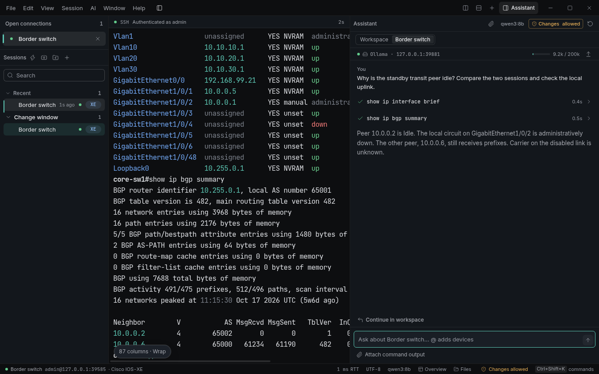

<h1></h1>

**A desktop workbench for network engineers.** Connect to routers, switches and firewalls over SSH, Telnet or serial. Compare the same check across vendors, inspect a packet capture offline, or ask an optional assistant to gather evidence. Each finding stays with the device, command or frame that produced it.

[Download Hopline 1.2.0](https://github.com/manuutr/hopline-terminal/releases/tag/v1.2.0) · [Try an example](#try-an-example) · [Build it yourself](#build-it-yourself) · [Operator guide](docs/guide/) · [Contribute](CONTRIBUTING.md)

[](docs/examples/circuit-rollback/README.md)

*One BGP peer is idle and its uplink is administratively down. Follow the circuit investigation by opening the screenshot.*

## Features

| | What you can do |
| --- | --- |
| **Terminal workspace** | Keep two devices visible in split panes, search across connections, and reopen saved sessions. Import inventories from OpenSSH, PuTTY, SecureCRT, MobaXterm, CSV or NetBox. [Sessions and imports](docs/guide/sessions.md) |
| **Network CLI tables** | Parse supported show commands into rows. Run one check across platforms, preview the native commands, compare results by device and copy matching rows into a ticket. [Productivity guide](docs/guide/productivity.md) |
| **Packet analysis** | Open a PCAP or PCAPNG, apply Wireshark display filters and inspect individual frames. The decoder runs locally. [Packet capture](docs/guide/packet-capture.md) |
| **Optional assistant** | Start a workspace conversation, choose a saved device, and bring its findings back for a follow-up. Use Ollama, an Anthropic, OpenAI or Gemini API key, or sign in with ChatGPT or GitHub Copilot. [Assistant guide](docs/guide/ai-assistant.md) |
| **Change review** | Inspect the exact commands, rollback plan and verification checks before approving an assistant-proposed change. Look up what ran and what was refused in the audit log. [Safety and audit](docs/guide/safety-and-audit.md) |

## Try an example

**Start with two packets.** Open the synthetic DNS capture and filter for `dns.flags.rcode > 0`. Frame 2 shows the resolver answered with NXDOMAIN. You can reproduce the finding with a fresh install, offline, without a device or model account. [Download the sample and follow the steps](docs/examples/dns-failure/README.md)

| Incident | Evidence to look for |
| --- | --- |
| [The VPN is up, but the client times out](docs/examples/vpn-return-path/README.md) | The specific return route exists in a different VRF from the server. |
| [BGP is stuck in Active](docs/examples/bgp-peer-auth/README.md) | Both peers reject the other's TCP digest. Ask the assistant to check both ends, or search the two logs yourself. |
| [OSPF is stuck in ExStart](docs/examples/ospf-mtu/README.md) | Compare the IPv4 MTU on each end of the link in split terminals. |
| [A new circuit fails its acceptance checks](docs/examples/circuit-rollback/README.md) | Review the proposed change and the rollback. After approval, the port still has no carrier and the peer stays Active. |

The four device walkthroughs use reconstructed incidents over loopback SSH. The assistant replies in the screenshots are scripted so contributors can reproduce them. [Browse the screenshots](docs/examples/README.md)

## Install

| Platform | Hopline 1.2.0 |
| --- | --- |
| Windows 10/11 x64 | [Windows installer](https://github.com/manuutr/hopline-terminal/releases/download/v1.2.0/Hopline-1.2.0-win-x64.exe) |
| Linux x86-64 | [AppImage](https://github.com/manuutr/hopline-terminal/releases/download/v1.2.0/Hopline-1.2.0-linux-x86_64.AppImage) · [Debian package](https://github.com/manuutr/hopline-terminal/releases/download/v1.2.0/Hopline-1.2.0-linux-amd64.deb) |
| macOS | Build on a Mac using the command below. [macOS build and signing](docs/SIGNING.md#macos-developer-id-hardened-runtime-notarization) |

The Windows and Linux downloads are unsigned. Compare your file with the release checksum before opening it. [SHA-256 checksums](https://github.com/manuutr/hopline-terminal/releases/download/v1.2.0/SHA256SUMS.txt) · [Verification and updates](docs/guide/getting-started.md#check-the-download)

A fresh install opens with an empty inventory. Choose **Add host…**, enter a device you manage, and verify its SSH host key when you connect. [First connection](docs/guide/getting-started.md)

## Build it yourself

Install Git, Node.js 24.11 or later, and npm 11. To build the same source as the release, open a shell on the OS you want to package for and run the following.

```sh
git clone --branch v1.2.0 https://github.com/manuutr/hopline-terminal.git
cd hopline-terminal
npm ci
npm run build
```

`npm run build` writes the production app to `apps/desktop/out/`. The first desktop launch fetches the pinned Electron runtime. Run `npm run preview -w @hopline/desktop -- --skipBuild` to open it, or use one of these commands to create an installer in `apps/desktop/release/`.

| Build machine | Command | Output |
| --- | --- | --- |
| Windows x64 | `npm run dist:win -w @hopline/desktop` | NSIS installer |
| Linux x86-64 | `npm run dist:linux -w @hopline/desktop` | AppImage |
| macOS with Xcode command-line tools | `npm run dist:mac -w @hopline/desktop` | Apple Silicon and Intel DMG and ZIP files |

For development, clone the default branch and use `npm run dev` after `npm ci`. Choose **Open the simulator lab** from the command palette to try a local device. [Platform setup and tests](docs/contributing/development.md) · [Signing credentials](docs/SIGNING.md)

## What reaches the model

Hopline replaces recognized device identities and interface descriptions with temporary aliases. For example, `Gi0/1  up  up  Acme payroll uplink` can reach the model as `Gi0/1  up  up  label-3-a194ef`. Interface IDs, route prefixes and link state stay useful for diagnosis. Other addresses and unfamiliar output can still identify a network. Choose an on-device model for investigations that must stay on the machine. With request logging enabled, **What left this machine** shows the provider payload. [Privacy guide](docs/guide/privacy.md#assistant-requests)

## Contribute

A synthetic command transcript with the original columns and spacing makes a good first contribution. Include the platform, command and rows that show the problem. Report vulnerabilities through the private channel in the security policy. [How to contribute](CONTRIBUTING.md) · [Share a CLI fixture](https://github.com/manuutr/hopline-terminal/issues/new?template=cli-output.yml) · [Security policy](SECURITY.md)

Hopline’s own code uses Apache 2.0. The bundled Wiregasm decoder uses GPL-2.0-or-later. [Decoder source, license and build instructions](third_party/wiregasm/README.md)

[Documentation index](docs/README.md) · [Architecture](docs/contributing/architecture.md) · [Release notes](CHANGELOG.md) · [Roadmap](docs/ROADMAP.md) · [Apache 2.0 license](LICENSE)
