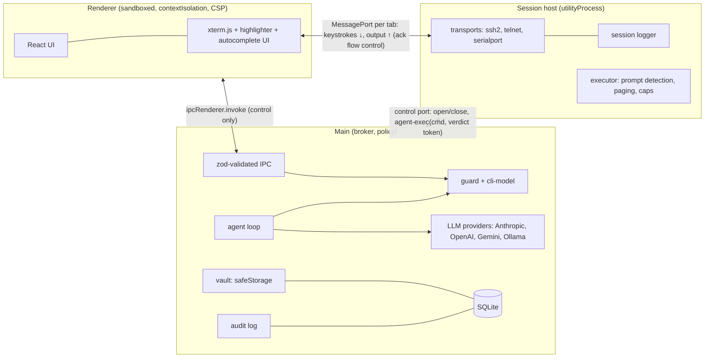
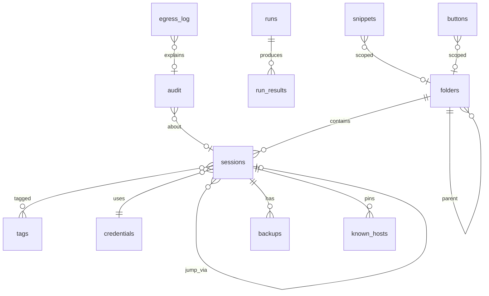

# Hopline: Architecture

This is the original architecture and decision record. The [architecture tour](contributing/architecture.md) maps the current implementation, and the [project roadmap](ROADMAP.md) describes where contributions help.

## 1. Repository layout

```
apps/desktop            Electron app
  src/main              broker process: windows, IPC, settings, vault, DB, guard, agent, audit, updater
  src/session-host      utility process: transports (SSH/Telnet/Serial), logging, executor
  src/preload           typed bridge (window.hopline)
  src/renderer          React UI, xterm, highlighting, autocomplete UI
  e2e/                  Playwright tests against the real app and the simulator
  test/                 integration tests (main-side modules against the simulator)
packages/guard          command classifier and redactor (pure TS); the deny-lists are in the cli-model trees
packages/cli-model      per-platform profiles and command trees (pure data plus a matcher)
packages/simulator      multi-vendor SSH/Telnet device simulator (dev, tests, demo lab)
packages/parsers        TextFSM engine (TypeScript port of Python textfsm) + 358 bundled ntc-templates (Apache-2.0, pinned)
docs/                   PRD, architecture, roadmap, research, user and contributor guides
```

Packages are pure TypeScript with no Electron dependency, so they are tested directly with vitest and shared by every process.

## Packet captures

Each window owns a packet workspace in main. The Assistant accepts a user-chosen PCAP/PCAPNG via native file selection or a disk-backed file drop resolved in preload. IOS XE collection binds a fixed command preview to its SSH tab and passes each device command through GuardedRunner. The existing transfer queue downloads the capture and records its digest. Main verifies the downloaded bytes, runs the packaged Wiregasm Wireshark WebAssembly decoder in a cancellable utility process with an in-memory filesystem and returns pages of decoded metadata. The operator can request the full protocol tree for one frame. This text is displayed locally and excluded from model input. Asking the assistant sends a framed metadata sample through the configured safe provider and egress log. [Operator workflow](guide/packet-capture.md)

## 2. Processes



| Process | Trust | Responsibilities |
| --- | --- | --- |
| **Renderer** | Untrusted (sandboxed) | UI, xterm, output highlighting, autocomplete UI, inline `@ai` capture. Never sees secrets. Can only *ask* main to do privileged things |
| **Main** | Trusted | Window lifecycle, IPC validation, settings, vault (decrypts secrets), DB, **guard (policy decision point)**, agent loop and LLM calls, audit, auto-update, crash-reporter consent |
| **Session host** | Trusted, isolated | All network/serial I/O, session logging, keep-alive/reconnect, the agent **executor** (it sees the byte stream). It enforces the guard a second time for every non-user write |

> **Decision D1: move transports into an Electron `utilityProcess` ("session host").**
> Today SSH runs in main. A dedicated process:
> - keeps heavy output, crypto and serial I/O off the thread that serves IPC and the UI;
> - stops a transport crash from taking down the app (the host restarts and sessions reconnect);
> - lets the renderer talk to its tab over a direct `MessagePort` (no main hop), which makes ack-based flow control simple.
>
> Cost: one more process (~30 MB) and a control protocol.
> Alternative: keep transports in main and use worker threads only for parsing. **Recommendation: do it (Phase 1).**

### 2.1 Data path and flow control

- **Output.** Transport → host buffers up to 64 KB or 8 ms → port message to the renderer → highlighter → `term.write(data, ack)`.
  - The renderer acks the bytes once xterm has parsed them.
  - The host pauses the SSH channel / socket / serial stream when unacked bytes exceed 512 KB (high watermark) and resumes below 128 KB.
  - This replaces today's unbounded `webContents.send` and protects against xterm's ~50 MB input cap ([tech-stack §1](research/tech-stack.md)).
- **Input.** Keystrokes go renderer → port → host → transport.
  - Writes from the user are tagged `origin: 'user'`.
  - Agent, snippet-run, send-to-many and multi-device writes come only over main's control port. They are tagged with their origin and carry a **verdict token** from the guard.
  - Decision (Phase 4): an **insert** snippet is typed through the tab's own port as user input, *without* Enter. Main first fills it, classifies the line and refuses blocked commands, multi-line bodies and control characters, then returns the text. Nothing runs until the user presses Enter, and what they then send is a user-typed line like any other. So insert needs no verdict token, and it can't be used to make Hopline run anything by itself.
- **Logging** happens in the host on the raw stream. It is ANSI-stripped and backspace-applied, with optional raw mode, filename tokens and daily rotation.

### 2.2 Guard enforcement points (defense in depth)

1. **Main** classifies every non-user command with `guard.classify(command, platform)` (cli-model tree plus rules) before anything else happens, and audits the decision.
2. **Approval binding.** Config changes are stored in main by `proposalId`. The renderer can only send `{proposalId, approve, ack?, lines?}`, where `lines` are indexes into the stored lines (per-line approval, §6.3). Main re-checks the subset and runs the stored lines. After the apply the renderer can only send `{proposalId, 'confirm' | 'rollback'}` (`agent:change`); main runs the stored net lines.
3. **Session host** re-checks each non-user write.
   - It accepts it only with a valid verdict token: an HMAC over `(tabId, command, kind, platform, ack, hosts, probe, readOnly, net, expiry, nonce)`, keyed by a secret that main passes to the host at spawn time over a private channel.
   - `net` marks an app-owned safety-net line (§6.3: `archive config`, `configure replace <archive> force`, `rollback running-config checkpoint hopline-…`, `configure session hopline-… commit|abort`, `commit confirmed N`, …). Main signs it only for lines it generates itself, never for a model's line. The host then skips the deny-list for that line but requires an exact match against the platform's fixed net templates (`cli-model netLineAllowed`), in the mode its own prompt shows (exec or any configuration level), on a `config` verdict bound to the device's hostname, and never in read-only mode. Any other line with `net` set is refused, and the deny-list is unchanged for everything else.
   - Config and disruptive lines carry `hosts`: the prompt hostname when the proposal was made, plus a hostname the proposal itself sets (`hostname x`, `set system host-name x`, ...). The host refuses the line when the prompt it sees shows another hostname ("the device changed": a nested ssh/telnet hop), and main checks the same before it runs an approved proposal. A config or disruptive verdict without `hosts` is refused (fails closed). Decision: a prompt without a hostname (FTD `>`) matches only a binding without one, so a hop between two such devices is not detected (documented gap).
   - `kind` is `read`, `config` or `disruptive`. A disruptive line needs `ack`, the hostname the user typed, and the host checks it against the hostname in the prompt it sees.
   - `readOnly` is set when global read-only mode was on as main signed; the host then refuses anything that is not a read (`readOnlyRefusal`).
   - A session whose platform is `auto` (not identified) takes one thing only: the auto-detect probe (`probe` lists the candidate platforms). The host re-derives the probe from its own observation, requires an idle prompt and no recent typing, and checks it is read-only on every candidate.
   - Even then it refuses anything the deny-list blocks. It re-classifies in the mode its own prompt shows, with the same rules as main: on platforms whose config mode also takes exec commands (NX-OS, ASA, EOS, AOS-CX, VRP: `configInheritsExec`) the exec deny-list applies in config too, and Linux pipe filters (EOS, NX-OS, IOS-XR) take only a fixed set of short options, with no quotes, backslashes, `=` or file operands.
   - A bug in main's agent code therefore cannot write an unclassified command.
4. **Executor** refuses to type unless the device is at an idle prompt of the expected mode with nothing half-typed. It also refuses a tab known not to echo, and a tab flagged as possibly holding unsent text. It locks user input while running. Then:
   - **Clear.** It sends the profile's line-clear key where one is marked safe (`keys.lineClear`, Ctrl-U). Only erase output may come back (`\b`, spaces, `CSI K/J`, a bell, `\r` plus the same prompt, log lines followed by the prompt). A device that shows `^U` stops the run before anything is typed.
   - **Echo.** It types the command without Enter and feeds the echo to a line-editor emulator (`session-host/line-editor.ts`, pure). The emulator follows frames:
     - IOS `$` scroll windows, in both the backspace and the CR form, each aligned at or after the previous window, with the last one at the command's end
     - `\r` + prompt redraws
     - the readline/libedit ` \r` wrap at the terminal width
     - log lines that interrupt the echo and are followed by a redraw
     - erases and colour

     Enter is pressed only when every index of the command was displayed at its own offset and matched. There is no prefix shortcut. Per-token completion is allowed only on complete-on-space profiles (Junos, PAN-OS). A cursor movement it cannot follow is a mismatch.
   - **Abandon.** On a mismatch, a deadline (its own, at most 5 s, with its own error), Ctrl-C or a cancel before Enter, it erases the line and waits for it to show blank again. If it can't confirm that, for example because the device never echoed, the result is `typedNotSent` ("typed, not sent" in the audit). The tab is then flagged (`HostTab.markUnsent`): a terminal notice tells the user to clear the line, and Hopline types nothing there until the user presses Ctrl-U, Ctrl-C or Enter.
   - **Echo learning.** `HostTab` learns whether the device echoes from the user's own keys at a bare prompt (two misses mean no echo), from Telnet echo negotiation, and from the executor's own checks (one echo proves it; two silent runs disprove it). A reconnect forgets both flags. Until it knows, it types and checks.
   - **Run.** The command timeout starts at Enter. The output starts after the first line break after Enter, found by offset. The result carries `hostname`, the prompt hostname the command was typed at (backups bind to it).
   - Prompts, pager prompts and keys, and device error patterns come from the cli-model profile of the session's platform.
   - Decision: the executor pages through output with the profile's page key and **never sends the profile's pager-disable command** (`terminal length 0`, `set cli screen-length 0`, …): those change the user's session settings, and some platforms treat them as config.

### 2.3 Auto-detect (F8)

Sessions default to `auto`. When one connects, main (`main/detect.ts`):
1. asks the host for what it observed, without sending anything: the SSH server identification (`SSH-2.0-Cisco-1.25`), the first output (banner, MOTD) and the prompt. The host answers once the device is idle at a prompt and the user has not typed for 1.5 s, or once the screen settles on something that is neither a prompt nor a login;
2. fingerprints it (`cli-model fingerprint`). Version text is decisive; prompt shapes and SSH strings alone are not (IOS vs IOS-XE);
3. if not decisive and the device is at a prompt, runs `probeCommand` (the platform's own version command, chosen to be read-only on the most candidates) as an audited read with source `app`, reason `auto-detect`, at most twice per connection;
4. stores the platform and `detected` (version, model, confidence) on the session, or says "unknown" and keeps watching (sending nothing) until the screen changes and shows a prompt, the tab disconnects or the user sets the platform.

Unknown stays `auto`, and both main and the host default-deny every AI command on it. Changing the platform by hand clears `detected`.

### 2.4 Files (SFTP/SCP) and port forwarding

**Decisions (Phase 4, workstream C):**
- *Bytes go through main.* The session host owns the SSH connection; main owns every local file. A transfer is a control-channel stream: `xfer` starts it, `xfer-data` chunks flow one way and `xfer-ack` the other under a 2 MiB window, so a slow disk or a slow device pauses the other side instead of buffering. Main hashes MD5 and SHA-256 while streaming and never hands a path to the host or the renderer. The renderer only gets item ids and progress events.
- *One login.* SFTP is a new channel on the tab's connection (`SshTransport.openSftp`), through the jump chain. The host keeps three failures apart: the channel itself refused (`(SSH) Channel open failure`) → a second connection with the same auth (`sideConnection`, no shell, no agent forwarding), shown as "second login"; the `sftp` subsystem refused → SCP mode; the exec channel refused → the "enable the SCP server" hint.
- *SCP mode* runs `scp -t` / `scp -f` on an exec channel (`transports/scp.ts`), one file per transfer. Paths are POSIX-quoted for shell-based servers, with a leading `~/` left unquoted so it expands. IOS, NX-OS, FortiOS and other device SCP servers parse the path themselves, so only plain paths (`[A-Za-z0-9._/:+@%=,-]`) are allowed there, and any other path is refused before the transfer. SCP to a Windows OpenSSH server whose default shell is cmd.exe is unsupported: single quotes mean nothing there, and `%VAR%` is expanded. Uploads are refused while read-only mode is on. Device filesystems don't list over SCP, so the UI takes a typed path with presets per platform (`DEVICE_ROOTS`). SCP can't check for an existing file: any policy other than replace becomes an explicit confirm.
- *Local file safety* (`main/files/paths.ts`): names from the device are hostile; `safeLocalName` keeps the last component and applies Windows naming rules on every OS. Downloads write `name.hopline-part` with `O_EXCL|O_NOFOLLOW` (or append on resume), then commit with `link()` (fails if the name exists) or `rename()` only when the user chose replace; `rename()` replaces a symlink rather than following it. Upload sources are `lstat`ed and symlinks refused. The download folder is chosen with the OS dialog and remembered.
- *Audit* uses the existing columns (no migration): source `transfer`, command `sftp|scp put|get <remote path>`, kind = direction, decision executed / cancelled / error, bytes, reason `sha256 … md5 …; <local name>`.
- *Forwards* live in the host (`transports/forward.ts`, `Forwards` per tab). `attach(link)` on each connection, `detach()` on close: local and dynamic listeners stay bound across a reconnect (they refuse while down), remote forwards are requested again. Saved forwards (`options.ssh.forwards`) start on the first connect only when bound to loopback (`isLoopbackBind` in `transports/bind.ts`: 127/8, `::1` in any spelling, `localhost`); every other bind only starts by hand. Background connections (`OpenSpec.background`) get no forwards at all. Forwards added live are also remembered by main (`ForwardService`) and restored after a host restart. Main audits every start, stop and failure, including saved forwards the host starts on connect (seen in its `fwd-state` stream). Local listeners bind `listenHost(bindHost)`: brackets removed, `localhost` as `127.0.0.1`, so the address the loopback check approved is the one bound. Main and the host decide which saved forwards start on their own with the same `startsOnConnect` predicate. A remote (-R) forward bound to the server's loopback is still reachable by every user and process on that server (a jump host, for example); treat it as exposed to that machine. Notices (`forward L …: listening`) are held while the agent owns the terminal or the device is mid-line and still sending (up to 3 s), then written above the current line, which is drawn again.

## 3. IPC

**(current)** `ipcMain.handle(channel, zodSchema, fn)`. Each handler validates its payload with zod before the function runs. The preload exposes only typed functions (`window.hopline.*`), never `ipcRenderer` itself.

Target surface, grouped by namespace. Each namespace is one file in `src/main/ipc/`, with a schema per channel and a contract test that sends invalid payloads.

| Namespace | Channels (invoke unless noted) |
| --- | --- |
| `sessions` | list, save, delete, move, duplicate, tags, import(previewId), importPreview(file) |
| `folders` | list, save, delete, move |
| `credentials` | list (metadata only), save, delete, test |
| `term` | open(tabId, sessionId, dims, oneTimeSecret?), close, reconnect, port handoff (`postMessage` with a `MessagePort`) |
| `transfer` | open(tabId) → mode, op (list/stat/mkdir/rename/remove), pickUpload, uploadDropped (preload-resolved paths), download, downloadDir, chooseDownloadDir, resolve(token, choice), cancel, retry, clear, list, reveal, dragOut (send), event (`transfer:event`) |
| `forward` | list, add, start, stop, remove, event (`forward:event`) |
| `agent` | run, cancel, decide(proposalId, approve, lines), reset, scope.set, event (`agent:event`) |
| `multi` | info, resolve(targets), preview(mode, targets, command, perPlatform) → previewId, start(previewId, confirmConfig, concurrency) → runId, cancel(runId), event (`multi:event`) |
| `backups` | **(current)** list(sessionId?), take(sessionIds), get(id) → redacted text, live(sessionId) → redacted, not stored, remove, export(id, includeSecrets) via main's save dialog, schedules/saveSchedule/removeSchedule, retention/setRetention, `backups:changed` (event). No restore channel |
| `keymap` | get, set (rebound shortcuts, settings key `keymap`) |
| `snippets` | list, save, remove, reorder, prepare(snippetId, tabId, vars) → plan, run(planId, approve, ack), insert(snippetId, tabId, vars) → text |
| `keywords` | CRUD |
| `blocks` | rerun(tabId, command) → ran \| insert (classified in main; see §7.1) |
| `parse` | not an IPC channel: TextFSM runs in a renderer worker (table view) and in main (agent), see §7.2 |
| `audit` | list(limit). No export channel: the dialog's **Copy CSV** builds the CSV in the window from the rows it listed |
| `settings` | get, update, setApiKey, vaultStatus, setMasterPassword |
| `updates` | status, check, restart (refused while any session is open), onStatus |
| `crash` | status, test, report (renderer errors, dropped unless opted in), sendDump (confirmed in main), deleteDump |

Rules:
- Every payload has a zod schema with explicit length caps. Unknown keys are rejected (`.strict()`).
- Secrets travel renderer → main exactly once (for example a typed password) and are never returned. Credential `list` returns metadata only.
- Events to the renderer never include secrets or unredacted device output from other tabs.
- Main serves the bundled renderer from `app://hopline` and accepts bridge calls only from its main frame. Navigation, pop-ups and webviews are denied. The production CSP sets `default-src 'none'`, `connect-src 'none'` and `frame-src 'none'`. External links require confirmation in main.

## 4. Data model (SQLite, better-sqlite3, WAL)

**(current)** Migrations are ordered SQL in `src/main/db/index.ts`. The audit table is append-only via triggers.



| Table | Key columns | Notes |
| --- | --- | --- |
| `folders` | id, parent_id, name, sort, color | |
| `sessions` | id, folder_id, name, protocol(ssh/telnet/serial/raw), host, port, username, platform, credential_id, jump_session_id, serial_json, options_json (logging, keepalive, term type, encoding, startup cmds, highlighting set), sort, favorite, source(import id) | Options JSON is validated by zod on read |
| `tags`, `session_tags` | | Many-to-many |
| `credentials` | id, name, username, kind(password/key/agent/prompt), secret_enc (blob), key_path, passphrase_enc | `secret_enc` comes from the vault and never leaves main |
| `known_hosts` | host, port, alg, fingerprint, first_seen | |
| `settings` | key, value_json | |
| `audit` | ts, session_id, session_name, host, source (agent/user/app/snippet/multi/backup/transfer/forward/fleet/safety-net), command, kind, decision, reason, approver, model, duration_ms, bytes, redactions | Append-only (triggers) |
| `egress_log` | ts, provider, model, destination, source, session_name, run_id, lane, input/output tokens, bytes, status, duration_ms, payload (gzip + AES-GCM with the vault data key, AAD bound to the row id) | Powers "what left this machine" (Phase 5). Created by `egress/store.ts`; capped at 5,000 rows / 64 MB, oldest first. Dropped when the vault goes ephemeral. |
| `snippets`, `buttons` | id, scope(folder/session/global), platform, name, body, vars_json, mode(insert/run) | |
| `keyword_sets` | id, name, rules_json | User highlighting; SecureCRT import |
| `config_backups` | id, session_id, session_name, platform, ts, digest, size, lines, trigger(manual/scheduled), command, content_enc | **(current, migration 10)** gzip + AES-256-GCM under the DEK, AAD `backup:<id>`; `digest` is an HMAC (key derived from the DEK) of the noise-normalised text, used for dedupe, so no plain hash of a config sits in the DB |
| `backup_schedules` | id, kind(folder/tag), target, cadence(daily/weekly), weekday, time(HH:MM local), enabled, created_at, last_run_at, last_summary | **(current)** |
| `runs`, `run_results` | run, targets, commands, per-target status/output_enc | Multi-device runs and send-to-many |
| `scrollback` | tab state persisted as encrypted files under `userData/scrollback/`, indexed by session | Not in SQLite, to keep the DB small |

**Encryption at rest** (`src/main/vault/`).
- A random 256-bit data key (DEK) encrypts every secret: device passwords, private keys and passphrases, the API key, NetBox tokens, the sync passphrase, and scrollback, backups and run outputs. It uses AES-256-GCM, with AAD bound to the row and field, so a ciphertext can't be moved to another row.
- The DEK is wrapped in one of three modes:
  - **OS keychain**: `safeStorage`; the default where a keyring exists.
  - **Master password**: scrypt N=2^17, r=8, p=1, with a verifier so a wrong password is detected.
  - **Session-only**: the DEK lives in memory only. On Linux without a keyring (`basic_text`) the vault is session-only until a master password is set (D5): secrets saved there are gone after a restart, and Settings › Security offers the master password.
- Switching modes re-wraps the DEK; no secret is re-encrypted.
- Locking (manual, idle timer, sleep or screen lock) drops the DEK from memory. Open sessions keep running, and new connects ask for the unlock.
- A broken keychain leaves the vault locked and never wipes data.
- Secrets flow only from the renderer to main, never back. `test/ipc-shapes.test.ts` plants canary secrets and scans every IPC channel's results and errors for them.
- Key files and import sources are read by main through its own dialogs; the renderer never supplies a path.

**Export and sync** (`src/main/backup/`, D3).
- A `.hopline` file is a JSON header (authenticated as AAD) followed by AES-256-GCM over the gzipped payload, keyed from the passphrase with scrypt.
- Secrets are included only with an explicit main-side confirmation. The API key and vault material are never exported.
- Folder sync writes the export to a user-chosen folder after changes (debounced). When another machine writes a newer file there, Hopline offers to import it and never overwrites it before that.
- A file is untrusted. A merge that changes the host, port, protocol, jump chain or agent forwarding of an existing session detaches its credential, and the preview lists it under "Retargeted (credentials removed)". Host keys are never imported for a host/port the same file introduces or retargets. Only appearance preferences travel (theme, terminal font, cursor, scrollback size, terminal theme, highlighting); AI read-only, output caps, timeouts, logging and the rest stay per machine.
- Sync converges. Deletions are kept as tombstones (`tombstones` table, migration 8) and carried in the file; a sync merge applies a tombstone when it is at least as new as the item's `updatedAt`, and skips a file item deleted here unless it changed after the deletion (ties: the deletion wins). Tombstones are pruned after 90 days. A file picked by hand ignores tombstones. The content hash leaves out the export time, `includesSecrets`, secrets and host keys; `lastConnectedAt` is not exported (per machine), favorites are (a user choice, like a color).
- The sync file and its tmp file are never followed: writes use a random name opened `O_CREAT|O_EXCL|O_NOFOLLOW`, reads require a regular file under the size cap, and the disk hash is re-checked right before the rename.

## 5. Security model

### 5.1 Assets and threats

| Asset | Threats | Controls |
| --- | --- | --- |
| Device credentials, keys, API keys | Renderer compromise (XSS via device output or AI text), malware reading the DB, leakage to the LLM | Secrets only in main; vault encryption; redaction before the LLM; no secret in IPC responses; React text rendering only (no `innerHTML`); strict CSP |
| Devices (production network) | AI-issued destructive commands, prompt injection, hallucinated commands, renderer forging approvals | Guard (default-deny, platform trees); deny-list survives approval; approvals bound to stored lines; verdict tokens checked in the session host; executor prompt checks; per-command timeout and cap |
| Audit integrity | Tampering, gaps, secrets at rest | Append-only triggers log every attempt. Copy CSV exports redacted commands and reasons. A vault-derived HMAC correlates original commands when the key is available. Startup redacts older rows once per ruleset version. |
| Device output | Escape-sequence attacks (OSC 52 clipboard read, title spoofing), terminal DoS | xterm with clipboard read disabled; OSC 52 write only with opt-in; flow control; output caps |
| Update channel | Malicious update | Signed builds; electron-updater signature verification; HTTPS only |
| Crash reports | Secret leakage | Opt-in; scrubbing with the shared redaction ruleset plus crash-specific rules; no minidump upload by default |

### 5.2 Prompt-injection posture

Banners, interface descriptions, LLDP/CDP names, syslog and config comments can all contain attacker text. The rules:

1. **The gate is code.** The model's output can only *request* tool calls, and every call goes through the guard. The hard deny-list applies even after approval. Configuration changes require approval of the exact lines.
2. Each untrusted frame carries a fresh random identifier in both boundaries. Fleet report fields are cleaned before JSON serialization. TextFSM rows are cleaned again after assembly. Device output reaches a model only inside an untrusted frame (`<device_output … untrusted="true">`, `<device_report … untrusted="true">`, `<terminal_output>` for a selection), with terminal escapes stripped in main. The system prompt says it is data. Details in §6.7.
3. Proposed commands that contain long substrings copied from device output are flagged on the approval card ("this line came from device output").
4. Red-team tests: the simulator ships hostile banners, descriptions, neighbor names, syslog, config comments, SNMP location and hostnames, with escapes (`hostile-content`, `hostile-vectors`, `hostile-hostname`), and CI drives an obedient scripted model through them (`test/injection.test.ts`, `test/fleet-redteam.test.ts`): the agent never runs anything outside the guard and flags long verbatim copies from recent output.

### 5.3 Guard v2 (with cli-model)

- **Classification order:**
  1. normalize (strip `do`/`run`, collapse whitespace, printable ASCII only)
  2. reject separators (`;`, newline, backtick, `$(`)
  3. split pipes and check each against the per-platform allow-list (EOS: unknown pipe words run as shell, so default-deny)
  4. resolve abbreviations against the command tree (ambiguity → treat as the most dangerous expansion)
  5. look up the node's `risk`
  6. apply argument-dependent rules (`clear ip bgp *` is disruptive; `clear counters` is config-level)
  7. apply the deny-list
  8. reachability probes (cli-model `probe.ts`): ping and traceroute options are resolved with the device's prefix rule and capped (count 10, size 1500, timeout 5 s, TTL 64, no flood, payload or unknown option, Junos/PAN-OS need a count); past a cap the line is `config`
- **Negations and shadows (Phase 8 M1):** in a configuration mode, `no`/`default`/`undo X` is blocked when `X` is, unless the tree has an explicit negation node. An abbreviation that matches a modelled read child under a blocked open head (PAN-OS `request system software in`: `info` or `install`) keeps the head's blocked meaning; this never escalates a line that is already `config`.
- **Exec deny-list at a configuration prompt (A-L1):** a line the config tree does not model is classified in exec too, and blocked if exec blocks it; main and the session host both apply it.
- **One canonicaliser (Phase 8 H3):** every rule that looks at command words (the fleet and agent reach rule, the team policy's dump groups, the probe caps) works on cli-model `canonicalize` (the guard's own resolution of the head, `do`/`do-exec`/`run` removed) and `matchWord` (the device's unique-prefix rule), never on raw tokens. A lint test (`p8-no-raw-token-rules.test.ts`) greps the rule sources for raw-token comparisons.
- **Reach (Phase 8 H1):** a probe whose target is not an IP literal is a DNS lookup, a way out of the network. The single-device agent shows a one-click card for it (refused in read-only mode); a fleet worker refuses it, and only probes addresses seen in its own lane.
- **Risk levels:** `read` (auto-run allowed), `config` (approval), `disruptive` (approval plus a second confirmation and typed hostname; never in multi-device runs), `blocked` (never).
- **Interactive confirmations** (`[confirm]`, `Save? [yes/no]`) are answered by the executor only when the prompt belongs to the command that was approved. Otherwise it sends Ctrl-C.
- **Platforms:** the 15 platforms of `cli-model/src/profiles.ts`.
- **Regression corpus:** the Phase 8 adversarial corpus (`test/fixtures/p8-corpus.ts`, 8,047 rows over every platform, with abbreviation, case, whitespace, wrapper and character-injection variants) runs on every CI build against `classify`, the session host re-check and `analyze()`. Its known-failure list is empty, and the test fails both on a new failure and on a known failure that started to pass.

## 6. AI agent design

**(current)** A manual streaming loop in main using a provider-neutral message format, with an Anthropic adapter (adaptive thinking, server-side refusal fallback where the model has it, strict tools, prompt caching), an OpenAI/Gemini Chat Completions adapter, and an Ollama adapter (`/api/chat` with tools, NDJSON streaming, explicit `num_ctx`). It has three tools, `run_show_command` (with an optional local `filter`), `propose_config_change` and `report_verification` (§6.2), a per-tab conversation, cancellation, history repair and an audit of every attempt.

**Modules (current, `src/main/agent/`).** The agent is split so a fleet coordinator can run many loops over many devices ([FLEET-AGENT §3.3](design/FLEET-AGENT.md#33-mapping-onto-the-current-code)):

| File | Role |
| --- | --- |
| `agent.ts` | `Agent`: the per-tab chat. Keeps one conversation per tab, at most one run per tab, cancellation by run id and proposal decisions by id. Each run is an `AgentLoop` over a `DeviceTools` bound to the tab. Also `selectionForModel` (redact, then cut). |
| `loop.ts` | `AgentLoop`: provider-agnostic. It owns one conversation, one `ToolSet`, the budgets (`MAX_ITERATIONS` 16, `MAX_TOOL_CALLS_PER_TURN` 8, both overridable), cancellation, history repair and the `text` / `thinking` / `done` events. It wraps the provider in `safeProvider` itself, so no loop can call a model unredacted. It knows nothing about devices, the guard or the audit. A tool call that throws ends the run. |
| `device-tools.ts` | `DeviceTools`: the device tool set for one session (`AgentTab`) and one executor (`TabControl`). `run_show_command` classifies with the guard for the session's current platform (default-deny when unknown), validates the local filter, runs with the settings' timeout and output cap, then strips and redacts (`untrusted.ts`, §6.7) → filters → caps (40k characters) → frames → adds TextFSM rows. Every attempt is audited and shown as a step; a thrown error is audited and returned as `ERROR:` (if that audit write fails too, the run ends). Config and disruptive commands are handed to a `ChangeProposer`. |
| `proposals.ts` | `Proposals` (implements `ChangeProposer`): `propose_config_change`, disruptive exec commands, the pending cards and `decide`. It classifies every line with the guard and audits every attempt itself. Kept behind the small `ChangeProposer` interface so it can be reworked (rollback/verify, fleet change sets) without touching the loop or the read path. |
| `system-prompt.ts` | The chat role's system prompt, rebuilt every turn. |
| `config-apply.ts`, `filter.ts` | Platform change wrappers (§6.3) and the local output filter. |

- `llm/service.ts` (`AiService`) builds the provider from settings and runs the onboarding checks (`ai:test`, `ai:connect`, `ai:ollamaModels`). Keys are saved only after a working test and never returned; the renderer sees `aiConfigured` and `apiKeyLast4`.
- `llm/safe.ts` (`safeProvider`) wraps every provider the agent uses: it redacts the whole request (system prompt, user text, tool results) last, and bounds each turn (10 min). Guard, audit, command timeouts and output caps live in `DeviceTools` and `Proposals`, below the loop, so they are identical for every provider.
- `agent/filter.ts`: the device gets the plain, guard-classified command; Hopline applies tail/head/grep/count to the **redacted** output (so a pattern can't probe for a secret), then the 40k-character cap. grep runs in a `vm` context with a 250 ms budget and a 200-character pattern limit (ReDoS). The result is labelled for the model ("showing last 30 of 2,410 lines"); a capped capture says its "last lines" are not the real ones.
- **Suggest mode (Phase 5, `agent/suggest.ts`).** A model without tool calling (Ollama `/api/show` capabilities) runs with no tools and `SUGGEST_RULES` added to the system prompt. When it answers, Hopline extracts fenced blocks and `RUN:` lines, classifies each line with the guard for the session's platform (and the team policy), and stores them in main under ids (at most 10, 30 minutes, replaced by the next answer). The window gets only ids, commands, kind and reason. `agent:runSuggestion(id)` runs a read through the same `DeviceTools.run_show_command` path (guard, signed verdict, timeout, cap, redaction, audit with the OS user as approver); config lines and disruptive commands go to the normal approval card. The output is appended to the conversation for the next question. Fleet refuses suggest-mode models (`FLEET_NEEDS_TOOLS`).
- **Malformed tool calls** (Phase 5): arguments are validated with zod (`RunShowInput`, `ProposeConfigInput`, strict). Unparseable JSON, unknown tools and bad arguments are never executed: they are audited as `refused` and answered with `REJECTED: …` so the model can retry.
- **Context fitting** (`llm/context.ts`): Ollama's `num_ctx` comes from the model's `context_length` (`/api/show`, cached 5 min), clamped to 2k–32k (fallback 16k). Before each turn, whole exchanges are dropped from the front (with a note to the model) and tool results in the newest exchange are cut head-and-tail to fit, so the latest question is never lost. Ollama `think` is not used.
- **Egress log** (`llm/egress.ts`, `egress/store.ts`): every adapter passes its exact wire body to `TurnRequest.beforeSend` after `safeProvider` redaction; `egressProvider` records it before the request leaves, then the tokens, duration and status. See §4 `egress_log`.

### 6.1 Providers

```ts
interface LlmProvider {
  id: 'anthropic' | 'openai' | 'gemini' | 'ollama' | 'chatgpt' | 'copilot'
  capabilities?: { tools: boolean; maxContext: number }   // tools false → suggest mode
  logsWire?: boolean                                      // calls req.beforeSend(body) with the exact wire body
  turn(req: TurnRequest): Promise<TurnResult>   // neutral messages, tools, signal, onText/onThinking, meta, beforeSend
}
```

- **ChatGPT and Copilot accounts.** The official CLI owns device authorization. Main restores its account files from the vault into a temporary profile for each turn. The client receives a masked transcript on stdin and returns suggestions to Hopline. Exact-wire-log policies exclude these adapters because the final HTTP body belongs to the CLI.
- **Anthropic.**
  - Default model `claude-opus-5-5`; Sonnet/Haiku are selectable.
  - The API key lives in the vault.
  - Server-side refusal fallback is on.
- **Ollama.**
  - Uses `/api/chat` with `tools`, `num_ctx` set explicitly (at least 8192, so Ollama never trims the prompt to its 2k/4k default) and arguments validated with zod.
  - The history is fitted to the model's real window (`fitContext`, `fitWindow(num_ctx, context_length)`): long tool results and long text are shortened head-and-tail; if the request still does not fit, nothing is sent and the user sees "Context too small".
  - The stream is bounded: 1 MB per NDJSON line, 200k characters of text and of thinking (then the turn ends as `max_tokens`), 32 tool calls, 256 KB of arguments per call (a larger call is returned to the model as invalid). The reader is cancelled on every exit.
  - Endpoint defaults to `http://127.0.0.1:11434`. It must be an origin: `http(s)://host[:port]` with no path, query, fragment or credentials (`parseOrigin`, enforced by the settings schema and by `AiService`); request URLs are built from it with `new URL(path, origin)`. Any host is allowed; non-loopback shows a warning, and a team policy can restrict hosts. Redirects are not followed (`redirect: 'manual'`): a 3xx is reported as an error, so a request never lands on another host.
  - Recommended models are listed in Settings.
  - If a model lacks tool calling, it runs in *suggest mode* (shipped, Phase 5): the model proposes commands as text, and the user clicks to run each one through the same guard and audit.
  - The model picker shows tool support and context size; the panel's trust bar runs a health check (`ai:health`: `/api/version` + `/api/show` for Ollama, a models lookup for Anthropic).
- **The egress log** ("what left this machine", Phase 5) records, when it is on (Settings, or required by a team policy):
  - every chat turn of a run (source `agent`, `fleet` or `suggest`), written with the exact wire body before it is sent and finished with the status, the usage and the number of HTTP attempts (`attempts`: the SDK's or our retries count; >1 is shown in the dialog);
  - every request a connect check sends (Settings › Test connection and Connect in the panel; source `check`, one row per request, e.g. Ollama's tool probe and its retry without tools, Anthropic's `models.retrieve` and the minimal `messages.create`).
  - Not logged: the trust bar's health check (`/api/version`, `/api/show`, a models lookup; it runs on every panel open and sends no prompt) and model discovery (`/api/tags`).
  - Bodies are redacted, gzipped and encrypted with the vault's data key. A body over 4 MB is stored as `{ truncated, bytes, head }`. Rows still `sending` when the app quit are marked `unknown` on the next start. Searching payloads needs the vault unlocked; locked, the dialog searches metadata only and says so. An export (`.jsonl`, 0600) is itself audited.
- The panel identifies the selected cloud provider or Ollama host. OpenAI and Gemini use Chat Completions with function calling.
- **Team policy** ([POLICY.md](POLICY.md), `main/policy/policy.ts`) can restrict providers and Ollama servers; `AiService` refuses a disallowed provider for tests, discovery and runs. An invalid policy turns AI off.

### 6.2 Tools

The tool list in the code (`main/agent/device-tools.ts`, `main/fleet/run.ts`, `main/fleet/report.ts`). The assistant has the first three; a fleet run's coordinator has only `dispatch_tasks`, and its workers have `run_show_command` and `submit_report`.

| Tool | Risk | Behavior |
| --- | --- | --- |
| `run_show_command(command, reason, filter?)` | read | Guard → executor on the tab the conversation belongs to → redact → local filter → cap for the model. Read-only, runs without approval. There is no session argument: the assistant works on one device. |
| `propose_config_change(commands[], rationale, rollback[], verify[{command, expect}], safety_net?, confirm_minutes?)` | config | Zod-validated in main. Guard on every line; rollback lines must not be blocked or read-only; verify commands must classify read. Card with the lines, rollback plan, verify commands and safety net. The net is armed on approval; the approved subset runs verbatim, stops at the first error, then the verify commands run. Shipped in Phase 5 (§6.3). |
| `report_verification(verified, summary)` | none | The model's verified / not-verified judgement of the verify output, shown to the user and audited. It cannot confirm or roll back: only the user can. |
| `dispatch_tasks(tasks[{device, task, suggested?}])` | read | Fleet coordinator only. Sends one read-only task per device in the run's scope to per-device workers, in parallel, and returns their reports (untrusted device data). See [design/FLEET-AGENT.md](design/FLEET-AGENT.md). |
| `submit_report(status, findings[], evidence[{command, lines[]}], …)` | none | Fleet worker only. Ends the worker's task. Evidence lines must occur in that worker's own redacted output; others are dropped. |

There is no `parse_output` tool: when a bundled TextFSM template matches, `run_show_command`'s result carries the parsed rows (compact TSV, at most 150 rows / 8k characters) after the raw text, parsed from the *redacted* output, only for a complete unfiltered read, in a `vm` context with a 250 ms timeout (`main/parse/safe.ts`).

### 6.3 Change execution with safety nets

**Shipped in Phase 5 (Proposals v2)**: `cli-model/src/safety-net.ts` (the nets and their fixed line templates), `main/agent/proposals.ts` (input, checks, card), `main/agent/changes.ts` (arm, apply, verify, confirm / rollback, expiry), `renderer/src/features/ai/ProposalCard.tsx` (card v2). `<name>` is `hopline-<8 hex>`, new per proposal; N is `confirm_minutes` (1–30, default 5).

| Platform | Net | Arm / apply | Confirm (user) | Roll back now (user) | On its own |
| --- | --- | --- | --- | --- | --- |
| Junos | commit confirmed | `configure private`, lines, `commit confirmed N comment <name>`, `exit configuration-mode` | `configure private`, `commit comment <name>-ok and-quit` | `configure private`, `rollback 1`, `commit comment <name>-undo and-quit` | Junos rolls back after N minutes |
| EOS | configure session + commit timer | `configure session <name>`, lines, `commit timer 00:NN:00` | `configure session <name> commit` | `configure session <name> abort` | EOS rolls back after N minutes |
| NX-OS | checkpoint | `checkpoint <name>` (an `ERROR:` answer stops the apply), then `configure terminal` … `end` | `no checkpoint <name>` | `rollback running-config checkpoint <name>`, then `no checkpoint <name>` | none: the change stays until the user decides |
| IOS-XE | archive | `archive config`; `show archive` before and after must show a new `<- Most Recent` file; then `configure terminal` … `end` | nothing to run | `configure replace <that file> force` | none |
| IOS classic, IOS-XR, ASA, C9800, Cisco SB, AOS-CX, PAN-OS, VRP, FortiOS, AireOS, FTD | none: the agent's rollback lines | the Phase 3 wrapper below | nothing to run | the rollback lines, through the same wrapper | none |

- **App-owned.** Every net line is generated by main from the template, never by the model, and goes to the session host as a `net` verdict (§2.2). The deny-list keeps blocking `configure replace`, `archive config`, `rollback running-config …`, `configure session …` for the agent, in main and in the host. Net lines are audited with source `safety-net`; `configure replace` accepts only a file on a local file system (`flash:`, `bootflash:`, `disk0:` …), never `nvram:` (the startup configuration), a bare directory, a URL or `..`. The agent may not touch a net's snapshot either: NX-OS `checkpoint` / `no checkpoint` and IOS-XE `archive` (with `no` / `default`) are on its deny-list (Phase 5 review L4).
- **Flow.** Approve → arm (a failed arm applies nothing) → apply, stopping at the first error (a failure with nothing live discards the net; a partial apply is reported and still offers rollback) → run the verify commands through the guard as ordinary agent reads → show the outputs (redacted, capped) and ask the model for `report_verification` → the user presses Confirm or Roll back. The model never confirms. A change outlives its run: the card stays actionable after the model's turn ends (15 minutes for the model to wait on the decision).
- **One open change per device session (Phase 5 review H1).** A proposal is refused before its card while another change on the same session id is applying, waiting or unknown, and `Changes.apply` checks again, synchronously, before it registers the change (two cards can be approved one after the other; the second card gets a `failed` change event: "Another change is open on this device …"). Rolling back the first (Junos positional `rollback 1`, IOS-XE `configure replace`, an NX-OS checkpoint) would also undo the second, and confirming one could commit the other. A change whose tab closed no longer blocks: its card cannot act any more.
- **Timer nets (Junos, EOS): the state of THIS change.** Every Junos commit Hopline makes carries a comment bound to the change: `<name>` on the `commit confirmed`, `<name>-ok` on the confirm, `<name>-undo` on the rollback. The check (`show system commit` / `show configuration sessions`) is classified by `check.state` (cli-model) into `pending`, `confirmed`, `rolled-back` or `unknown`. Junos walks the commits after ours: our `-ok` keeps it, our `-undo` or the device's automatic rollback (`by root via other`) undoes it, anything else (another admin's commit, a `rollback 1` after the device already rolled back) is `unknown`. EOS reads the session's row: `pendingCommitTimer`, `completed`, missing (rolled back), anything else unknown. Whatever the parser does not recognise is `unknown`, never `confirmed`.
- **Before and after every confirm or rollback (H2, L2).** Main reads the state first: rolled back → `expired`, nothing sent; unreadable or not ours → nothing sent, the change goes to `unknown` (still open; Confirm and Roll back check again). After the lines it reads the state again and reports only what the device shows: `confirmed` / `rolled-back` as asked, `expired` when the timer fired before the confirm took, back to waiting when it is still pending, and `unknown` (closed, nothing more sent) when it cannot tell. Junos `rollback 1` is therefore only typed while our commit is index 0 and pending.
- **Expiry.** The deadline is stamped when the commit line is sent, not when the card appears. At the deadline plus 10 s main reads the state: rolled back → `expired` (audited, no approver); pending (device clock behind) → again in 15 s; unreadable → `unknown` (audited once), retried after 15 s doubling to 5 minutes. A tab closed at the deadline gives `unknown`, not "rolled back".
- **State unknown — check the device.** Phase `unknown` and audit decision `unknown` are used wherever Hopline cannot verify the device's state; the card shows the words, a red label, and (while the change is open) Confirm and Roll back, which check the device before sending anything. `report_verification` tells the model the state is unknown and not to say whether the change is in effect.
- **Uncertain commits (H3).** A commit line that times out, is cancelled or hits a transport error, a later commit line failing after an earlier one went through, and a leave failing after a commit are `uncertain` in `runConfig` (only a commit the device answers with an error is a known failure). The discard lines still run, gated on the prompt showing configuration mode (they drop only the uncommitted candidate). `Changes.apply` then reads the net's state at the exec prompt: pending → the change is applied and verified as usual; our commit proven absent → "not applied", citing the check; otherwise the change stays open as `unknown`, audited `unknown`, with its undo offered. Snippets and send-to-many report an uncertain commit as `partial` with "State unknown — check the device". "Nothing was changed" is never written once a commit line was sent unless the device proved it.
- **Host binding (M2).** The approval is bound to the prompt's hostname and the names the APPROVED lines set (an unticked `hostname x` does not widen it). After the apply it is narrowed to the original hostname plus the one the prompt shows. A disruptive rollback line carries, as its confirmation, the hostname its own prompt shows when that name is one the approval is bound to (L6: after an approved rename the typed name would be refused).
- **Checks before confirm / rollback.** Read-only mode refuses both (audited; a timer net then rolls back on the device); the session must still be open, at the exec prompt, on the approved hostname. `busy` is taken before the first await (L1), so Confirm and Roll back (or the expiry check) never run together; every refusal is audited (L10). Without a timer net nothing reads the device after a rollback: the card says which lines ran without a device error and that the configuration was not read back.
- **Rollback plan.** Required on every proposal and shown on the card, even where a device net exists (the user sees what undo means). Lines on the deny-list are refused, reads are refused. Decision: disruptive rollback lines are allowed (`shutdown` undoes `no shutdown`); when they are the only undo (no device net) they join the card's disruptive reasons and need the typed hostname.
- **Per-line approval.** Every line has a checkbox; sub-mode lines are grouped under the line that enters their context. Main re-checks a subset: each ticked sub-mode line needs its own context line ticked (a `description` kept under another interface would land on the wrong one), inside a section the ticks must be a prefix (a section can stop early but not skip a line: the guard's mode model does not see every nested context, for example IOS `address-family` stays router mode to it, so a skipped middle line could move the lines after it), and no remaining line may be typed in another mode. Unticked lines are audited `rejected`. On rollback-lines platforms the rollback plan was written for every line; the card warns.
- **Team policy.** The policy's blocked commands (docs/POLICY.md) are checked in main on every line of a proposal before the card: the change, the rollback plan (under a device net those lines are never sent, so the exec-time check alone would never see them), the verify commands, the platform wrapper (enter, commit, leave, discard) and every line and read of the safety net (arm, `show archive`, the timer check, confirm, rollback, cleanup; Phase 5 review M4). A net line the policy blocks refuses the proposal (the hint offers `safety_net: "rollback_lines"`) instead of failing at send time with the change live and no undo. Net lines are not exempt at send time. `SessionHostClient.exec` checks again before signing, and the session host checks every verdict, net lines included, before the net branch: policy and read-only win over a safety net.
- **Suggest mode.** Configuration lines a tool-less model wrote as text open the same card through `DeviceTools.proposeSuggested` (main only, never a tool call). Rollback plan and verify commands may be empty; the device net is still armed. Without a net and without rollback lines the card says "no undo" and offers Confirm only; the model gives no judgement, the user decides from the output.
- **Arming delay.** Approve, Confirm and Roll back stay disabled for 1.5 s after they appear, so a click or Enter meant for something else cannot approve or roll back. UI-only; main does not rely on it.
- **Copied lines.** A line holding a 24-character run of recent redacted device output from this tab (case-insensitive) is flagged on the card with the command that printed it (§5.2, same rule as the fleet ledger).
- **Gaps.** IOS-XR `commit confirmed` is not used yet (rollback lines there). Nothing re-checks a change whose tab closed before the decision: a timer net then rolls back on the device (the card says state unknown); NX-OS and IOS-XE keep the change and the checkpoint / archive. The Junos automatic-rollback row (`by root via other`) and a confirming commit with no changes adding a history row are modelled from documentation and the simulator; any other shape reads as `unknown`. A change that ended `unknown` after its action was sent no longer blocks new proposals on the session. The card shows the lines (`+`), not a diff against the running configuration. Junos `commit confirmed` inside `configure private` and EOS abort-while-pending restoring the configuration are modelled from vendor documentation and the simulator, not yet checked on hardware. IOS-XE needs `archive` / `path` configured; without it nothing is applied and the result says so.

**Shipped in Phase 3** (`main/agent/config-apply.ts`, `cli-model CONFIG_SESSIONS`): each platform's own wrapper. The card shows the wrapper lines and the discard step.

| Platform | Enter | Commit / leave | After a failed line |
| --- | --- | --- | --- |
| IOS, IOS-XE, NX-OS, EOS, ASA, C9800, Cisco SB, AOS-CX | `configure terminal` | `end` | `end` (what ran stays: reported as partial) |
| IOS-XR | `configure terminal` | `commit`, `end` | `abort` (nothing was committed) |
| Junos | `configure private` | `commit and-quit` | `rollback 0`, `exit configuration-mode` (part of the approved flow, audited with the approver) |
| PAN-OS | pre-check `show config diff` (a read), `configure` | `commit partial admin <user>`, `exit` | `exit`; the uncommitted candidate is reported as left over |
| VRP | `system-view` | `commit` (two-stage `[~host]` only), `return` | `return`, answering N to the "uncommitted configurations" question |
| FortiOS | none: balanced `config` … `end` blocks | none | `abort` while a block is open |
| AireOS, FTD | none: one-line commands | none | none |

**Shared candidates (review H4).** Junos and PAN-OS keep one candidate configuration that every administrator edits, and a plain `commit` commits all of it, including another person's half-done work.
- Junos: Hopline always enters `configure private` (its own candidate, started from the active configuration). If Junos refuses because the shared candidate has uncommitted changes, the run stops and says so; it never falls back to plain `configure`, and it never runs `configure exclusive`.
- PAN-OS: before `configure`, Hopline runs `show config diff` (classified as a read and audited). If anything is pending, it refuses and says so. It commits with `commit partial admin <user>`, where the user is the admin name in the `user@host` prompt, so only this admin's changes are committed. A prompt without an admin name refuses the proposal; Hopline never runs a plain `commit` there.

**Failures (review H2).** A line, a commit or a leave that fails is "not applied".
- Commit failures are matched per platform (`commitFailed`), for example IOS-XR `% Failed to commit`, Junos `commit failed` / `configuration check-out failed`, PAN-OS `Validation Error` / `commit failed`, VRP `fails to be committed`.
- A leave that the device answers with an "uncommitted changes" question (`exitFailed`) is not applied either, unless a commit line already went through: then the result is uncertain (Phase 5 review H3, see above).
- Then the discard lines run (IOS-XR `abort`, Junos `rollback 0`).
- Before each line the prompt must still show configuration mode. At the end Hopline checks the session is back at the exec prompt; if it is not, the result says so in words for the user and the model.

**Disruptive lines.** A command or line the guard marks disruptive is shown on a red card with the guard's reason and runs only after the user types the device hostname (case-insensitive). Main checks it before anything runs and signs it into the verdict; the session host checks it against the prompt again. Read-only mode refuses disruptive commands, and a proposal approved after read-only was switched on is refused too. FTD's `>` prompt shows no hostname, so nothing disruptive can be confirmed there.

### 6.4 Scope and multi-device

An agent run has a **scope**: the active tab by default, or a set of sessions the user picked ("investigate across core-sw1, dist-eos1"). The model can't add sessions; it can ask, and the user approves. Tools that touch devices outside the scope are refused and audited.

The fleet agent (coordinator plus per-device workers, lanes UI, multi-device change sets) is designed in [design/FLEET-AGENT.md](design/FLEET-AGENT.md). The read-only part ships in 0.6.0 (`src/main/fleet/`, FLEET-AGENT §10):
- **Scope** (`fleet/scope.ts`, `fleet/topology.ts`): sessions, folders with subfolders, tags, or a CDP/LLDP walk (1–2 hops) from a seed session whose neighbours are matched to saved sessions. Resolved in main, stored under a `scopeId` for 10 minutes, used once by the same window, frozen at start. Device names resolve only against the frozen scope; no tool takes a host. At most 32 devices; ephemeral, `auto`-platform, serial, telnet and sign-in-only sessions are excluded with a reason.
- **Lanes** (`fleet/pool.ts`): `openBackground` connections only, 1–8 at once, at most 2 per jump host, all closed in a `finally`.
- **Workers** (`fleet/worker.ts`): an `AgentLoop` over `DeviceTools` with two tools, `run_show_command` and `submit_report`. Change proposals are refused and audited. Every read's redacted output goes into the run's `Ledger`.
- **Reports** (`fleet/report.ts`): zod-validated, capped, evidence lines verified against that lane's ledger (others dropped and counted), recommendations with copied output flagged, then redacted and wrapped as `<device_report … untrusted="true">` for the coordinator, with frame tags in device text neutralised.
- **Coordinator** (`fleet/run.ts`): one tool, `dispatch_tasks`. Tasks that name a device outside the scope, or quote another lane's output, are refused and audited.
- **Budgets** (`fleet/budget.ts`): a per-run token meter (warning at 80%, stop at 100%), 3 min per lane, 15 min per run; Stop aborts every lane and each running exec gets Ctrl-C.
- **Audit:** every attempt, with source `fleet`, `run_id` and `lane` (new columns).

### 6.4.1 Commands the user did not type (Phase 4): snippets, send-to-many, multi-device runs

These share one path, `main/productivity/runner.ts` (`GuardedRunner`): the agent's execution path without the model.
- **Read-only mode** (Settings, the `aiReadOnly` flag, on by default) covers every automated send. This was the owner's decision on review Low 5. It is enforced in four places:
  - `SessionHostClient.exec` refuses any non-read for every caller (the agent, snippets, send-to-many, multi-device runs, backups) before signing.
  - `analyze(…, {readOnlyMode})` refuses non-read plans, so snippet and send-to-many previews show the refusal, and `GuardedRunner.run` refuses (audited) a plan whose mode was turned on after the preview.
  - The verdict carries `readOnly`, so the session host refuses too.
  - `TransferService.upload` refuses and audits uploads.

  Port forwards and what the user types are not covered.
- **Analysis (pure).** `analyze(platform, lines, {multi, readOnly, readOnlyMode})` classifies each line with guard v2 for the target's own platform. The result has a shape:
  - `read`: every line is read-only.
  - `exec`: one known exec command that changes state, such as `clear counters` or `clear ip bgp *`. Never a line that changes the mode or privilege level (`configure terminal`, `enable`, `disable`, `exit`, Junos `edit`, VRP `system-view`/`return`, FortiOS `config …`): those are refused. A line goes to the configuration session only when the configuration tree itself (not its exec fallback) resolves it deeper than exec does, and never when it starts with an exec-only head (debug, undebug, debugging, terminal, more, diff, cd, find, test, capture, shun, monitor, clear). A bare exec match counts only for generic heads (`set`, `no`, `undo`, `default`, `delete`): Junos `set interfaces …`, EOS `no ip routing`, PAN-OS `set deviceconfig …` are `config`, with the higher risk of the two readings. An exec command the guard can't resolve whole is refused (R2). Mode, privilege and context changes, including VRF `routing-context`, FortiOS `execute enter`, PAN-OS `target-vsys` and the CLI output modes, are refused as single lines and inside proposals, one-letter abbreviations included. The assistant's disruptive path applies the same rules (`proposals.ts`). A sweep test over every cli-model line (`p4fx-routing-sweep.test.ts`) keeps these true.
  - `config`: configuration lines, wrapped by `checkProposal` for the platform.
  - Otherwise `blocked` or `refused`. An unknown platform, a mix of show and config lines, mode changes, more than 50 lines and control characters are all refused.
  - `multi` refuses anything disruptive: each device would need its own typed hostname. `readOnly` refuses anything that is not read.
- **Run.** `run(tabId, planned, opts)`:
  1. Re-analyses on the tab's current platform and prompt user. If the decision changed since the preview, it refuses.
  2. Requires approval for anything that is not read.
  3. Binds every line, reads included, to the hostname the prompt showed at preview, and config and disruptive lines to the prompt hostname in the verdict (`hosts`). Disruptive also needs the typed `ack`.
  4. Runs exec lines with `exec(kind)`, and config through `runConfig` (the agent's `config-apply.ts`: the platform's enter and commit, discard on failure).
  5. Audits every line with its result and source (`snippet` or `multi`), and records blocked, refused and declined attempts too. It also audits a run on a tab that has closed (from the previewed session), lines that never ran after a stop or an earlier failure ("not run"), and previews that expired or whose window closed. `snippets:run` checks again that the tab is in the asking window.
  6. Redacts the output and caps it at 64k characters. A thrown exec (a tab closing mid-run) becomes an audited `error`, and so does a line whose first output lines carry a profile device error (`commandError`: `% Invalid input`, `syntax error`, `Command authorization failed` …).
- **Plans live in main.** `snippets:prepare` and `multi:preview` store the analysed plan under an id, with a 10-minute TTL. The renderer only sends `{planId, approve, ack}` or `{previewId, confirmConfig}`. A plan runs once. A preview is audited only when it is refused or dropped unrun (expired, or its window closed).
- **Targets** (`main/productivity/multi.ts`) are resolved in main:
  - open tabs of the asking window only (`SessionHostClient.ownedBy`)
  - sessions, folders with their subfolders, and tags, deduplicated by session, at most 64 devices
  - an open tab of the same window is reused, and is bound to the hostname its prompt showed at preview (`hostname` in `run`), so a hop to another device before Start is refused
  - excluded: `auto` platforms, serial and quick-connect sessions without an open tab, each with the reason
- **Concurrency.** Runs use 1–8 workers. Stop-all aborts through an `AbortSignal`: queued targets become `skipped` and running execs are cancelled. When its window reloads or closes, the run stops.
- **Background sessions.** `SessionHostClient.openBackground` opens a tab with no window:
  - no renderer port: the host keeps a bounded tail of the output
  - `autoReconnect: false`
  - secret and keyboard-interactive asks are answered with null, so a device that wants a typed sign-in fails as "needs sign-in"
  - a changed host key is refused
  - it waits up to 30 s to connect, then for an idle prompt (`evidence`)
  - excluded from `tabsOf`, `reopenAll`, `openCount` and recents, and dropped when the session host restarts
  - the run closes it in a `finally`
- **Per-platform translation.** `cli-model/src/equivalents.ts` maps one intent to each platform's command: version, interface status, IP interfaces, VLANs, LLDP neighbours, routes, BGP summary, OSPF neighbours. A unit test checks that every mapped command classifies as read on its platform.
- **Results.** The renderer's Compare view (`shared/output-diff.ts`) strips the echoed command, normalises clocks, dates, uptimes, rates and counters, then diffs line by line against a baseline device. The Table tab uses `main/productivity/parsers.ts`, a hook that main/index.ts fills with `parseSafe` (`main/parse/safe.ts`: `parseOutput` in a vm with a 250 ms timeout, because device output is untrusted). The table travels in the target's result event. Without a registered parser, the tab is disabled.
- **Storage.** The keymap and snippets are JSON under separate `keymap` and `snippets` settings keys. No schema migration.

### 6.5 Budgets

- Max 16 model turns and 8 tool calls per turn per run.
- Per-command timeout and output cap (settings).
- A per-run token budget (Phase 5; `aiRunTokenBudget`, default 200k, 20k–4M for the user, capped by the team policy's `maxRunTokenBudget`, which may go down to 5k). If the first turn alone does not fit, the run stops before anything is sent, with a message that names the cause (a long conversation, or the policy cap). It reuses `fleet/budget.ts` (`TokenMeter` with one account, `meteredProvider`): each turn is estimated before it is sent; at the limit the model is told to finish without tools. The panel shows a meter (amber at 80%).
- Truncated output is labelled for the model.

### 6.6 Team policy (Phase 5)

`main/policy/policy.ts` loads one JSON file at start (admin path per OS, else `HOPLINE_POLICY`), validated with a strict zod schema; any error fails closed (read-only on, AI off, banner, and every command Hopline itself sends is refused: backups, snippets, send-to-many, auto-detect and the agent; Phase 5 review L7). The Windows admin path comes from the registry (`Common AppData`), never an environment variable; prototype keys, duplicate keys and a dangling symlink at the admin path fail closed; a UTF-8 BOM and UTF-16 are accepted. A pattern that blocks a whole configuration dump blocks the platform's equivalent dump commands too (M3, docs/POLICY.md). The locks (`shared/policy.ts`) are applied in main:

- `SettingsService` overlays locked values on every read and refuses a patch that changes one (`PolicyLockedError`); stored values are never overwritten by the overlay.
- Blocked commands are merged into the deny-list: `DeviceTools`, suggest mode, `GuardedRunner`/multi-device analysis and `SessionHostClient.exec` refuse them before signing, and the session host re-checks the same rules (sent at `init`) after verifying the signed verdict.
- `AiService` checks allowed providers and Ollama endpoints; `FleetService` caps concurrency and budget and refuses to start while AI is off; the egress log is forced on and a failed write blocks the request.

The renderer only displays: `policy:info` drives the banner and "Managed by policy" labels.

### 6.7 Injection: device text on its way to a model (Phase 5)

Everything a device prints is attacker-controlled: the banner/MOTD, interface descriptions, LLDP/CDP names, syslog, `show run` comments, the hostname, SNMP location. It can also carry terminal escapes: OSC 0 titles, OSC 8 hyperlinks, OSC 52 clipboard writes, DCS/APC/PM/SOS strings, 7- and 8-bit C1 controls, and concealed or overwritten text. Four rules, each enforced in code and each with a test:

1. **One transform, in main** (`agent/untrusted.ts`, `untrustedText`). It strips terminal escapes and controls (`cleanTerminalText`, which also removes DCS/SOS/PM/APC payloads), drops zero-width and bidi format characters, applies NFKC, neutralises frame tags (`<device_output`, `</device_report`, `<terminal_output`, fullwidth and spaced variants become `‹…`), and redacts last, so an escape can't split a secret. The executor already cleans its capture; main does it again, so it never trusts the executor alone. The single-device tools, the fleet workers, the fleet evidence ledger and the selection all use this transform, so the model, the renderer preview and the ledger see the same bytes. A worker's quoted evidence therefore still verifies.
2. **Frames.** Each command's output goes to the model as `<device_output device="…" command="…" untrusted="true">…</device_output>`. Attributes are escaped. Hopline's own notes (filter label, truncation, parse errors) sit outside the frame, and so do TextFSM rows, which get a frame of their own with `parsed="textfsm"`. Device text therefore can't close the frame or forge a note. Fleet reports are framed as `<device_report … untrusted="true">`, and a selection as `<terminal_output>`. Both system prompts say framed text is data and never an instruction.
3. **The gate is code, not the prompt.** The model can only request tool calls. Each one is classified by the guard for the session's platform and audited, and the session host checks it again. In read-only mode a non-read is blocked; otherwise it becomes a proposal that a human approves line by line. A fleet run has no change path at all.
4. **The renderer has no sink.** The AI and fleet panels build React elements from a parser that has no link, image or HTML node. They set no `href`, no `innerHTML`, no clipboard write and no `openExternal`. Device text therefore can't become a clickable link or reach the clipboard, even through an OSC 8 or OSC 52 sequence that survived upstream.

**Tests.**
- `test/injection.test.ts` covers each escape vector. It drives `DeviceTools` over an executor that returns raw escapes. It runs an *obedient* scripted model, one that does whatever the device text says, on IOS-XE, NX-OS, EOS and Junos with the hostile scenarios, with read-only on and off (the user declines each proposal). It also runs an obedient fleet over all four vendors and checks the renderer sources.
- The tests assert four things: only reads reach a device; every tool result is escape-free and framed; no event carries a control character; and no forged frame survives.
- `test/fleet-redteam.test.ts` covers forged evidence and relay attempts in the fleet.
- The scenario eval (`docs/EVALS.md`) runs the same agents over the fault catalogue, and also counts any blocked or non-read attempt.

## 7. Autocomplete

- **Data.** `@hopline/cli-model` holds the platform profiles and command trees from [cli-overview §2](research/cli-overview.md). They are pure data and are shared by the simulator, the guard and autocomplete.
- **Line tracking.** The renderer tracks the line being typed (as `@ai` capture does today) and resets it on Enter, Ctrl-C and Ctrl-U. When it loses certainty (arrows, Tab sent to the device, `?`, history) it re-reads the typed text from the screen once the echo arrives; it shows nothing at a pager, password or unrecognised prompt.
- **Engine** (renderer, pure: `lib/autocomplete.ts`). It runs cli-model `complete()` on the tracked line for the current mode, inferred from the prompt. It returns:
  - ghost text, the unique completion, drawn as a DOM overlay over the xterm canvas (`features/terminal/autocomplete-view.ts`), never written into the buffer, so copy, scrollback, logs and find never contain it
  - a candidate list with help text and argument labels, shown under the line
- **Latency.** Suggestions are computed in the keystroke handler from the locally tracked line, not from the device echo; the echo re-syncs the line when it disagrees (after Tab, `?`, history, paste). e2e budget: keydown → ghost p95 < 16 ms (measured ~1 ms).
- **Accept.** `→` or `End` accepts the ghost text and sends the missing characters to the device as keystrokes, so the device's own echo stays the source of truth. Tab always goes to the device (decision: no Tab-to-accept setting; the device's own completion stays authoritative).
- **Live values (decision: passive only).**
  - Hopline never runs a command to learn values. When the user runs the profile's own listing command (`show ip interface brief`, `show vlan brief`, `show vrf`, `show ip bgp summary`, `show ip ospf neighbor`, in any abbreviation, without a pipe), the output up to the next prompt is parsed per platform and cached per tab.
  - Values are device-supplied text that accepting a completion types into the device, so each kind has a strict whitelist (interface names by the platform's naming, VLAN ids 1–4094, IPv4 neighbours, VRF names without separators); no whitespace, control characters, pipes, quotes or separators, length-capped.
  - Off: Settings → Terminal → Autocomplete. It is also off for `auto`/unknown platforms, password and pager prompts, the alternate screen, scrollback, an `@ai` line and while the assistant types.

### 7.1 Command blocks (Phase 4)

- **Detection** (`renderer/src/lib/blocks.ts`). Every parsed write only stamps a time. Once output has been quiet for 60 ms, the cursor line is checked once against the session platform's prompt grammar (`shared/cli promptState`, cli-model). A prompt on a new line closes the block that started at the previous prompt line, if a command was typed there (by the user, a re-run or the assistant). Blocks are xterm markers on the prompt lines (at most 1,000 per tab; markers dispose with the scrollback); the buffer is never modified. A flood costs one timestamp per write: the perf e2e stays at raw-xterm speed.
- **Output extraction** joins soft-wrapped rows, strips pager residue and the Junos/PAN-OS `[edit]` / `{master:0}` lines above the next prompt.
- **View** (`features/blocks/`). One overlay per terminal, not a decoration per block: an accent rail beside the active block (hovered, or picked with Mod+↑/↓) and a toolbar on its prompt row: Copy output, Copy command, Re-run, Ask AI, Table (with the row count and a dot when it changed since the last run).
- **Block text is device-controlled** (a banner can fake a prompt and a command):
  - *Re-run* goes to main (`blocks:rerun`). Main strips control characters and classifies with the guard: a read runs through the executor (signed verdict, re-checked by the session host, idle-prompt check, input lock) and is audited (source `user`, "re-run from a command block"); anything else (config, disruptive, blocked, unknown platform, not at an exec prompt) is only typed at the prompt without Enter, and audited as `inserted`.
  - *Ask AI* sends the block as the selection of an "Explain this output" question; main redacts it before any provider sees it.
- **Actions** are one list (`features/blocks/actions.ts`: id, title, keywords, keys, run) that the palette shows and a capture-phase key handler binds (Mod+↑ / Mod+↓: previous / next prompt), so they move into the shared action registry as-is.

### 7.2 TextFSM tables (Phase 4, D4)

- `@hopline/parsers`: a TypeScript port of Python textfsm (Value options Filldown/Key/Required/List/Fillup, states, Next/Continue, Record/NoRecord/Clear/Clearall, Error, implicit EOF) with Python `re` converted to JS, and 358 ntc-templates copied unmodified at a pinned commit (fetched at dev time by `scripts/fetch-templates.mjs`, LICENSE and NOTICE kept). Platform and command matching follows ntc's index (first match wins, `sh[[ow]]` abbreviations), mapped to cli-model ids. CI runs all 893 ntc fixtures of the bundled templates and every simulated platform's commands. API: `parseOutput(platform, command, text) → { template, ntcPlatform, headers, rows, keys? } | null`; `@hopline/parsers/match` answers "is there a template?" from the index only (~70 KB).
- **ReDoS**: device output is untrusted. The renderer parses in a dedicated worker (`lib/parse-client.ts`) that is terminated when a parse overruns its 1.5 s budget; main parses in a `vm` context with a timeout. Inputs over 1 MB (renderer) / 512 KB (main) are not parsed.
- **Table view**: sortable (natural order for interface names), filterable, column chooser, copy as CSV/TSV (spreadsheet formula prefixes neutralised). **Changed since last run**: the last 5 parsed results per session + canonical command (cli-model expansion, so `sh ip int br` = `show ip interface brief`) are kept in memory only; rows are matched by the template's Key values, else the first column unique in both runs; new rows, changed cells (with the old value) and removed rows are marked.

### 7.3 Config backups (Phase 4)

- **Capture** (`main/backups/service.ts`). The platform's backup command comes from cli-model `BACKUP_COMMANDS` (`show running-config`; Junos `show configuration | display set`; PAN-OS `show config running`; FortiOS `show`; AireOS `show run-config commands`; VRP `display current-configuration`). Main classifies it with the guard (a test asserts every platform's command is `read`), then runs it with `TabControl.exec(…, 'read')`, so the session host re-checks the signed verdict and the executor's idle-prompt rules apply. Backups use at least an 8 MB cap and a 120 s timeout. A capped, timed-out, errored or device-error result (`% Invalid input` in the first lines) is never stored.
- **Audit.** Every attempt has source `backup`, including the ones refused before anything was sent (no tab, unknown platform). "Compare with live" is audited as "shown, not stored".
- **Device binding.** Each version stores the prompt hostname it was captured at. A capture whose prompt shows another hostname than the earlier versions (a tab that hopped to another device) is refused and audited, then retried over a direct background connection where the session allows one; over a background connection a new hostname is accepted only when the captured config sets it. Only tabs of the asking window are used for manual backups. The encryption AAD binds the session id and the version id.
  - The binding name is `bindingHostname(platform, prompt)`; on ASA and FTD that is the text before the first `/`, so failover pairs match. When the prompt shows no name or a factory one (FTD, VRP `<HUAWEI>`, AireOS `(Cisco Controller)`), it is the last hostname the captured config sets (`configHostnames`). It comes from the exec result itself (`hostname`: the prompt the command was typed at), not from a separate prompt read.
  - Also accepted besides an exact match: SRX cluster node names, and a user-accepted rename (`backups:acceptRename`, audited, kind `binding`; the device must show exactly that name).
  - The background-connection rename rule is trust on first use of the session's host address. A different device answering at that address with a config that sets the hostname its prompt shows is accepted as a rename. Only the address, and for SSH the host key, identify the device there.
  - Old-format AAD rows are re-bound wherever they are found, after the sweep too, and audited (kind `migration`). A failed re-seal still returns the plaintext.
- **Where it runs.** On an open, connected tab of the session. Decision: no headless background connections. A scheduled or multi-select backup of a session without a connected tab is skipped with "not connected", so nothing ever prompts, accepts a host key or unlocks the vault in the background. A scheduled slot skipped that way (typically the catch-up right after start) stays pending in memory and runs once when a tab of that session next reaches the device (`SessionHostClient.onConnected`, retried after 5, 15 and 45 s while the executor waits for an idle prompt). Sessions on `auto` are skipped, and a locked vault records a failure.
- **Storage.** The `config_backups` table (see §4). Identical configs after the noise filter are not stored twice. Retention keeps the last N versions per session and drops versions older than M days, and always keeps the newest.
- **Schedules.** Per folder (with its subfolders) or per tag, daily or weekly at a local HH:MM. They run while the app is open (checked every 30 s). A slot missed while the app was closed runs once, about 10 s after the next start; only the latest missed slot runs, never one per missed day.
- **Renderer.** Receives only redacted text (`@hopline/guard redact`). Export writes through main's own save dialog, redacted by default; secrets only after a main-side confirmation. Restore is out of scope: Hopline never pushes a configuration to a device.
- **Diff viewer** (`features/backups/`). Monaco from the bundled `monaco-editor` package: a lazy chunk with only the diff editor, folding, sticky scroll, find and codicons, plus one same-origin editor worker (CSP `script-src 'self'`). It offers side-by-side or inline layout and collapses unchanged regions. A folding provider built from `shared/config-text.ts` stanzas drives sticky stanza headers: IOS indentation, Junos braces, `display set` paths, FortiOS `config`/`edit`. The noise filter hides timestamps, `! Last configuration change`, `! NVRAM config last updated`, `Current configuration : N bytes`, `ntp clock-period`, crypto pki certificate hex, uptime lines, Junos `## Last commit`, VRP and ASA headers. A change list labels each hunk with its stanza.

## 8. Renderer architecture

- **State:**
  - zustand stores per domain (sessions, tabs/layout, ai, settings)
  - layout as a split tree (`{type:'split', dir, children, sizes} | {type:'pane', tabId}`), persisted per window
- **Terminals:**
  - `TerminalView` owns an xterm instance, the highlighter and the autocomplete overlay
  - xterm instances survive layout changes (re-parenting the DOM node rather than remounting)
- **Actions (current, `lib/actions.ts`):** an action registry (`id, title, category, keys, when, run`) feeds the palette, tooltips and hints, the shortcut sheet (Mod+/) and Settings → Keyboard.
  - One window capture listener dispatches by physical key (`e.code`). `Mod` is Ctrl+Shift on Windows/Linux and ⌘ on macOS.
  - User overrides are stored as `{actionId: combos[]}`.
  - The editor refuses device-reserved keys (`lib/keymap.ts reservedReason`): Ctrl+letter, Ctrl+[ ] \ Space, Ctrl+Shift+6/2/-, Alt+letter, Tab, plain typing keys and copy/paste. It also refuses conflicts.
  - Palette prefixes are parsed in `lib/palette-mode.ts`.
  - Feature-owned actions (command blocks, config backups, files panel, port forwarding) join the registry through `features/actions/external.ts`, so their keys (Mod+↑/↓ prompt navigation) are dispatched, rebindable and listed with the rest.
  - Context menus in the session tree add Run on / Send to for a folder or the selection. There is no app menu on Windows/Linux; the macOS menu is the standard native one, not built from the registry.
- **Design system:** Tailwind 4 tokens plus Radix primitives (current) and a motion scale of 120/180/260 ms. The terminal never animates.

## 9. Testing strategy

| Layer | Tool | What |
| --- | --- | --- |
| Unit | vitest | guard (classifier, deny-list, red-team corpus), redactor, cli-model matcher, highlighter, importers, telnet negotiation, TextFSM wrappers |
| Integration | vitest plus the simulator | executor, agent loop (scripted provider), transports (SSH/Telnet against the simulator; serial with a virtual PTY pair on Linux), backups, multi-device runs |
| E2E | Playwright `_electron` | Real app against an in-process simulator; reads the terminal via the `__hoplineTest` hook. Covers connect, splits, palette, import, AI flows (scripted provider via a test-only env), approvals, settings |
| Performance | Playwright plus the bench hook | Startup time, flood throughput, memory with 20 tabs; thresholds in CI |
| Security | vitest plus a review checklist | IPC fuzz (invalid payloads), guard bypass corpus, prompt-injection scenarios (hostile simulator with an obedient model, §6.7), secret-leak tests (secrets never in renderer state, logs or prompts) |
| Scenario eval | vitest plus the simulator | Fault catalogue × vendors on the real agents ([EVALS.md](EVALS.md)): scripted baseline in CI, live model run on demand (`npm run eval`) |

CI (GitHub Actions) runs typecheck, unit, build and e2e under xvfb on Linux on every push and pull request. Release builds run on native macOS, Windows and Linux runners with signing.

## 10. Distribution

**(current, 0.7)** Configuration: `apps/desktop/electron-builder.config.cjs`. Signing setup: [SIGNING.md](SIGNING.md).

- electron-builder 26:
  - **Windows:** NSIS x64, signed by SignPath or Azure Artifact Signing when their secrets exist.
  - **macOS:** dmg and zip, arm64 and x64 from one run (one `latest-mac.yml`). Per-arch rather than universal, because the per-arch `.node` prebuilds trip the universal merge. Hardened runtime and notarization with a Developer ID, ad-hoc signing otherwise. `NSLocalNetworkUsageDescription` is set.
  - **Linux:** AppImage, deb and rpm, with `desktopName` and `.desktop` metadata. Detached GPG signatures over the packages and `SHA256SUMS.txt`.
- **Updates** (`src/main/update/service.ts`, wired in `src/main/privacy.ts`): electron-updater from GitHub Releases, with stable/beta channels, `stagingPercentage` and differential downloads.
  - Never before the first-run privacy screen; never against the policy's `disableUpdates`.
  - Where the update is verified (signed Windows with `publisherName`, Developer ID macOS: `update/mode.ts`), it downloads in the background and installs on quit. "Restart and install" is refused in main while any connection is live, and freezes new connections once accepted.
  - Unsigned Windows, ad-hoc macOS and every Linux package (AppImage, deb, rpm) are notify-only.
- **Crash reporting** (`src/main/crash/`): a `@sentry/core` client with no integrations, constructed only after opt-in.
  - `beforeSend` rebuilds every event from an allow-list and scrubs its message (`scrub.ts`).
  - Renderer errors reach main over `crash:report`; dead processes are reported by type and reason only.
  - Crashpad runs with `uploadToServer: false`; each native dump is sent only after its own confirmation in main. Its folder is 0700; dumps are deleted on opt-out and after 7 days.
  - Crashpad starts before the session host when the user has already opted in. When the user opts in mid-run, processes that are already running are covered from the next launch.
  - Main logs an unhandled promise rejection and keeps running, like the session host does, instead of Node's default of throwing. When the user has opted in, it is also reported.
