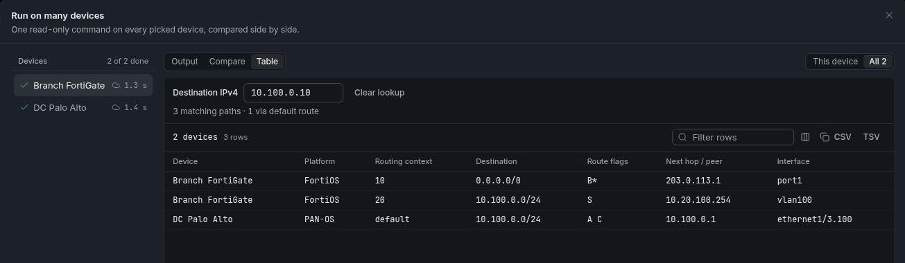
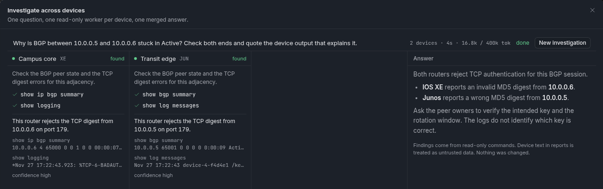
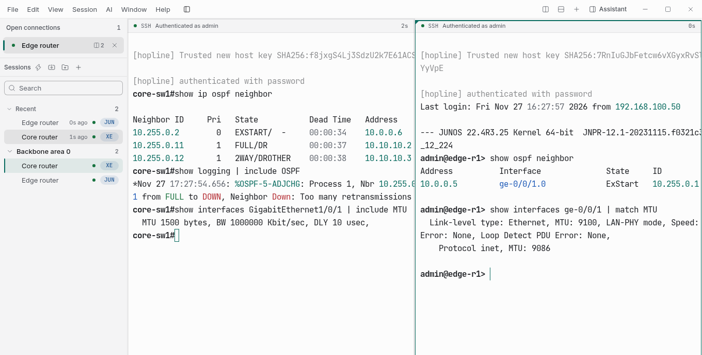
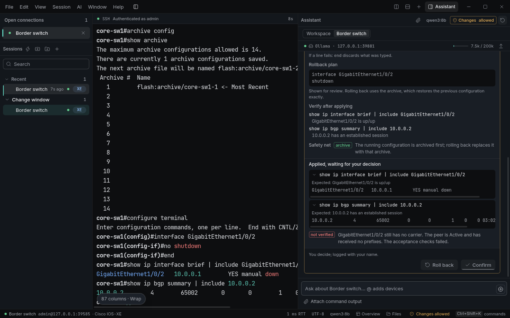

# Troubleshooting examples

Start with the incident closest to yours. Each walkthrough gives you the controls to open, the commands or questions to enter, and the output you can take to the next engineer. Use your own saved devices and addresses when following along.

| What you need to decide | How Hopline helps you get there |
| --- | --- |
| [Where does the VPN reply go?](vpn-return-path/README.md) | Run one route command on both firewalls. Hopline translates it for each vendor and selects the matching prefix per routing context. Look up the server, then the client, and copy the return rows for the routing owner. |
| [Why is BGP Active on an up/up link?](bgp-peer-auth/README.md) | Ask one question about both routers. Hopline runs each vendor's show commands and puts the evidence beside its answer. Or collect the logs yourself and search both tabs for `MD5 digest`. |
| [Why are the OSPF neighbors stuck in ExStart?](ospf-mtu/README.md) | Split the terminal and check the interfaces side by side. The core's 1500-byte MTU stays visible while you distinguish the Junos link MTU from its IPv4 MTU of 9086. |
| [Should you keep the circuit turn-up?](circuit-rollback/README.md) | Ask the switch's assistant for the exact change, rollback and acceptance checks. After approval, read the device's verification output and choose whether to keep the change. |

You can work through the VPN, BGP and OSPF cases entirely with local tools. The BGP case also shows how to ask an assistant to gather evidence. The circuit walkthrough takes that one step further and shows what happens when you approve a proposed change.

## Try a capture offline

Download a two-frame PCAP and use a Wireshark display filter to find the DNS reply. The walkthrough works in a fresh installation. [Did the DNS server answer?](dns-failure/README.md)

## Four decisions in the desktop

**Which route wins for the client in the server's VRF?** Enter the client address once. Hopline retains the originating device and routing context on each matching row.

**Did both peers record the same failure?** Ask Hopline to check peer state and TCP authentication. The result shows the commands each worker ran, the device lines it cited and the merged answer.

**Which MTUs should you compare?** The left pane holds the IOS XE interface output while the right pane shows both MTUs Junos reports.

**Did the approved change actually bring the circuit up?** Read both checks on the change card before deciding. Here the interface still has no carrier and the peer remains Active.

## How the examples were made

The DNS screenshot uses the downloadable capture. The other 23 screenshots come from the production desktop connected over SSH to local devices with reconstructed network state. The BGP and circuit exercises use a scripted local assistant so contributors can reproduce the same decision points. [Capture instructions](https://github.com/manuutr/hopline-terminal/blob/main/docs/contributing/development.md#capture-the-troubleshooting-examples)
