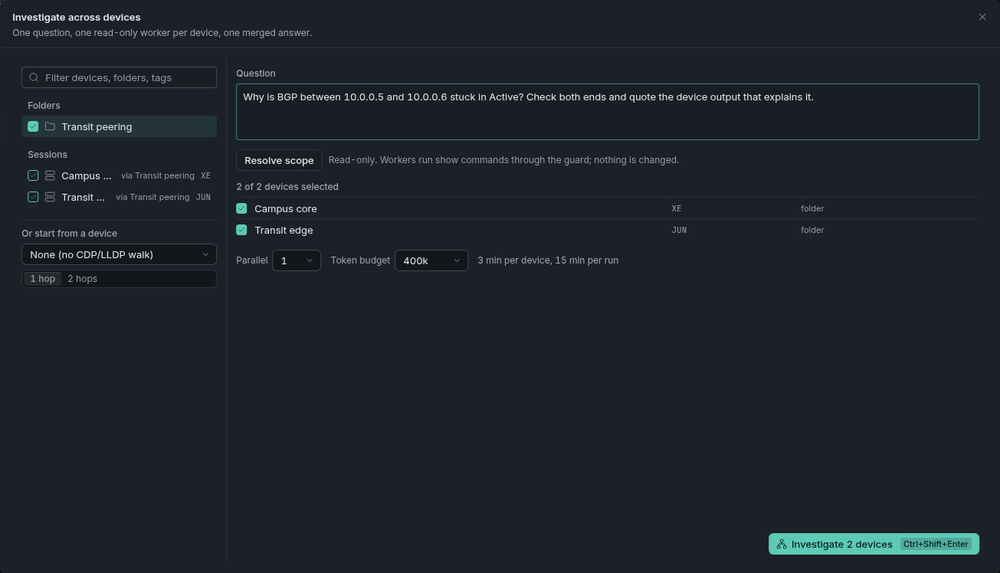
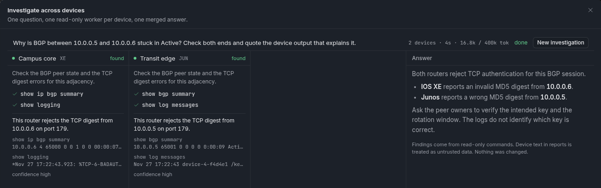
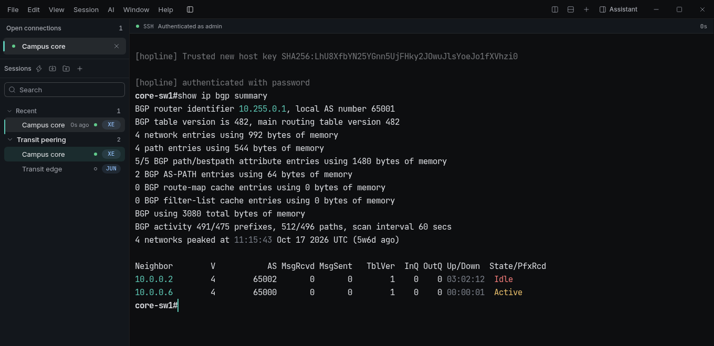
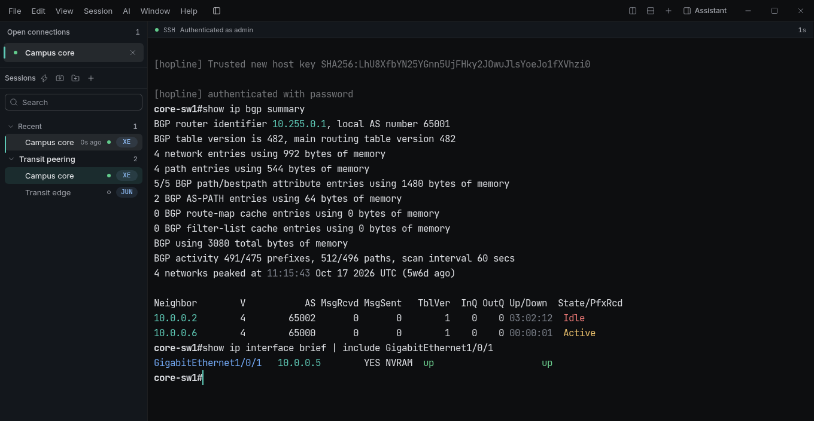
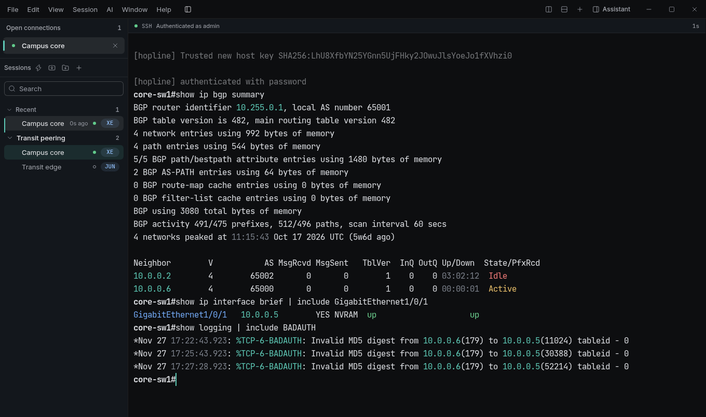
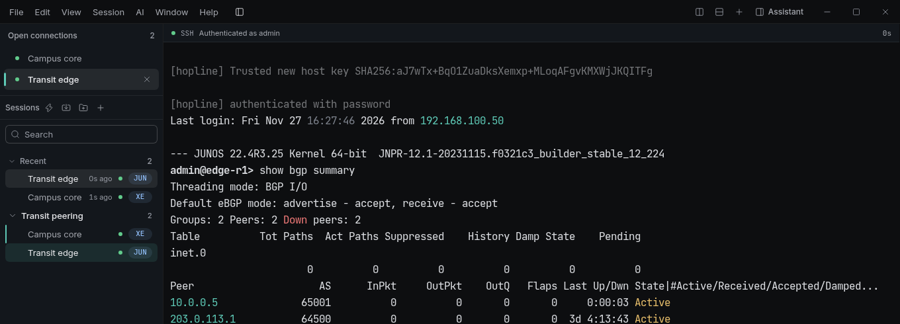
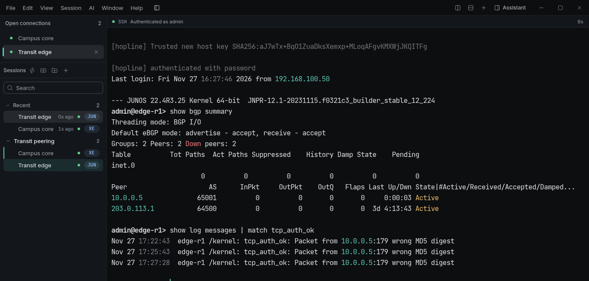
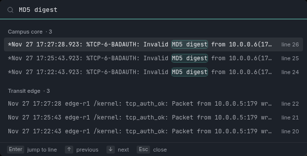

# BGP stays Active on a link that is up

The campus core (`10.0.0.5`, IOS XE) peers with the transit edge (`10.0.0.6`, Junos). Both routers have other peers. You need to know whether the two routers report the same failure for this adjacency. You can ask Hopline to gather the evidence across both peers, or run the commands yourself and search the open tabs.

## Ask Hopline to investigate both routers

With a tool-capable model connected, right-click **Transit peering** in **Sessions** and choose **Investigate across devices…**. Click **Resolve scope**, check that **Campus core** and **Transit edge** are selected, and enter this question.

> Why is BGP between 10.0.0.5 and 10.0.0.6 stuck in Active? Check both ends and quote the device output that explains it.

Click **Investigate 2 devices**. Hopline opens a read-only connection to each saved device. In this run, the assistant chose `show ip bgp summary` and `show logging` on IOS XE, and `show bgp summary` and `show log messages` on Junos.

Read the two reports beside the answer. The core rejected a digest from `10.0.0.6`, and the edge rejected one from `10.0.0.5`. Hopline checks each quoted evidence line against the output that worker collected. That gives the two owners a reason to check the key rotation for this adjacency. The intended key still has to come from their secret-management process.

This capture used a scripted local model to make the run reproducible. The desktop ran the commands against both SSH fixtures and checked the evidence. A model you connect can choose different commands. [Fleet investigation guide](https://github.com/manuutr/hopline-terminal/blob/main/docs/guide/fleet.md)

## Collect and search the same evidence yourself

These six steps use the terminal and its cross-tab search. You can follow them with the assistant off.

### 1. Identify the affected peer

In **Sessions**, double-click **Campus core** and run `show ip bgp summary`. Find `10.0.0.6`. Its state is **Active** where an established session would show a received-prefix count. The Idle row for `10.0.0.2` belongs to a different peer.

### 2. Check the local transport interface

In the same tab, run `show ip interface brief | include GigabitEthernet1/0/1`. The interface owns `10.0.0.5` and reports `up/up`. Local carrier is present. Check what happens when TCP traffic arrives from the peer.

### 3. Collect the local authentication errors

Run `show logging | include BADAUTH`. The repeated **Invalid MD5 digest** messages name `10.0.0.6(179)`. Leave this tab open so you can search its scrollback alongside the edge's.

### 4. Check the reciprocal peer on Junos

Double-click **Transit edge** in **Sessions** to open a second tab. Run `show bgp summary` and read the row for `10.0.0.5`, the core's address. This is the other end of the adjacency you identified in step 1.

### 5. Collect the edge's authentication errors

Run `show log messages | match tcp_auth_ok` in the edge tab. Junos records a **wrong MD5 digest** from `10.0.0.5:179`. The vendors word the error differently, but both include the phrase `MD5 digest`.

### 6. Search once and take both lines to the peer owners

Open **Find in all tabs…** (`Ctrl+Shift+Alt+F` on Windows/Linux, `⌘⌥F` on macOS). Search for `MD5 digest`. Hopline groups matching lines by session. Select a result to jump to its full terminal line. Right-click that command block and choose **Copy for ticket**. Repeat for the other router to attach both sources.

The reciprocal source addresses tie both failures to this adjacency. The logs establish a TCP authentication problem. The peer owners still need to verify the intended key and rotation window through their secret-management process. After they reconcile the settings, check that the peer establishes and the expected prefixes return.

[All investigations](../README.md)
