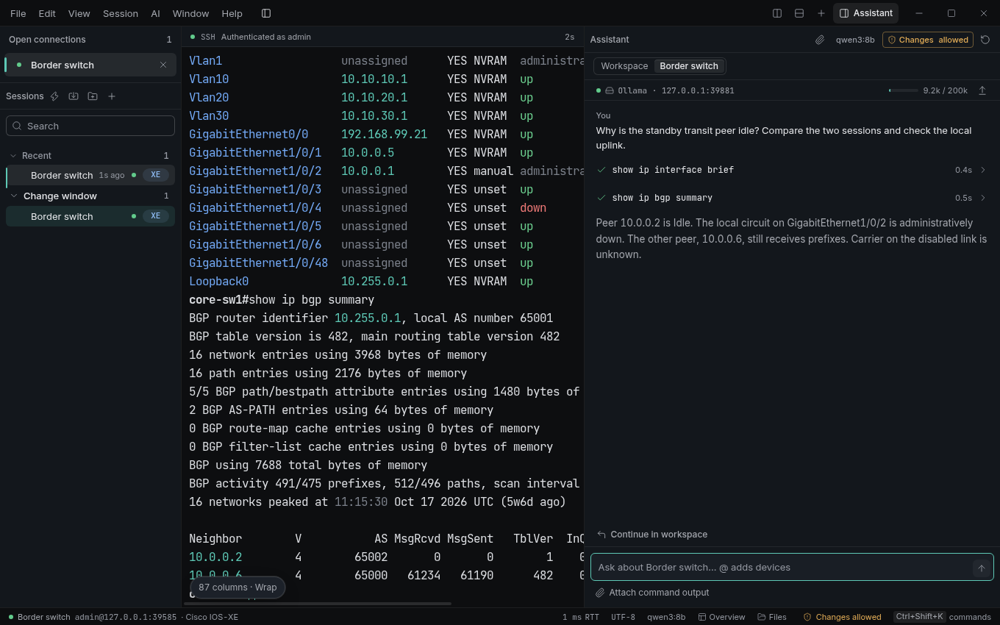
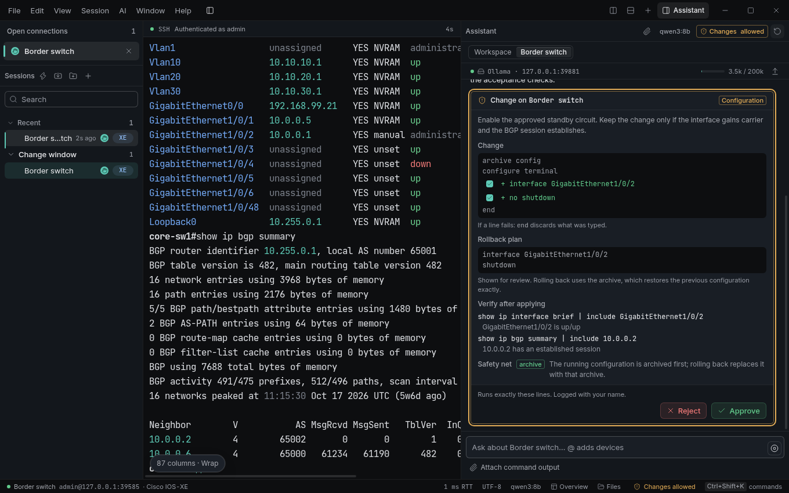
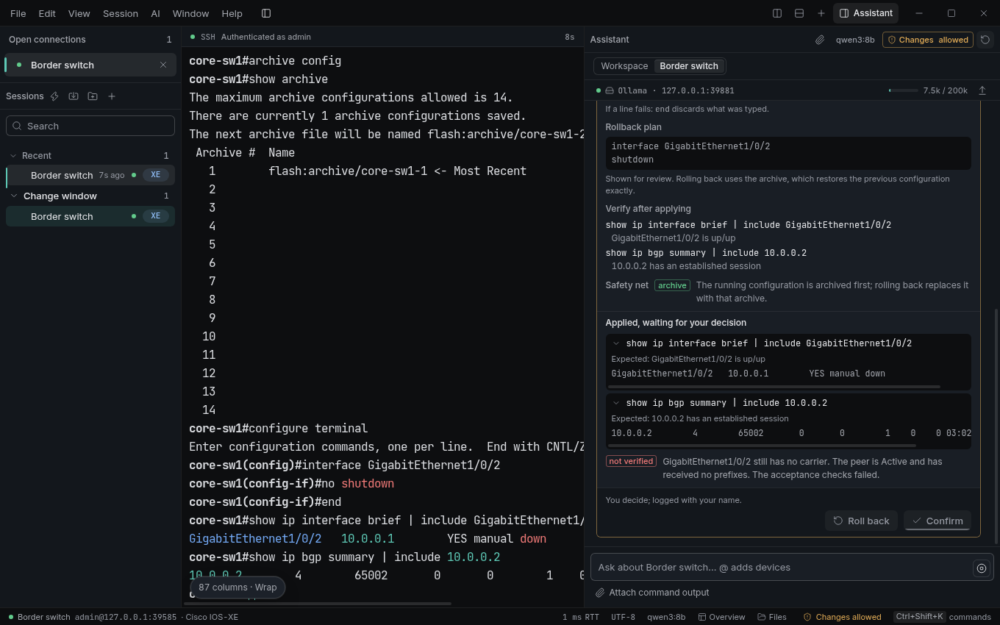
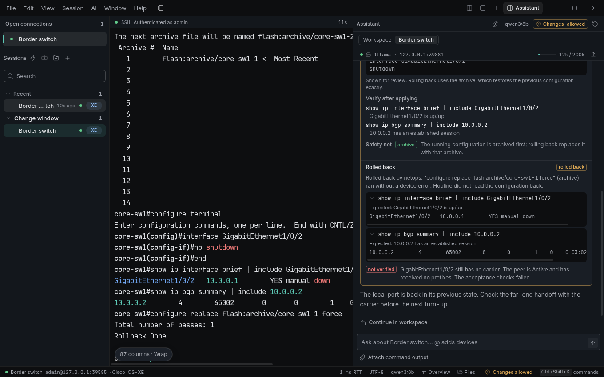
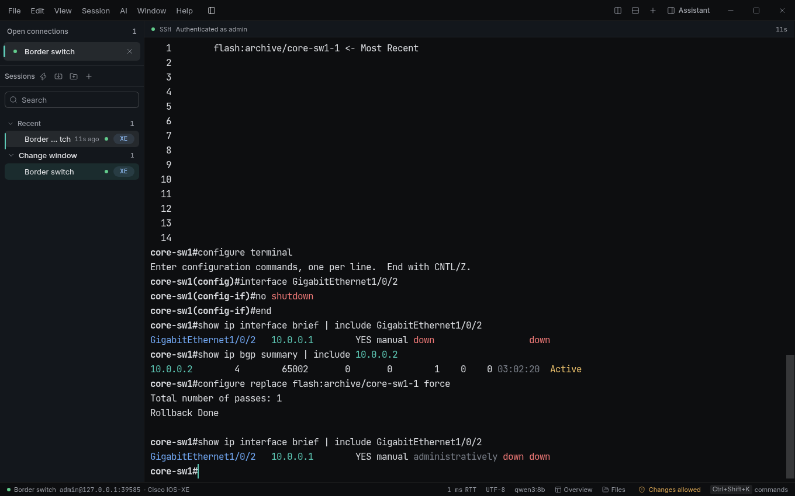

# A circuit turn-up that should be rolled back

You have a change window to enable a standby transit handoff on IOS XE. You'll keep the change only if the port gains carrier **and** BGP establishes. Use the assistant on the switch's tab to collect the show output, propose the exact change, and run the acceptance checks. You decide whether to approve the change and whether to keep it.

The screenshots use a scripted local assistant and an SSH device fixture whose far end stays down. To follow this workflow on your own equipment, connect a tool-capable model from **Connect a model** in the assistant panel. An Ollama model running on your machine can keep the investigation local. [Assistant setup](https://github.com/manuutr/hopline-terminal/blob/main/docs/guide/getting-started.md#connect-a-model)

## 1. Ask the assistant to check the two BGP peers

Open **Border switch** in **Sessions**. Run `show ip bgp summary`, then open the tab's assistant (`Ctrl+Shift+I` on Windows/Linux, `⌘I` on macOS). You can leave **Read-only** on for this question.

> Why is the standby transit peer idle? Compare the two sessions and check the local uplink.

The assistant runs `show ip interface brief` and `show ip bgp summary` on this switch. Peer `10.0.0.6` is receiving prefixes. The standby peer `10.0.0.2` is Idle and its local uplink `GigabitEthernet1/0/2` is administratively down. Carrier on a disabled port is still unknown.

## 2. Ask for the change and its acceptance checks

For an authorized window, switch the assistant header from **Read-only** to **Changes allowed** if needed. Ask the follow-up in the same conversation.

> The turn-up is authorized for this window. Show the exact change, the rollback and the acceptance checks.

Hopline opens a review card. Check that `no shutdown` applies to **GigabitEthernet1/0/2**, that the inverse restores `shutdown`, and that the checks cover both interface carrier and the BGP session. The proposal waits for you to click **Approve**.

## 3. Read the device's answer before keeping the change

Click **Approve** after reviewing those lines. Hopline saves an IOS XE configuration snapshot, applies the approved commands, and runs the interface and BGP checks on the switch. The card shows their actual output beside the assistant's **not verified** judgment.

The switch accepted the configuration. The port is now `down/down` and the peer moved from `Idle` to `Active`. Neither meets the agreed criteria of `up/up` and an established peer.

## 4. Roll back from the review card

Choose **Roll back**. On IOS XE, Hopline restores the saved configuration using `configure replace`. The change panel records the rollback alongside the evidence that led you to it.

## 5. Verify the starting state independently

Return to the switch terminal and run `show ip interface brief | include GigabitEthernet1/0/2` yourself. The port is back to **administratively down/down**. Give the carrier the post-change carrier reading and the restored port state before scheduling another turn-up.

[All investigations](../README.md)
