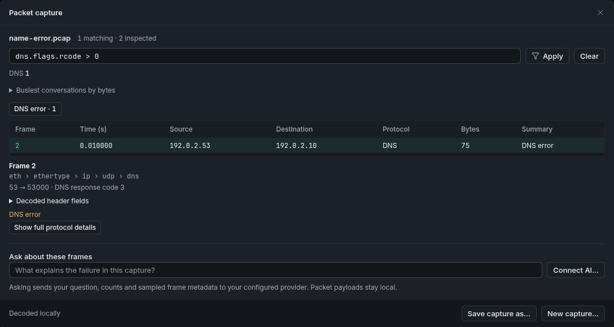

# Did the DNS server answer?

A workstation reports that it cannot find `printer.invalid`. Open this two-frame capture in Hopline 1.2 to distinguish a DNS error from a timeout. Both frames are synthetic. You can finish the exercise offline, with an empty device inventory and the assistant disconnected.

1. Save [name-error.pcap](name-error.pcap). On GitHub, open the file and choose **Download raw file**.
2. Choose **Session › Packet capture… › Capture file › Open capture…** and open the file. Frame 1 is a DNS query from `192.0.2.10` to `192.0.2.53`. Frame 2 travels in the opposite direction.
3. Enter `dns.flags.rcode > 0` in the display filter and choose **Apply**. Only frame 2 matches. Select it and expand **Decoded header fields**. The DNS response code is **3 (NXDOMAIN)**.
4. Choose **Show full protocol details** to find the query name. The resolver answered the client about `printer.invalid` after 10 ms. That reply establishes a name error. To investigate further, check which DNS zone should contain the requested name.

The full DNS dissection is available locally. If you connect a model, the capture assistant uses a bounded sample of frame metadata. [Packet capture guide](https://github.com/manuutr/hopline-terminal/blob/v1.2.0/docs/guide/packet-capture.md)

[All examples](../README.md)
