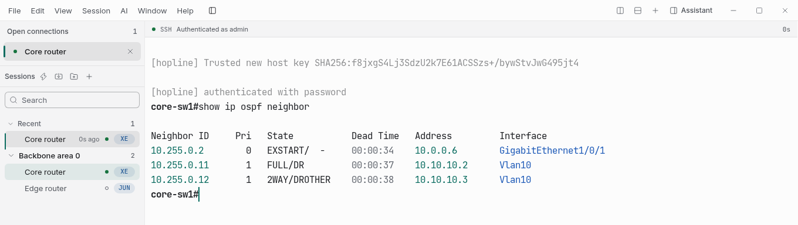
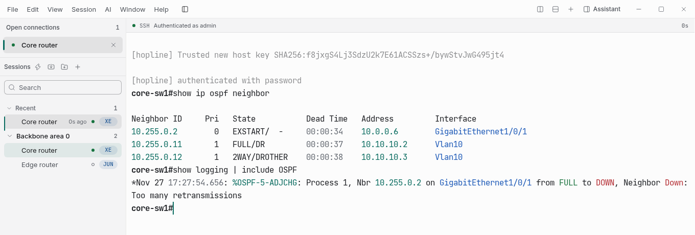
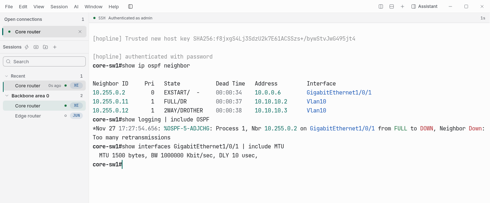
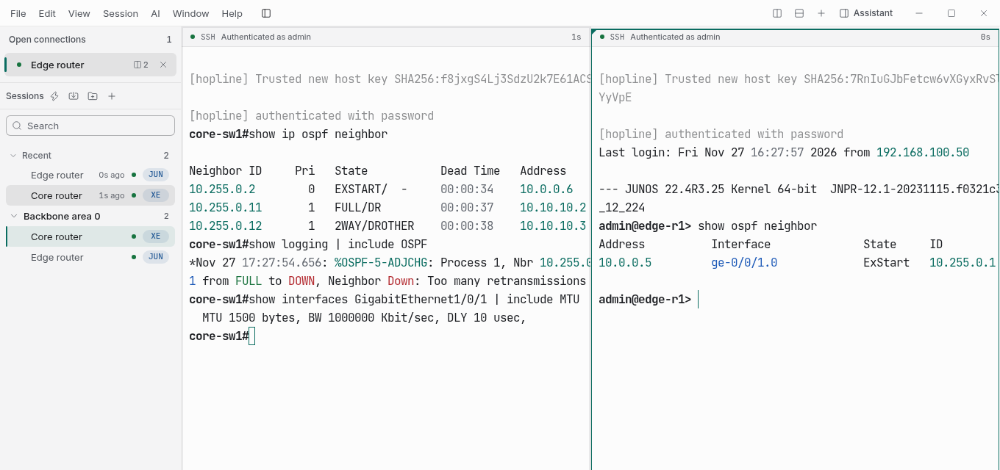
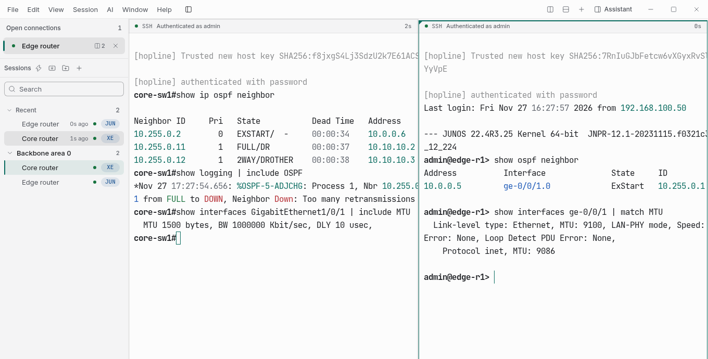

# OSPF neighbors see each other but cannot finish adjacency

An IOS XE core and a Junos edge share an area 0 link. The adjacency stalls during database exchange. Use **Split right** in Hopline to keep the core's interface output visible while you query the edge. You can then compare the two IPv4 MTUs directly. This workflow needs read access to both routers and works without a model.

## 1. Identify the local interface

In **Sessions**, double-click **Core router** and run `show ip ospf neighbor`. The neighbor at `10.0.0.6` is in **EXSTART** on `GigabitEthernet1/0/1`. Use that interface for the next checks.

## 2. Check whether the adjacency ever reached Full

Run `show logging | include OSPF`. The core logged a transition from `FULL` to `DOWN` after too many retransmissions. That gives you the history of this adjacency. Several conditions can cause retransmissions, so collect the interface settings at both ends.

## 3. Keep the core's MTU on screen

Run `show interfaces GigabitEthernet1/0/1 | include MTU`. Leave the **1500 bytes** result visible in the core terminal.

## 4. Open the other end beside it

Click **Split right** in the title bar. Type **Edge router** in the new pane's launcher and press Enter. Run `show ospf neighbor` in the right pane. Junos sees the core at `10.0.0.5` in **ExStart** on `ge-0/0/1.0`. The core's output stays visible on the left.

## 5. Compare the IP-layer values

In the Junos pane run `show interfaces ge-0/0/1 | match MTU`. The edge reports a link-level MTU of **9100** and a **Protocol inet** MTU of **9086**. It's the latter value that you compare with the core's **1500**.

The two ends disagree on IPv4 MTU. For a ticket, right-click the interface command block in each pane and choose **Copy for ticket**. Give the link owners both readings so they can confirm the intended IP MTU and supported frame size. After an agreed correction, verify that both ends reach **Full** and an expected OSPF prefix returns.

[All investigations](../README.md)
