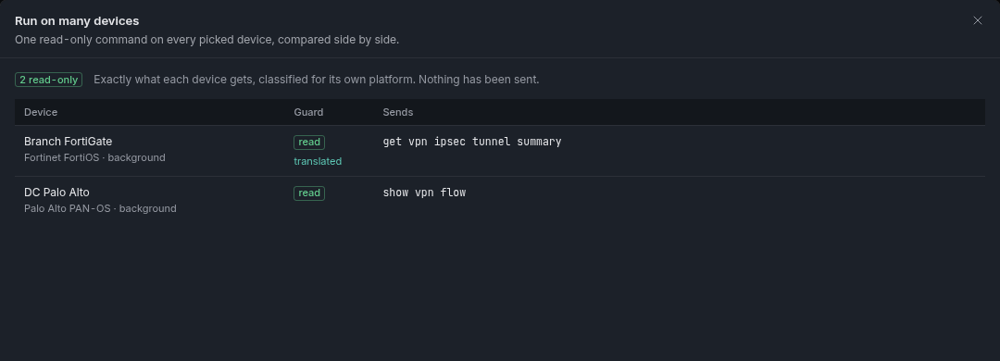
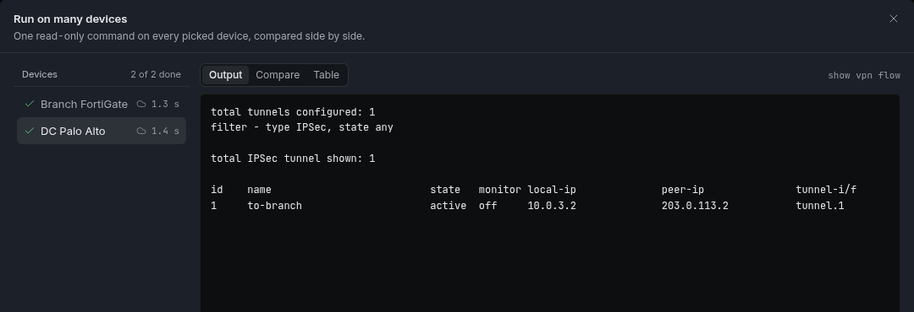
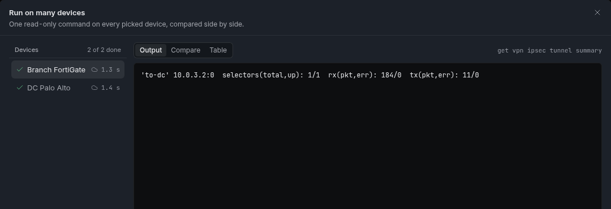
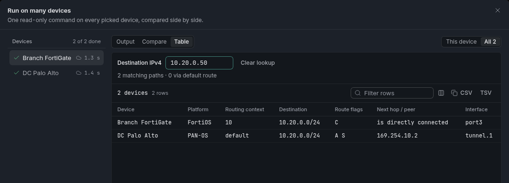
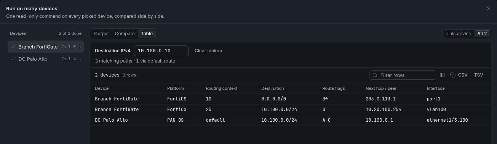

# The tunnel is up. Where does the reply go?

A data-center client (`10.100.0.10`) times out connecting to a branch server (`10.20.0.50`). You have read access to the Palo Alto and FortiGate. Use **Run on many devices** to send one check to both firewalls, then enter each host address in a combined route table. Hopline does the vendor translation and prefix matching locally. You decide which routing context the packet enters.

## 1. Preview one tunnel check for both firewalls

In **Sessions**, right-click the folder containing your two saved firewalls and choose **Run on this folder…**. In this example the folder is **Site firewalls**. Enter `show vpn flow` in **Show command**, leave **Translate per platform** on, and click **Preview**. Check the target names and the commands Hopline will send. The Palo Alto gets `show vpn flow` and the FortiGate gets `get vpn ipsec tunnel summary`. Both are marked read-only.

## 2. Read the data-center result

Click **Run on 2**, then select **DC Palo Alto** in the results. In **Output**, find the row for `to-branch`. Its state is `active`. That establishes the security association on this end. You still need the forwarding decision for the server.

## 3. Check what the other end reported

Select **Branch FortiGate** in the same results. The line for `to-dc` says `selectors(total,up): 1/1`. Both firewalls report an active tunnel, and the counters cover more traffic than this client's request. Move on to routing.

## 4. Find where the request reaches the server

Click **New run**. Enter `show routing route`, then **Preview** and **Run on 2**. Hopline collects the Palo Alto route table and its FortiOS equivalent, `get router info routing-table all`. Open **Table**, select **All 2**, and enter the server address `10.20.0.50` in **Destination IPv4**.

Hopline selects the longest active prefix matching that address in each captured routing context. The Palo Alto uses `tunnel.1`. On the FortiGate the server is directly connected on `port3` in **VRF 10**. That's the context you need for the reply.

## 5. Find where the reply goes and copy the evidence

Replace the destination with the client address, `10.100.0.10`. Compare **Routing context**, **Destination** and **Interface** on the two FortiGate rows. Drag the bottom-right corner of the viewer if you need more room.

In **VRF 10**, the winning route is `0.0.0.0/0` via `203.0.113.1` on `port1`. The specific `10.100.0.0/24` route via `vlan100` belongs to **VRF 20**. A reply entering VRF 10 therefore selects the WAN default. With the client lookup still active, click **CSV** to copy the displayed rows into the incident ticket. Ask the routing owner to verify the intended next hop in VRF 10. After a correction, repeat the application request to verify traffic in both directions.

[All investigations](../README.md)
