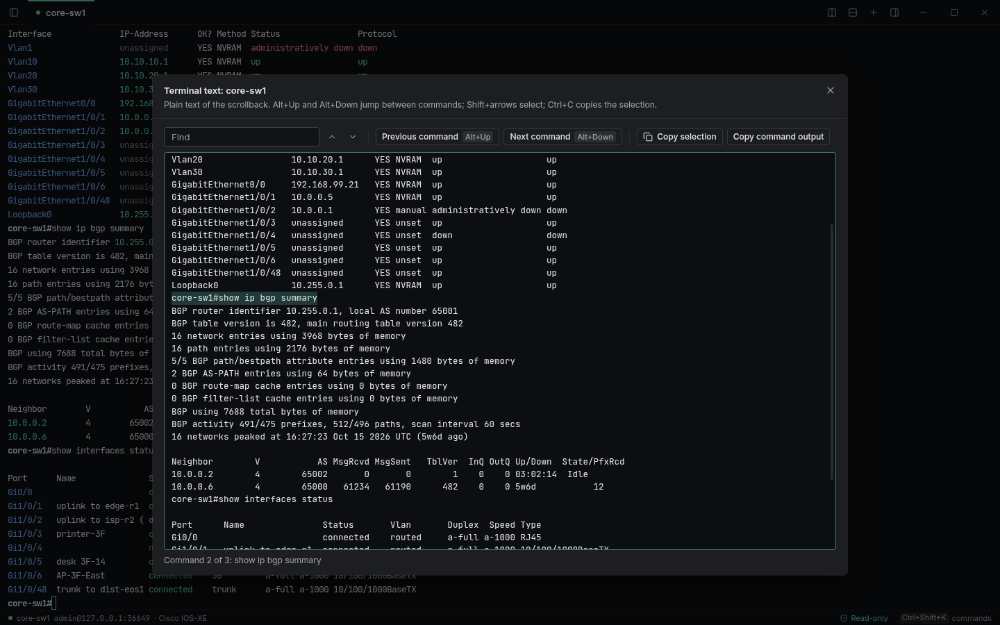

# Accessibility

Hopline aims at WCAG 2.2 AA. This page is the short version; [docs/ACCESSIBILITY.md](../ACCESSIBILITY.md) has the details, how each part is tested, and the known gaps.

## Screen readers

**Screen reader mode** (Settings › Terminal, or **Turn on screen reader mode** in the palette):

- the terminal exposes its rows to your screen reader;
- new output of the active tab is read through one polite live region, at most once a second;
- output over 8 lines or 500 characters is read as a one-line summary ("1,204 lines of output. Last: …");
- what you type is not echoed again (your reader already does);
- background tabs stay silent.

When the OS reports a screen reader (NVDA, JAWS, Narrator, VoiceOver, Orca), Hopline offers the mode once. It never turns it on by itself.

**The accessible buffer view** (`Mod+Alt+B`, or **Open terminal text** in the palette) shows the tab's scrollback as plain text in a read-only text area, which a screen reader can read by line, word and character:

| Key | Action |
| --- | --- |
| Arrows, Page Up/Down, Ctrl+Home/End | Move through the text; it opens at the latest output |
| Alt+Up / Alt+Down | Previous or next command ("Command 3 of 7: show version") |
| Shift+arrows, then Ctrl+C (⌘C) | Select and copy a range |
| **Copy command output** | Copy the output of the command at the cursor |
| Find, then Enter / Shift+Enter | Next or previous match |
| Esc | Close and return to the terminal |

## Keyboard only

- `Mod+K` opens the command palette, which lists every action, including those without a shortcut.
- **F6 / Shift+F6** move between the toolbar, open connections, saved sessions, the terminal, the files panel and the assistant. The terminal keeps Tab for the device, so F6 is the way out of it.
- In **Open connections**, Up and Down move between tabs. Enter activates the focused tab and Delete closes it.
- Dialogs keep focus inside, Esc closes them, and focus returns to where it was.
- Trees and lists are one Tab stop with arrow keys.
- **Dividers** (sidebar, assistant, files panel, split panes, the fleet answer column) are focusable: arrows move 16 px, Shift+arrows 96 px, Home/End go to either end, Enter collapses and restores the panel. Settings › Workspace › Appearance › Panel sizes resets them.
- `Mod+/` shows every shortcut; Settings › Keyboard rebinds them. See [Keyboard shortcuts](keyboard-shortcuts.md).

The window's minimise, maximise and close buttons (Windows and Linux) are mouse-only; use the OS shortcuts.

## Visual

- All text is at least 4.5:1 against its background in both themes, including hovered, selected and disabled states. The terminal raises any cell below 4.5:1 in every theme, custom and imported ones included.
- Every control shows focus; small controls have a 24 × 24 px target.
- Risk and state are never colour alone: risk labels are words, and status dots have text labels.
- With reduced motion on in the OS, nothing animates and the terminal cursor stops blinking.
- Font size, line height and the theme can be set globally or per host.
