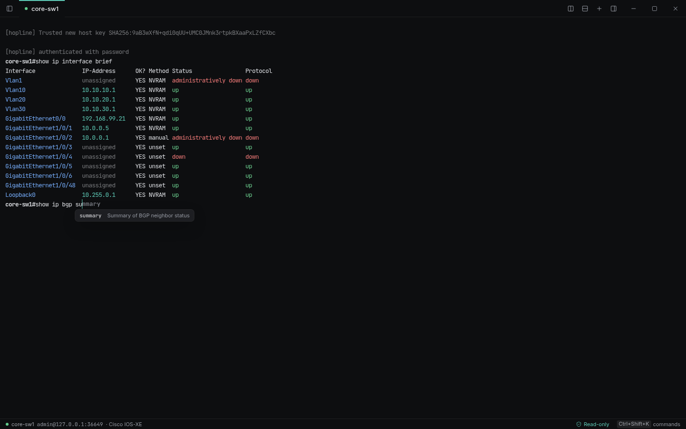

# Autocomplete

At a device prompt, Hopline Terminal suggests the rest of the command from the platform's command model (`@hopline/cli-model`) and the mode the prompt shows: exec, privileged exec, or a configuration level.

## Ghost text and hints

- **Ghost text** is the unique completion, drawn in grey after the cursor. It is an overlay, never written into the terminal, so copy, scrollback, logs and find never contain it.
- **The hint list** under the line shows the candidates that can follow, with their help text and argument labels (`WORD`, `<1-4094>`, `A.B.C.D`).
- **Tab, → or End accepts** the ghost text. Hopline Terminal types the missing characters to the device as keystrokes, so the device's own echo stays the source of truth.
- **With no ghost text showing, Tab goes to the device**, and `?` always does. The device's own completion and help stay authoritative.

Suggestions are computed from the line as you type it, not from the device's echo, so they keep up with fast typing; the echo re-syncs the line after Tab, `?`, history recall or a paste.

## Values learned from your own commands

Interface names, VLANs, VRFs and BGP and OSPF neighbours are offered as arguments once Hopline Terminal has seen them. It learns them **only from listing commands you run yourself**, such as `show ip interface brief`, `show vlan brief`, `show vrf`, `show ip bgp summary` and `show ip ospf neighbor`, in any abbreviation and without a pipe. Hopline Terminal never sends a command of its own to learn values.

These values are device text that accepting a completion would type into the device, so each kind is checked against a strict pattern (interface names in the platform's naming, VLAN ids 1–4094, IPv4 neighbours, VRF names without separators) and capped in length. Anything with spaces, control characters, pipes, quotes or separators is dropped.

## When it is off

Autocomplete shows nothing:

- on a session whose platform is Auto-detect or unknown;
- at a password prompt, a `--More--` pager or an unrecognised screen;
- in full-screen programs (the alternate screen) and while you scroll back;
- on an `@ai` line (there the `@` mention list takes over, see [Fleet](fleet.md#device-mentions));
- while the assistant is typing a command.

Turn it off in Settings › Terminal › **Autocomplete**, or per session or folder with [overrides](sessions.md#per-host-overrides).

## Platforms

Every platform in the command model has a tree: Cisco IOS, IOS-XE, NX-OS, IOS-XR, ASA, FTD, Catalyst 9800, AireOS and Small Business; Arista EOS; Juniper Junos; Palo Alto PAN-OS; Fortinet FortiOS; Aruba AOS-CX; Huawei VRP. The trees cover the common exec and configuration commands, not every command a vendor ships, so a missing suggestion does not mean the device rejects the command.
