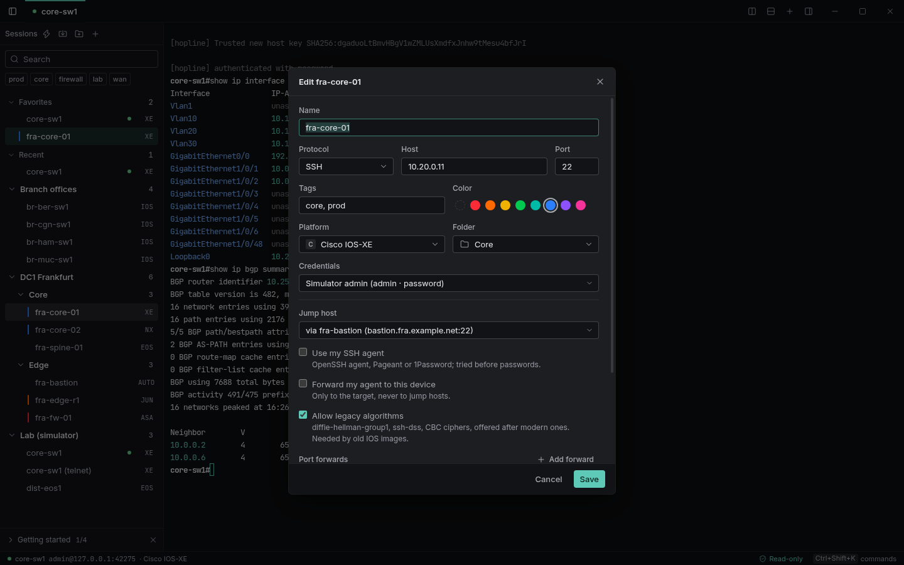
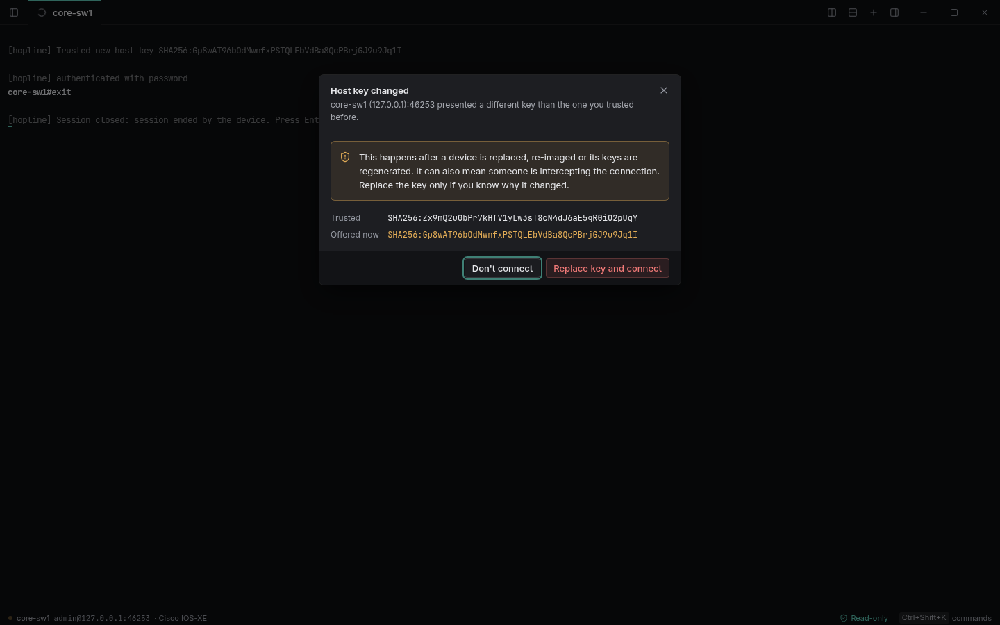
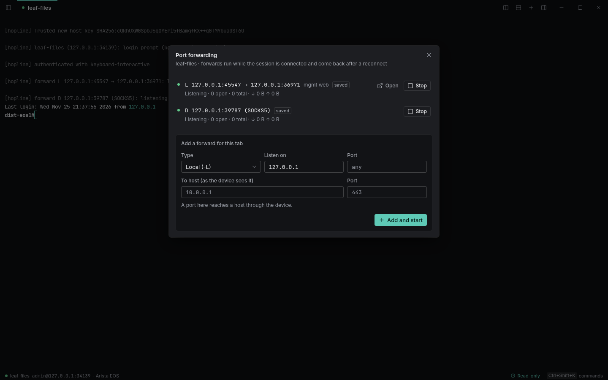
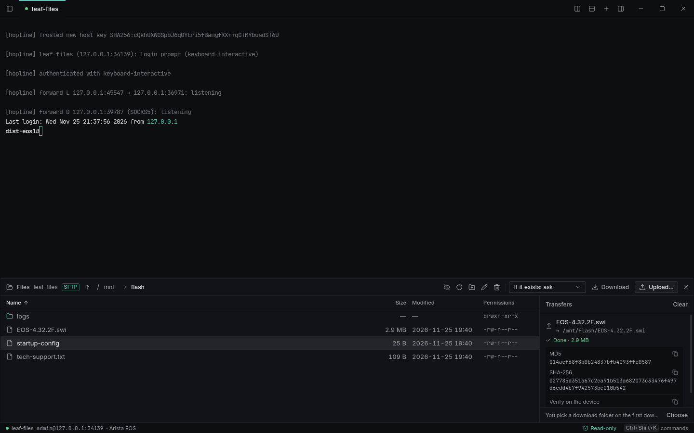

# Connections

Every connection runs in the **session host**, a separate process with flow control. If it crashes, Hopline Terminal restarts it with backoff and reconnects your tabs. A tab shows its state with a small dot; a dropped session shows a Disconnected strip with **Reconnect**.

Create a session with **New session…** (`Mod+N`), from the session tree's context menu, or connect once with **Quick connect** (`Mod+O`, see [Sessions](sessions.md#quick-connect)). The dialog's **Protocol** field picks SSH, Telnet, raw TCP or a serial console.

Common fields: **Name**, **Folder**, **Host**, **Port**, **Platform**, **Credentials** (a profile, or "Ask for password on connect"), **Tags**, **Color**, **Notes** and **Log session output to a file**.

**Platform** defaults to **Auto-detect**. On first connect Hopline Terminal reads the SSH server identification, the login banner and the prompt. Only if those are not decisive does it run the platform's version command once (twice at most), as an audited read marked "auto-detect", and only at an idle prompt. The result is saved with the version ("Detected Cisco IOS-XE 17.9.4a · Change"). A device that stays unidentified shows **Platform unknown — AI commands blocked · Set platform** in the status bar, the assistant panel and the tab, and every command Hopline Terminal would send for you is refused until you set the platform.

Supported platforms: Cisco IOS, IOS-XE, NX-OS, IOS-XR, ASA, FTD, Catalyst 9800, AireOS and Small Business; Arista EOS; Juniper Junos; Palo Alto PAN-OS; Fortinet FortiOS; Aruba AOS-CX; Huawei VRP.

## SSH

### Signing in

A credential profile (see [Sessions › Credentials](sessions.md#credential-profiles-and-the-vault)) holds one of:

- a **password**;
- a **private key**: OpenSSH, PEM, or PuTTY PPK v2/v3. An encrypted key asks for its passphrase. Encrypted PPK v3 keys are converted to OpenSSH once when saved, so connecting does not stall on Argon2;
- the **SSH agent**: OpenSSH agent, Pageant or 1Password;
- **ask every time**.

**Use my SSH agent** (on the SSH tab) tries the agent before passwords. Keyboard-interactive authentication is always tried as well, so servers that ask for a one-time code or a second factor (MFA) prompt you in an in-app dialog. A wrong password says how many attempts are left ("Wrong password (attempt 2 of 3)").

### Jump hosts

**Jump host** picks another saved SSH session to connect through ("via bastion (10.0.0.5:22)"). That session can have its own jump host, so chains of any length work. Each hop checks its own host key and prompts for its own credentials. Port forwards and SFTP go through the same chain.

### Agent forwarding

**Forward my agent to this device** forwards your local agent to the target only, never to the jump hosts in between.

### Legacy algorithms

**Allow legacy algorithms** (on by default) offers `diffie-hellman-group1`, `ssh-dss` and CBC ciphers after the modern ones. Old IOS images need them.

### Host keys

Hopline Terminal trusts a host's key the first time it connects (trust on first use) and remembers it. If the key changes later, Hopline Terminal stops before anything is sent and shows the trusted and the offered fingerprints. **Don't connect** has the focus; **Replace key and connect** trusts the new key.

**Known hosts…** (command palette, or Settings › Connections) lists the keys you trust, lets you forget one, and imports an OpenSSH `known_hosts` file.

### Keep-alive and reconnect

SSH keep-alive runs every 30 s by default (0 turns it off). **Auto-reconnect** retries with backoff when a session drops, but not after an authentication or host-key error, and not after you type `exit`. Both can be set per folder or session with [overrides](sessions.md#per-host-overrides).

## Telnet and raw TCP

Telnet negotiates options per RFC 1143 and learns from the server whether it echoes. Raw TCP sends and receives bytes as they are, for console servers and odd devices. The Telnet escape (`Ctrl+]`) and every other control key go to the device.

You sign in to a Telnet device at its own prompt. That is also why Telnet sessions can't take part in background work (fleet investigations, and multi-device runs or backups of sessions without an open tab): a background connection can't type a sign-in.

## Serial consoles

Choose **Serial console** as the protocol, then the **Serial port** (with **Rescan serial ports**), **Baud rate**, **Data bits**, **Parity**, **Stop bits** and **Flow control**. The default is 9600 8N1 with no flow control, which suits Cisco and most other console ports.

- **Send break** (command palette) sends a BREAK, for ROMMON and password recovery. The status bar shows BREAK while it is sent.
- The status bar shows the port's **DTR** and **RTS** lines. Click one, or use **Toggle DTR** / **Toggle RTS** in the palette, to turn it on or off. It shows what the port really has: if the adapter refuses a change, the line stays as it was and Hopline Terminal says why.
- On Linux your user must be in the serial group: `sudo usermod -aG dialout $USER` (Debian, Ubuntu, Fedora) or `sudo usermod -aG uucp $USER` (Arch), then log out and back in. Hopline Terminal says so when a port is refused.
- On macOS use `/dev/cu.*`, not `/dev/tty.*`.

Quick connect takes serial URLs too: `serial:///dev/ttyUSB0?baud=115200`.

## Port forwarding

SSH sessions can forward ports, like `ssh -L`, `-R` and `-D`:

- **Local (-L):** a port on this machine reaches an address on the device's side.
- **Remote (-R):** a port on the server reaches an address on this side. The server must allow it; Hopline Terminal says so when it refuses.
- **Dynamic (-D):** a SOCKS5 proxy on this machine.

Save forwards on the session (Edit session › SSH › Saved port forwards), or add one live from the tab menu › **Port forwarding…**. Each forward shows its status (listening, open and total connections, bytes, errors such as "port 8080 is already in use") and can be started and stopped live. A listening local forward has **Open**, which opens it in your browser.

- Binds default to `127.0.0.1`. `localhost` binds `127.0.0.1`.
- A bind that is not loopback (`0.0.0.0`, `::`, `0`, a LAN address) shows a warning, and a saved one never starts by itself: you start it by hand.
- Forwards come back after a reconnect: local listeners stay bound, remote forwards are requested again.
- Background connections (multi-device runs, backups, fleet workers) never start forwards.
- A remote forward bound to the server's loopback can still be reached by every user of that server. Treat it as exposed to that machine.
- At most 64 connections per forward; a SOCKS handshake must finish in 10 s.

Every start, stop and failure is in the audit log (source `forward`).

## Files: SFTP and SCP

Select **Files** in the status bar of a connected SSH session, or press `Mod+J`. To open the panel automatically and keep typing in the terminal, enable **Settings › Connections › Open Files on SSH connect**. SFTP runs as another channel on the tab's own connection, through the same jump chain, with no second login. If the device refuses a second channel, Hopline Terminal opens a second connection with the same credentials and says so.

- **Follow folder** appears in the SFTP toolbar when the SSH shell reports its working directory with OSC 7. Turn it on to follow directory changes in that tab. Browsing to another folder yourself switches it off. On devices with no directory reports, use the breadcrumbs.
- **Browse:** breadcrumbs, sorting, hidden files, permissions, new folder, rename (F2) and delete (with an in-app confirmation). Arrows move, Enter opens a folder or downloads a file, Backspace goes up, Space selects. Esc returns to the terminal; a second Esc closes the panel.
- **Preview file** opens the selected UTF-8 text file up to 256 KiB. Press F3 in the SFTP list to open it. Hopline Terminal masks recognised secrets before showing the text and reads it directly from the SSH connection. Download larger or binary files.
- **Upload** from the file picker or by dropping files from the desktop onto the list. **Download** to a folder you choose once (Change at any time), or drag a finished download out to the desktop.
- **The transfer queue** shows progress, speed and time left, with cancel and retry. An SFTP retry resumes where it stopped.
- **If a file exists:** ask (Keep both, Skip, Replace, or Resume a shorter copy), or always keep both, skip or replace. The ask dialog focuses Skip.
- **Checksums:** every finished transfer shows the MD5 and SHA-256 computed while streaming, and the device's own verify command to copy, such as `verify /md5 flash:x <md5>` on IOS. Hopline Terminal never runs it for you.

**SCP for devices without SFTP** (IOS with `ip scp server enable`, NX-OS, EOS, Junos). Hopline Terminal detects the refused SFTP subsystem and offers **Preview**, **Download** and upload by full path, with presets for common filesystem roots. On IOS, IOS XE and Catalyst 9800, **Browse device directory** uses the read-only `dir` command on a separate SSH channel. Pick a folder to navigate or a file to preview. When the device or team policy prevents directory listing, enter the file path directly. Common device errors are explained: SCP server off, privilege, no space, no such file, permission. On devices whose SCP server parses the path itself (IOS, NX-OS, FortiOS), a path that would need quoting is refused. SCP to a Windows OpenSSH server whose shell is `cmd.exe` is not supported.

Uploads are refused while [read-only mode](safety-and-audit.md#read-only-mode) is on. Local files are touched only by Hopline Terminal's main process, in folders you chose: names from the device are sanitised, nothing is written through a symlink, and nothing you did not agree to replace is overwritten. Every transfer, folder change, rename and delete is in the audit log (source `transfer`), with the remote path, size and both checksums.
