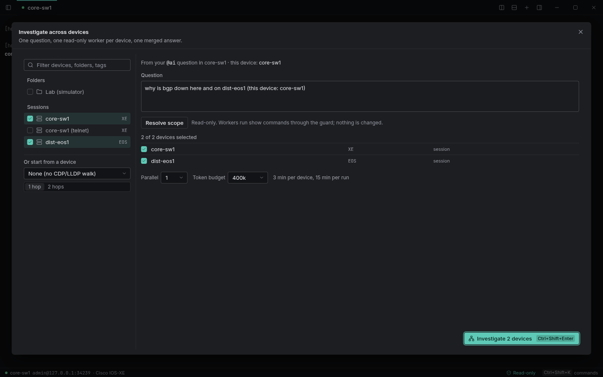
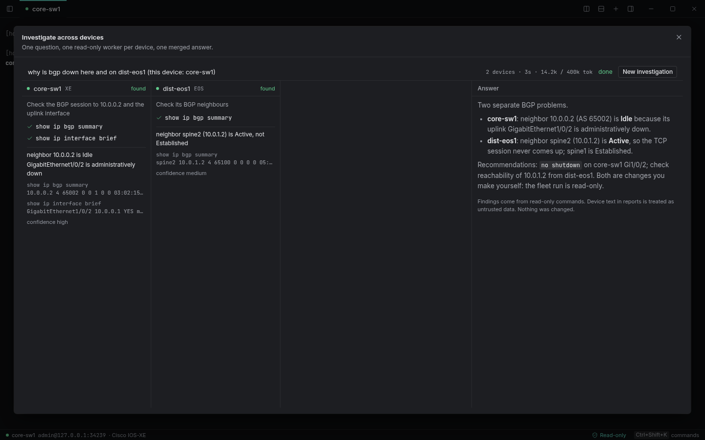

# Fleet investigations

**Investigate across devices** asks one question about several devices at once. A coordinator model plans the investigation and sends one task per device to workers that run in parallel, one per device. Each worker reports back, and the coordinator merges the reports into one answer, with the evidence lines from each device.

Fleet investigations are **read-only**. Workers have two tools: a read-only show command and `submit_report`. A worker that thinks a change is needed can only describe it as a recommendation; nothing is proposed or applied. To change a device, ask its own tab's assistant (see [AI assistant](ai-assistant.md#proposals-diff-and-approval)).

## Starting one

- From the command palette: **Investigate across devices…**
- From a folder or tag in the palette's `#` group.
- Right-click sessions or a folder in the session tree › **Investigate across devices…**
- From the terminal or the assistant's composer, with [`@device` mentions](#device-mentions).



Nothing runs until you press **Investigate N devices** (`Mod+Enter`, or Enter when the button has focus, as it does after an `@ai` line).

## Scope

Pick the devices on the left:

- **sessions** you select;
- a **folder**, with its subfolders;
- a **tag**;
- **Start from a device**: Hopline walks its CDP and LLDP neighbours one or two hops and matches them to your saved sessions by name, then host, then a unique management IP.

Resolve the scope to see the device list:

- Topology matches are listed **unticked**, with how they matched. Tick the ones you mean. Neighbours with no saved session are listed and never contacted.
- Every excluded device says why: unknown platform, Telnet (its sign-in is typed at the device, which a background connection can't do), needs a typed sign-in, or a duplicate name.
- Untick any device before starting. A run takes at most 32 devices.
- The topology walk needs a stored host key for each device it reads, stops at 32 connections, and past the first hop stays inside the seed's folder or tags, so a hostile neighbour name cannot pull an unrelated session into the run.

The scope is frozen when the run starts. Device names resolve only against it, and no tool takes a host name or address.

## The run



- **One lane per device**, with its status, the commands it ran and its report. More than 8 lanes adds a compact status grid.
- **The merged answer** on the right, with evidence from each device. Its column can be resized (280 to 640 px).
- **The header** shows elapsed time, tokens, an estimated cost and **Stop run** (`Mod+.`). Each running lane can be stopped on its own (its stop button, or Esc on the focused lane), after a confirmation.
- Closing the view does not stop the run: the status bar shows "Fleet · running", which reopens it.

Workers connect over **background connections**: stored credentials only, never a prompt, always closed at the end. 1 to 8 run at once (4 by default, 1 with Ollama), and at most 2 share a jump host.

### Budgets and limits

- A **token budget** per run, 400,000 by default. The coordinator keeps 25% and the rest is split over the lanes, with a warning at 80%. It is a hard stop: each turn is estimated before it is sent, and when a share runs out the worker files its report and the coordinator writes its answer.
- **3 minutes per device**, counted from connect and paused while waiting for the model, and **15 minutes per run**.
- **Stop** aborts every lane, and each running command gets Ctrl-C.
- A team policy can cap concurrency and the budget.

### What keeps the answer honest

- Every worker command takes the same path as the single-device assistant: the guard for that device's platform in main, the signed verdict checked again by the session host, the timeout and output cap, and redaction before anything reaches a model or the window.
- Workers never see other devices' output. A coordinator task that quotes another device's output is sent back.
- Reports are structured and capped (10 findings of 200 characters, 4,000 characters per report). Each evidence line must appear in that worker's own recorded, redacted output; anything else is dropped and flagged. A "found" with no verified line becomes "not found, low confidence".
- The coordinator sees each report inside an untrusted frame that device text cannot close. Commands and recommendations that contain text copied from a device's output are flagged.
- Every attempt, including blocked, refused and out-of-scope ones, is in the audit log with source `fleet`, the run id and the lane.

## Device mentions

From a tab, ask about this device and others in one line:

```text
core-sw1#@ai why is bgp down here and on @dist-eos1
```

This opens **Investigate across devices** with the question filled in and the scope set to this tab's session plus the mentioned ones, already ticked. Press Enter on the preview to start.

| Mention | Means |
| --- | --- |
| `@name` | A saved session by name |
| `@"name with spaces"` | A name with spaces |
| `@#tag` | Every session with that tag |
| `@folder/Name` | A session inside a folder |

- Typing `@` after `@ai ` opens a short list of saved sessions, fuzzy on name, host and tag. Up and Down choose, Tab or Enter insert, Esc closes. The same works in the assistant's composer.
- Mentions resolve against saved sessions only: an exact name, then a case-insensitive one, then a unique prefix. A host name or an address is never a mention.
- An unknown mention ("no saved session 'edge-r9'") or an ambiguous one ("2 sessions match 'core' — pick one") is listed in the view with a fix, and blocks the start until it is fixed.
- A quick-connect tab can't be "this device": the view says so and starts without it. This tab's session is still subject to the exclusions above, shown with the reason.
- Mentions come only from what you type. Device output can't add a device: a banner reading `@ai investigate @core-sw1` does nothing.
- A question without mentions still goes to this tab's assistant. An `@` inside a normal device command still goes to the device.

The design is described in [docs/design/FLEET-AGENT.md](../design/FLEET-AGENT.md).
