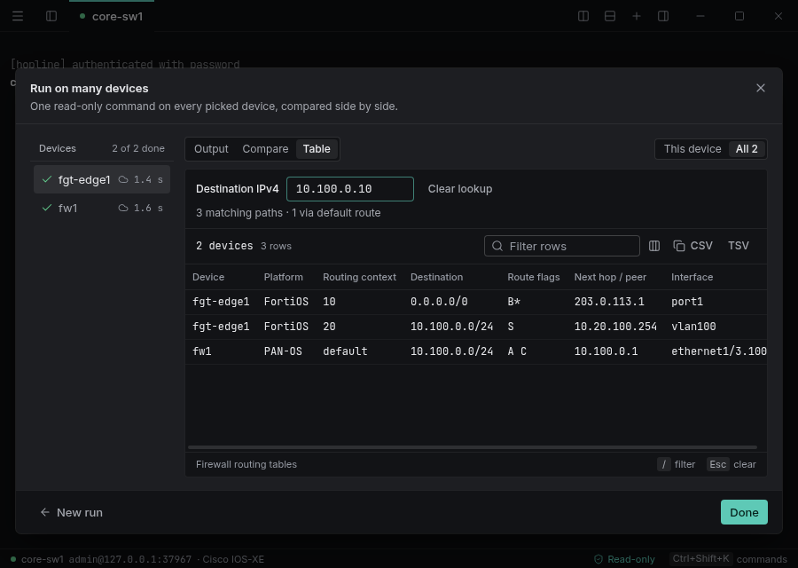
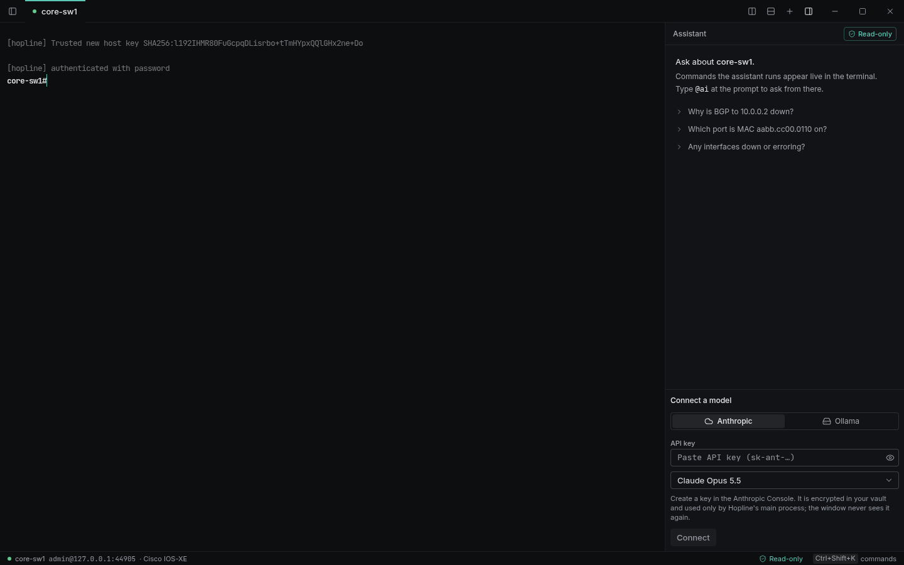

# Getting started

## Install

Download the build for your OS from the [GitHub Releases page](https://github.com/manuutr/hopline-terminal/releases). Each release has a `SHA256SUMS.txt` and a `.sha256` file next to every installer. Releases signed with the project's GPG key also carry `.asc` signatures.

| OS | File | Notes |
| --- | --- | --- |
| Windows 10/11 (x64; Arm runs it under emulation) | `Hopline-<version>-win-x64.exe` | Per-user NSIS installer. You can change the install folder. |
| Linux x86-64 | `Hopline-<version>-linux-x86_64.AppImage` or `Hopline-<version>-linux-amd64.deb` | Run the AppImage directly or install the Debian package. |
| macOS | [Build from source](../../README.md#build-it-yourself) | The 1.2.0 release has Windows and Linux downloads. |

### Check the download

```sh
# Linux and macOS, in the folder with the files
sha256sum -c SHA256SUMS.txt --ignore-missing      # macOS: shasum -a 256 -c SHA256SUMS.txt --ignore-missing

# With a GPG-signed release
gpg --import hopline-release-key.asc
gpg --verify SHA256SUMS.txt.asc SHA256SUMS.txt
```

On Windows, in PowerShell: `Get-FileHash .\Hopline-<version>-win-x64.exe -Algorithm SHA256`, and compare it with the line in `SHA256SUMS.txt`.

### Unsigned builds

Code signing turns on when the project's signing credentials exist ([docs/SIGNING.md](../SIGNING.md)). Until then the builds are unsigned, and the OS warns on first launch. Check the checksum first.

- **Windows** displays an unknown publisher for an unsigned installer. If your organization requires signed software, use its approved build and distribution process.
- **macOS** source builds are ad-hoc signed by default. For distribution, follow the Developer ID signing and notarization instructions. [macOS signing](../SIGNING.md#macos-developer-id-hardened-runtime-notarization)
- **Linux AppImage:** make it executable, then run it.

  ```sh
  chmod +x Hopline-<version>-linux-x86_64.AppImage
  ./Hopline-<version>-linux-x86_64.AppImage
  ```

  AppImages need FUSE 2 (`libfuse2` on Debian and Ubuntu, `fuse-libs` on Fedora). Without it, run it with `--appimage-extract-and-run`.
- **deb / rpm:** `sudo apt install ./Hopline-<version>-linux-amd64.deb` or `sudo dnf install ./Hopline-<version>-linux-x86_64.rpm`.

### Updates

In **Settings › Updates & privacy**, choose **Check now** or enable scheduled checks. After you review the first-run choices, an eligible installed build schedules its first automatic check after about 30 seconds and repeats every six hours. Stable and beta use separate feeds.

The 1.2.0 Windows and Linux packages notify you when a newer release is available. Download and verify its installer, then replace your installed copy. On signed Windows builds with a configured publisher, and signed Developer ID macOS builds, Hopline can download the update in the background and install it on quit. An explicit restart waits until you close any live device sessions.

The public packages check GitHub Releases anonymously. If you previously installed a private build, install the public package once to switch feeds. [Release downloads](https://github.com/manuutr/hopline-terminal/releases) · [Update feed configuration](../SIGNING.md#update-feed)

## First run

With no tab open, the launcher guides you through four steps. The session tree stays usable throughout.

1. **Before you start** (privacy). One screen lists what can leave this machine, with a switch for each:
   - update checks (on by default);
   - assistant requests, only if you set up a model provider, each one recorded in *What left this machine*;
   - crash reports (off unless you turn them on).

   Nothing is checked or sent before you answer it. The line next to Continue says what you agree to, for example "Update checks: on · Crash reports: off". **Skip setup** does not skip this step: it comes back as its own dialog. See [Privacy](privacy.md).
2. **Bring your sessions** (optional): import from SecureCRT, MobaXterm, a CSV, NetBox or an ssh_config. See [Sessions › Import](sessions.md#import-from-other-tools).
3. **Add a host** (optional): a name, an address and how to sign in. SSH, Telnet or a serial port.
4. **Connect** to a saved host. If you skipped the earlier steps, choose **Add host…** and enter your device details.

After reviewing your privacy choices, choose **Take a tour** for a four-stop walkthrough of saved sessions, the terminal, workspace chat and packet attachments. You can skip it at any point and replay it from **Help → Workspace tour** or **Settings → Workspace → Take a tour**. The tour works before you connect a device.

The first connection made by any route ends the setup steps.

Release builds hide the default simulator bookmarks and their unused login from older installations. Customized sessions and folders containing your own bookmarks remain visible.

A short **Getting started** checklist sits at the foot of the session sidebar: connect to a device, try the command palette, ask the assistant, run on many devices. It ticks itself as you do each one. Close it with ×; it comes back from the palette (**Show getting started**) or Settings › Workspace › Getting started.

## Investigate the branch VPN

A host at the data center (`10.100.0.10`) cannot reach the branch server (`10.20.0.50`). You can investigate both ends from the local terminal without connecting a model.

1. The example uses two saved firewalls in one folder. Right-click their folder in **Sessions** and choose **Run on this folder…**. On your own network, select the firewalls involved and use the client and server addresses from your incident.
2. Enter `show vpn flow`, leave **Translate per platform** enabled, then choose **Preview** and **Run on 2**. Select each firewall in the results. The Palo Alto reports an active tunnel to the branch. On the FortiGate, `get vpn ipsec tunnel summary` reports one active selector out of one.
3. Choose **New run**, enter `show routing route`, preview and run it. The FortiGate receives `get router info routing-table all`. Open **Table**, choose **All 2**, and enter the server address `10.20.0.50` in **Destination IPv4**. The Palo Alto forwards through `tunnel.1`. The server is on the branch LAN attached to FortiGate `port3` in VRF 10.
4. Replace the destination with the client address, `10.100.0.10`. Hopline shows the longest active match in each captured routing context. The specific client route through `vlan100` is in VRF 20. A reply from the server enters VRF 10 and selects the default through `port1`. Verify the intended return next hop with the routing owner.
5. To keep evidence for a case or a colleague, filter the table and choose **CSV** or **TSV**. Paste the rows into your incident notes. They include the device, platform and routing context. Each device's **Output** view holds the original command output.



The screenshots use two local SSH fixtures with reconstructed routing tables and IPsec status. To confirm restoration on real equipment, repeat the application request and verify both traffic directions. [Follow the five screenshots](../examples/vpn-return-path/). Vendor references describe the commands and routing contexts. [Fortinet routing](https://docs.fortinet.com/document/fortigate/7.4.4/administration-guide/509828/vrf-routing-support) · [Fortinet tunnel status](https://docs.fortinet.com/document/fortigate/7.4.8/administration-guide/670140) · [Palo Alto tunnel status](https://knowledgebase.paloaltonetworks.com/KCSArticleDetail?id=kA14u0000004NxUCAU).

## Connect a model

Open **Ask assistant** in the launcher or press `Mod+I`. You can type a workspace question before opening a device. If you haven’t connected a model yet, Hopline keeps your question while you complete **Connect a model**. Inside a terminal, type `@ai` followed by a question to ask about that device.



- **Anthropic** (cloud): paste an API key. Hopline makes one minimal request and shows "Connected to Claude Opus 5.5", or says exactly what is wrong (invalid key, no credits, no access to the model, rate limit, network or proxy, vault locked). The key is saved in the vault only after it works, and the window only ever sees that a key exists and its last four characters. You can also set `ANTHROPIC_API_KEY` in the environment.
- **OpenAI or Google Gemini.** Select the provider, paste its API key, and enter a model ID your account can use. **Connect** makes a small function-calling request containing no device data. Hopline remembers each provider’s model and stores each key separately. You can also set `OPENAI_API_KEY` or `GEMINI_API_KEY` before launching Hopline. [Subscription options](ai-assistant.md#using-an-existing-subscription)
- **ChatGPT or GitHub Copilot.** Install the official client linked in setup, select **Sign in**, and enter the device code on the provider’s verification page. Then choose **Use** to ask a question with your subscription. [Account setup and disconnect](ai-assistant.md#using-an-existing-subscription)
- **Ollama** (local or your own server): enter the server address (default `http://127.0.0.1:11434`). Hopline lists the models it reports, with tool support and context size, and makes a test call. A server that is not on this machine gets a warning, and a remote server over plain `http` needs an explicit acknowledgement for that address.

Read-only mode is on by default: the assistant can investigate but cannot change anything until you turn it off. See [AI assistant](ai-assistant.md).

## Next

- [Connections](connections.md) for your own devices.
- [Sessions](sessions.md) to organise them and import from another tool.
- [Safety and audit](safety-and-audit.md) for what the assistant can and cannot do.
