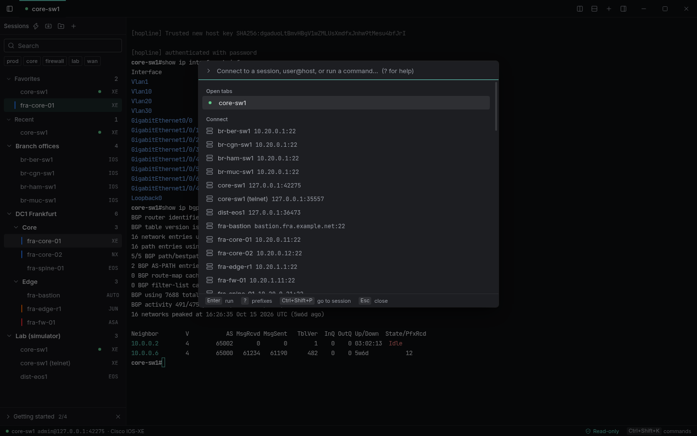
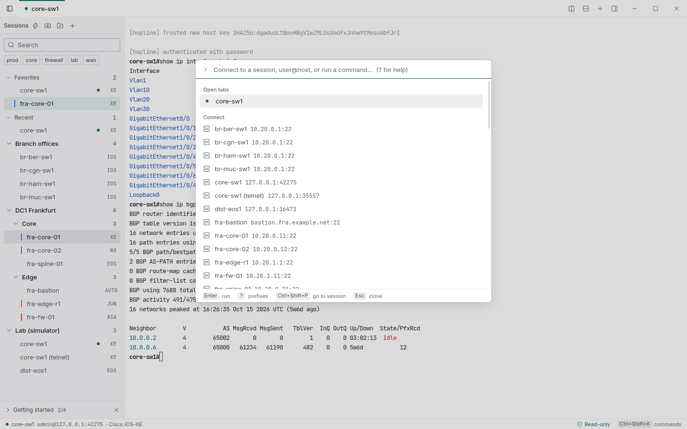
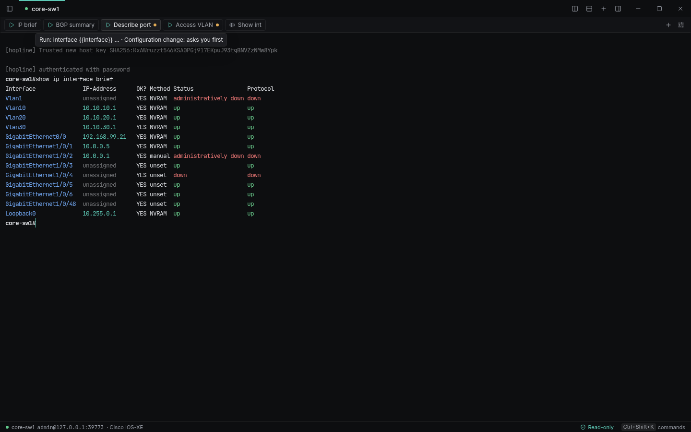
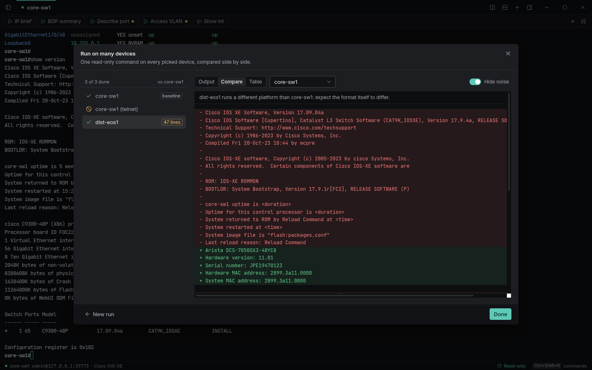
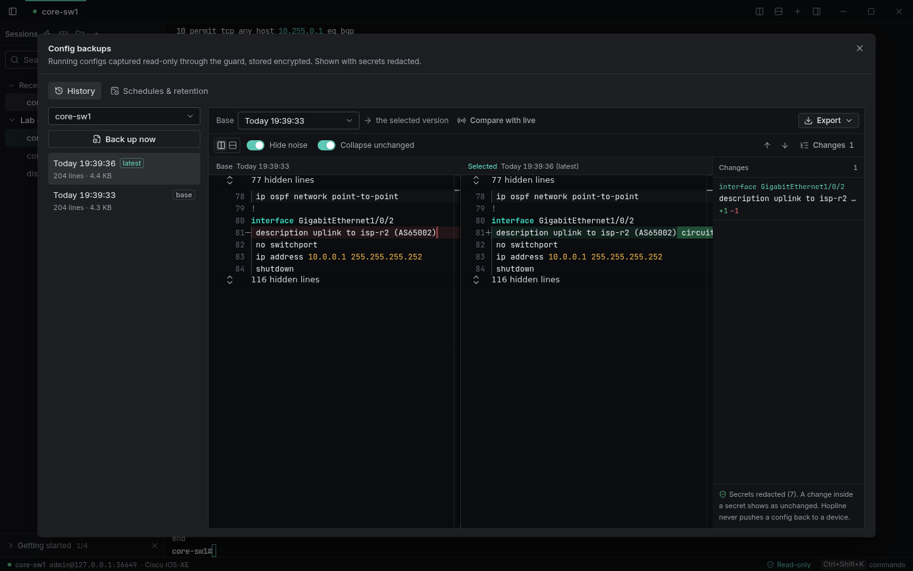
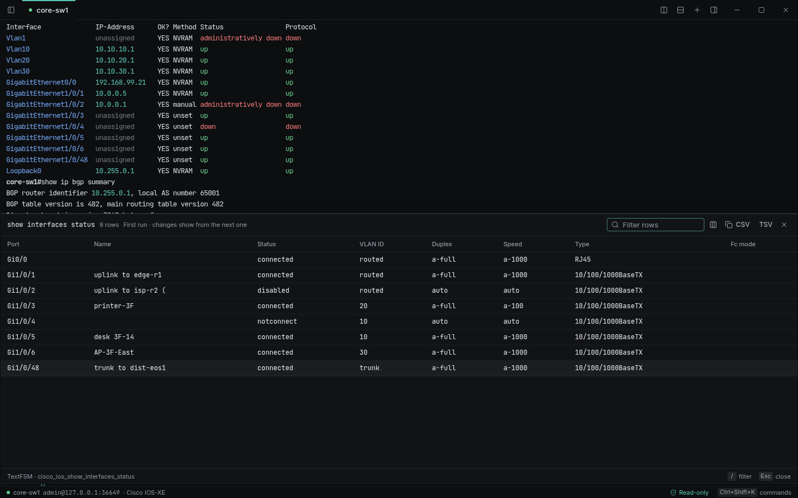

# Productivity

Everything here that sends a command to a device goes through the same guard as the assistant: the command is classified for that device's platform, blocked commands never run, configuration needs your confirmation, and every attempt is in the audit log. With [read-only mode](safety-and-audit.md#read-only-mode) on (the default), only read-only commands are sent.

## Command palette

`Mod+K` opens the palette from anywhere (plain `Ctrl+K` works too when the terminal does not have focus). Every action is listed, including the ones with no shortcut. Prefixes narrow it:

| Prefix | Lists |
| --- | --- |
| `>` | commands |
| `@` | sessions and open tabs |
| `#` | tags and folders: pick one to list its sessions, then run on, send to, back up or investigate all of them |
| `!` | snippets |
| `?` | help |

Settings search (inside Settings) covers every setting and every shortcut, with synonyms: "anti-idle" finds Keep-alive. See the [settings reference](settings-reference.md).

## Session overview

Open **Overview** in the status bar or **View › Session overview…** to see connections in this window. Filter by **Open** or **Closed**, or search by name, host, protocol or folder. The accent bar marks the active tab. Selecting an open connection focuses its pane. Selecting a closed saved session opens it through the usual sign-in flow.

## Scratchpad

Choose **View › Open scratchpad…** to write an investigation note. To include terminal evidence, select the output, right-click and choose **Add selection to scratchpad**. Hopline adds the tab name and the complete selected lines, with recognised secrets masked. You can close and reopen the scratchpad while you work in this window. Choose **Save as text…** to keep the note after the window closes.

## Snippets and the button bar

A snippet is a saved command or block of lines. Manage them with **Snippets…** in the palette.

- **Scope:** everywhere, a folder (and its subfolders) or one session, optionally limited to some platforms.
- **Variables** such as `{{interface}}`, `{{vlan}}`, `{{vrf}}` and `{{neighbor}}` are filled in a small form, which suggests values the terminal learned from listings you ran.
- **Insert** types one line at the prompt without Enter. The guard still checks it, and a blocked command is never typed. Nothing runs until you press Enter yourself.
- **Run** goes through the guard: show commands run at once; configuration shows the exact lines in the platform's wrapper (`configure terminal` … `end`, `commit` …) and asks first; disruptive commands need the device's hostname typed; blocked commands never run. Exec commands that change state (`clear`, `debug`) are never wrapped in a configuration session, and an exec command Hopline cannot resolve is refused rather than guessed.

The **button bar** is an optional slim row under the tabs with the snippets for the focused session (**Show/Hide the button bar** in the palette, or Settings › Workspace › Appearance). Drag buttons to reorder them; right-click one to edit it. A coloured dot shows the guard's view of a button: amber for configuration, red for disruptive.

## Send to many devices

**Send to many devices…** (palette, the tab menu, or right-click a folder or a selection in the tree) sends the same lines to several devices. Pick open tabs, sessions, folders or tags.

- The preview shows the exact lines each device will get, classified by the guard for that device's own platform.
- Configuration needs one explicit confirmation. Disruptive and blocked commands are never sent to several devices; the preview gives the reason per device.
- A results panel shows each device's status and output, up to 8 devices at a time, with **Stop all**.

Each target is bound to the hostname its prompt showed at preview, so a tab that has since hopped to another device (a nested `ssh`) is refused.

## Run on many devices

**Run on many devices…** (`Ctrl+Shift+M` on Windows and Linux, `⇧⌘M` on macOS) runs one read-only command in parallel.

- **Translate per platform** sends each platform its own equivalent: `show interfaces status` becomes `show interfaces terse` on Junos and `show interface status` on NX-OS.
- Open tabs are reused. Other devices are reached over hidden background connections that use stored credentials only: no prompts, no auto-reconnect, closed when done. A session that needs a typed sign-in (Telnet, or "ask every time") needs an open tab.
- Results show each device's output, a **Compare** view against a baseline device with **Hide noise** (clocks, uptimes, counters), and a **Table** tab with the output parsed by TextFSM. **All devices** merges every device's rows under a Device column.

A run of `show routing route` on Palo Alto and Fortinet firewalls translates to each device's routing-table command. Choose **Table** and **All** to compare prefixes with their device, routing context, flags, next hop and outgoing interface. Enter a host address in **Destination IPv4** to find the longest matching active prefix per device and routing context, including equal-cost paths. The lookup runs on captured rows. A row-limit notice means a more specific path may exist outside the captured table. Select **This device** for its native columns. Filtering and choosing **CSV** or **TSV** copies the visible evidence for your case notes. [Try the branch VPN incident](getting-started.md#investigate-the-branch-vpn).

### Copy evidence for a ticket

Choose **Copy run report** in the results footer for Markdown with each target’s identity, platform, requested command, result and captured output. Failed targets retain their reason. **Session → Reopen last multi-device results** brings the results back after you close them, until you start a new operation or close the window.

For a single command, hover its terminal block or right-click and choose **Copy for ticket**. Hopline keeps line breaks, masks recognised secrets and marks any omitted middle section in long output. Both actions write to the local clipboard.

## Config backups

Back up the running configuration from a tab (tab menu › **Back up config**), a selection in the tree, or on a schedule (folder menu › **Schedule backups…**). **Config history…** opens a device's versions.

- **Capture:** each platform's own read-only command runs through the guard and is audited as `backup`. Sessions without an open tab are reached over a background connection (stored credentials only).
- **Schedules** are per folder or tag, daily or weekly at a set time, and run while Hopline is open. A missed run catches up once at start.
- **Storage:** history is encrypted with the vault's key, identical configs are kept once, and retention is configurable.
- **Binding:** each version stores the hostname the prompt showed. A capture whose prompt shows another device is refused, so a hop can't file one device's config under another. A real rename shows **Device renamed: accept <new>**.
- **Diff viewer:** compare any two versions, or a version against the live config, side by side or inline, with sticky section headers, a change list and **Hide noise** (timestamps, byte counts, NTP clock period, certificate blobs, uptime).
- **Secrets** are shown redacted, and an export is redacted unless you confirm otherwise.

Hopline never pushes a configuration back to a device: there is no restore.

## Parsed tables

Use the bottom-right grip to resize the multi-device results viewer horizontally and vertically. Focus the grip to use the arrow keys, Home for the default size or End for maximum size. The terminal’s docked table has a top-edge grip.

Hopline bundles a TextFSM engine and 358 ntc-templates, covering Cisco IOS and IOS-XE, NX-OS, IOS-XR, ASA, WLC and SG first, then EOS, Junos, PAN-OS, FortiOS, AOS-CX and VRP. When a command block's output parses, the block toolbar offers **Show as table** (`Mod+Alt+T`):

- sort and filter rows, choose columns, copy as CSV or TSV;
- **changed since last run** highlights new rows, changed cells (with the old value) and removed rows, compared with the previous run of the same command on the same session.

Parsing runs in a worker with a time budget, so hostile or huge output cannot hang the window. The assistant also gets the parsed rows next to the raw output when a template matches.
