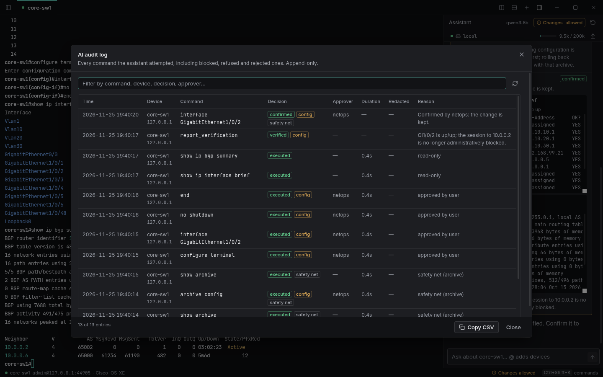
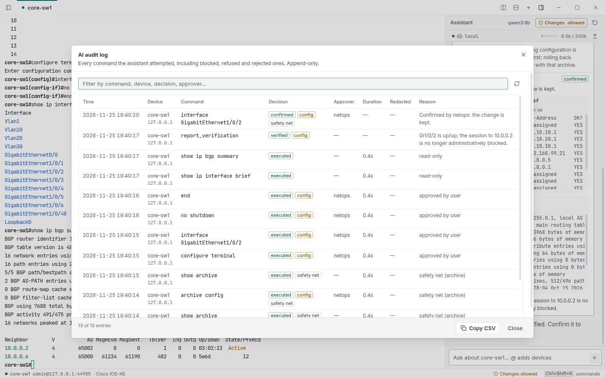

# Safety and audit

Hopline Terminal sends commands to devices for you in several ways: the assistant, fleet workers, snippets, the button bar, send to many, multi-device runs, command block re-runs, config backups and the auto-detect probe. All of them go through the same rules. What you type into the terminal yourself is never filtered.

All enforcement runs outside the window. The window, and the model, can only ask.

- **Main** (Hopline Terminal's main process) classifies every command, owns approvals, the audit log, credentials and host keys.
- **The session host** (a separate process) owns every device connection. It writes a command Hopline Terminal generated only with an HMAC-signed verdict from main, bound to that tab, that exact command, its kind and the device's hostname, and it checks the deny-list again itself.

The design is in [ARCHITECTURE.md › Security model](../ARCHITECTURE.md#5-security-model).

## The classifier

Every command is classified by `@hopline/guard`, using the command tree of the session's platform from `@hopline/cli-model`, as one of:

| Kind | Meaning | What happens |
| --- | --- | --- |
| `read` | Provably read-only | Runs (the assistant runs it by itself) |
| `config` | Changes configuration | Needs your approval of the exact lines, and read-only mode off |
| `disruptive` | Drops traffic or sessions (`clear ip bgp *`, interface `shutdown`, trunk VLAN lists) | Needs approval **and** the device's hostname typed |
| `blocked` | On the deny-list, or not safe to send at all | Never runs, whatever you approve |

- **Default-deny.** Anything not provably read-only is not read-only. A command the tree does not know is not a read. On a session whose platform is Auto-detect or unknown, everything Hopline Terminal would send is refused.
- **Abbreviations** are expanded with the platform's own vocabulary. If any possible expansion is dangerous, the command is blocked: `rel` could be `reload` or `release`, so it is blocked; `wr er` is `write erase`.
- **State-changing exec commands** (`clear`, `debug`, `monitor`, `test` …) are not read-only, so the assistant can't run them without a proposal, and many are blocked outright.
- **Mode changes** as single lines are refused (`configure terminal`, `enable`, `exit`, Junos `configure`, VRP `system-view` …): Hopline Terminal enters and leaves configuration itself with the platform's wrapper.
- **Pipes:** only the platform's read-only filters (`include`, `exclude`, `begin`, `section`, `count`, `match` …). Redirects and file writes (`| redirect`, `| tee`, `show … to-file`, `tftp:` targets) are blocked, and the Linux filters on EOS, NX-OS and IOS-XR take only a fixed set of short options. Control characters, `;`, backticks, `$(` and `do`/`run` wrappers are rejected.
- **Configuration mode** on NX-OS, ASA, EOS, AOS-CX and VRP also accepts exec commands, so the exec deny-list applies there too. On every other platform, a line the configuration tree doesn't know is still checked against the exec deny-list: FortiOS `execute reboot` inside a `config` block is blocked.
- **Negations.** `no X`, `default X` and VRP `undo X` are blocked when `X` is, unless the tree lists that negation itself. So `no boot system`, `no crypto pki …` and `no event manager …` are blocked, while `no shutdown` and `no logging console` stay ordinary configuration.
- **Ping and traceroute** are read-only only within limits, on every platform: at most 10 packets, 1,500 bytes, a 5 s timeout and a TTL of 64, with no flood, payload or option Hopline Terminal doesn't know. Junos and PAN-OS need an explicit count (`rapid` on Junos counts). Past a limit the probe is `config`: it needs your approval, and the assistant can't run it in read-only mode. Abbreviated options are resolved like the device does (`rep` is `repeat`; an ambiguous `s` is refused).
- **A ping or traceroute to a name** is a DNS lookup, which can carry data out of the network in the name itself. The assistant runs a probe to an IP address by itself; a probe to a name shows a one-click card first (refused in read-only mode). A fleet worker may only probe IP addresses that appear in its own device's output or task.
- **Unknown commands.** A line Hopline Terminal's command tree doesn't recognise is `config` (default-deny). The approval card marks it: "Hopline Terminal doesn't recognise this command". Read-only mode and fleet runs refuse it.

### The deny-list

The deny-list is part of each platform's command tree (`packages/cli-model/src/trees/`). No approval, team policy or setting can allow what it blocks. On Cisco IOS and IOS-XE it includes `reload`, `erase`, `write erase`, `format`, `delete`, `rename`, `mkdir`, `squeeze`, `fsck`, `tclsh`, `guestshell`, `install`, `upgrade`, `license`, `test`, `hw-module`, `redundancy`, `request`, `archive`, `setup` and nested `telnet` / `ssh`. `copy` is blocked too, except `copy running-config startup-config`, which saves the configuration and is a `config` command that needs approval. Other platforms have their equivalents (Junos `request …`, `configure replace`, NX-OS `checkpoint`, ASA `changeto` and so on). A [team policy](team-policy.md) can add commands to it, never remove them.

The safety nets' own lines (`archive config`, `configure replace … force`, `commit confirmed`, `configure session … commit`, checkpoint rollback) stay blocked for the assistant. Hopline Terminal generates them itself from fixed templates, and the session host accepts them only when they match a template exactly, on the approved device, outside read-only mode.

## Approval

- **Bound to the stored lines.** A proposal's lines are stored in main; the window sends back only the proposal's id and which lines are ticked. Main checks the ticked subset again and runs the stored lines.
- **Bound to the device.** The prompt's hostname is signed into each line's verdict. If the prompt shows another device (a nested `ssh` or `telnet` hop), the line is refused.
- **Disruptive lines need the hostname typed.** Main checks it, and the session host checks it again against the prompt.
- **The card says when Hopline Terminal is unsure.** A line no command tree models is flagged "Hopline Terminal doesn't recognise this command"; a held read (a ping to a name) says why it is held.
- **Approve arms after a short delay**, and desktop notifications only bring the window forward: nothing is ever approved from a notification.
- **Execution stops at the first device error** and reports what ran.

The copied-text hint looks for matching spans of at least 24 characters. Review every proposed line, including short or reworded lines.

## The executor

Before the session host types a command for you, it checks that:

- the session is connected and idle at a prompt of the expected mode, not at `--More--`, a password prompt or an unrecognised screen;
- you have nothing half-typed on the line;
- the device echoes (a tab known not to echo is refused, with how to recover).

It clears the line with the platform's key, types the command without Enter, and presses Enter only when every character came back in the echo at its own position. A wrong or partial echo erases the line and sends nothing. If the line can't be shown empty again, the tab is flagged "the line may hold unsent text": Hopline Terminal types nothing there until you clear the line (Ctrl-U, Ctrl-C or Enter), and the audit row says "typed, not sent".

When a command times out or reaches its output limit, Hopline Terminal sends the platform interrupt (Ctrl-Shift-6 on IOS). If the prompt does not return, take control in the terminal. Hopline Terminal waits for a prompt before sending another command.

While a command runs, your keyboard is locked except Ctrl-C, which cancels it. `--More--` is answered with Space; Hopline Terminal never changes `terminal length` or other session settings.

## Read-only mode

Read-only mode is **on by default**. While it is on, Hopline Terminal sends only read-only commands for you:

- the assistant can investigate but cannot propose changes;
- snippets, the button bar, send to many and multi-device runs send reads only;
- file uploads are refused;
- Confirm and Roll back on a change applied before it was turned on are refused.

It does not affect what you type yourself, or port forwards. The status bar says **Read-only** or **Changes allowed**; click it to open the setting. The palette has **Turn read-only mode on** / **off**. A team policy can lock it on.

The refusal is enforced in three places: in main for every caller, in the signed verdict (checked again by the session host), and for uploads. Every refusal is audited.

## Secrets never reach the model or the window

- **Redaction.** One table of rules (`REDACT_RULES` in `@hopline/guard`) is used everywhere text leaves main: prompts, the egress log, the window's previews, crash reports and the audit log. Only the secret itself is replaced, so the line's addresses and names stay readable. It covers enable secrets, type 5/7/8/9 hashes, SNMP communities and v3 keys, TACACS and RADIUS keys, key-strings, BGP and OSPF passwords, pre-shared keys, PEM and PuTTY keys (whole or cut off), Junos `$9$` and `SECRET-DATA`, PAN-OS XML secrets. The audit log records how many items were masked. Output is redacted before it is filtered, so a grep pattern can't probe for a secret.
- **Credentials** are decrypted only in main, never sent to the window, never put in a prompt. See [Sessions › The vault](sessions.md#the-vault).
- **Terminal escapes** are stripped from device text before a model or the assistant panel sees it, including OSC, DCS and other control strings, bidi and zero-width characters. The assistant and fleet panels have no link or clipboard sink a device could reach.

## Limits

| Limit | Default | Where |
| --- | --- | --- |
| Command timeout | 30 s, then interrupt | Settings › Assistant |
| Output per command | 512 KB, then interrupt | Settings › Assistant |
| Output sent to the model per command | 40,000 characters, with a note | Fixed |
| Model turns per question | 16 | Fixed |
| Tool calls per model turn | 8 | Fixed |
| Token budget per question | 200,000 | Settings, capped by a team policy |
| Fleet run | 400,000 tokens, 3 min per device, 15 min per run, 32 devices | Fleet view, capped by a team policy |

## The audit log

**Open audit log** in the palette. Every command Hopline Terminal sent or tried to send for you is recorded, whether it was executed, blocked, refused, rejected, timed out or cut off, with:

- time, session, host;
- source: `agent`, `fleet`, `snippet`, `multi` (send to many and multi-device runs), `backup`, `transfer`, `forward`, `safety-net`, `app` (the auto-detect probe), `user` (block re-runs and suggestions you clicked);
- the command, its kind and the decision (`executed`, `blocked`, `refused`, `rejected`, `timeout`, `capped`, `error`, `inserted`, `cancelled`, `verified`, `not-verified`, `confirmed`, `rolled-back`, `expired`, `unknown`);
- the reason, the approver (your OS user name), duration, bytes and the number of secrets redacted;
- for fleet runs, the run id and the lane.

The filter matches command, device, decision and approver. **Copy CSV** copies the rows shown. The table is append-only: SQLite triggers refuse updates and deletes.

Commands and reasons are stored redacted, with the same rules as everything else: a password typed into a command line (`snmp-server community …`, `username … secret …`) is never written to disk in clear. Each row also keeps a keyed hash of the original command (HMAC-SHA256 with a key derived from the vault's key), so two rows can be compared without storing the secret; the hash is empty while the vault is locked. Rows written by older versions are redacted once at startup, the only time Hopline Terminal rewrites the table; it happens again only when the redaction rules change.

## What never leaves the machine

- Passwords, private keys, passphrases and the API key.
- Unredacted device output.
- Your session list, host names and addresses, except where you send them yourself: a host name you type in a question, or device output (redacted) the assistant reads.
- Anything at all when no model is configured and update checks and crash reports are off.

See [Privacy](privacy.md) for the full list of what can leave, and when.
