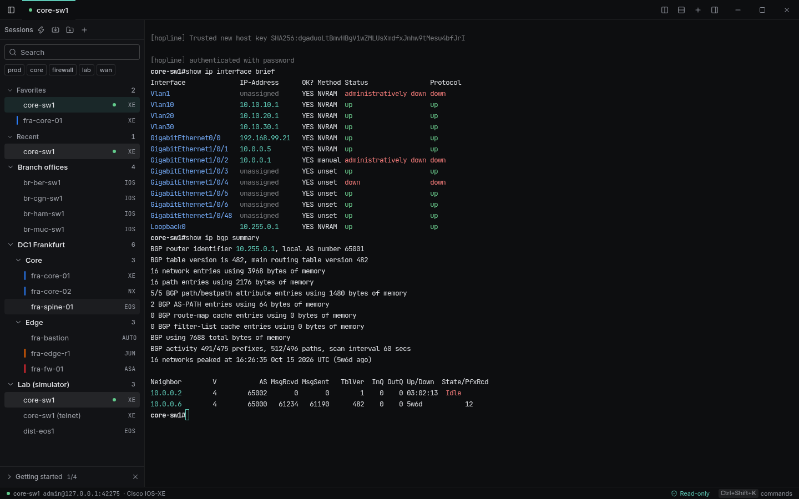
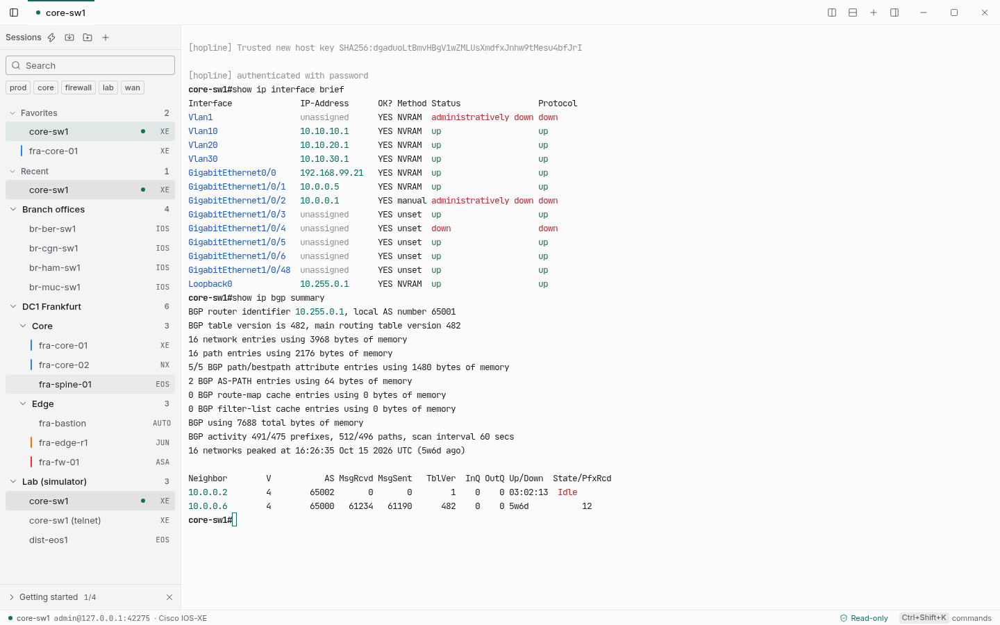
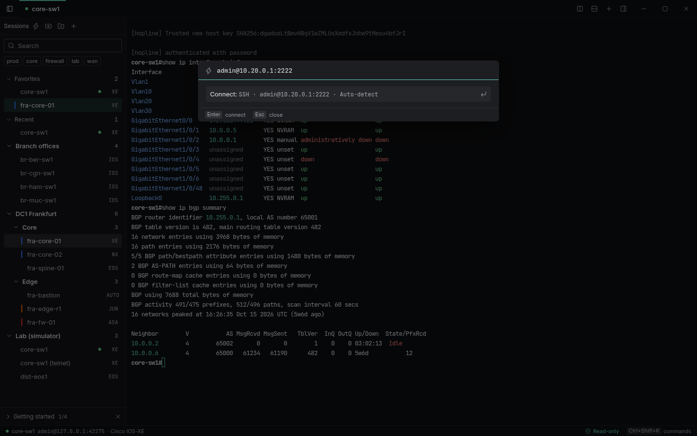
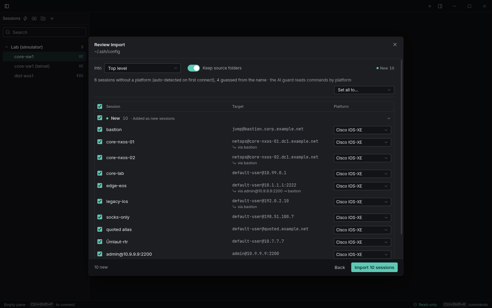
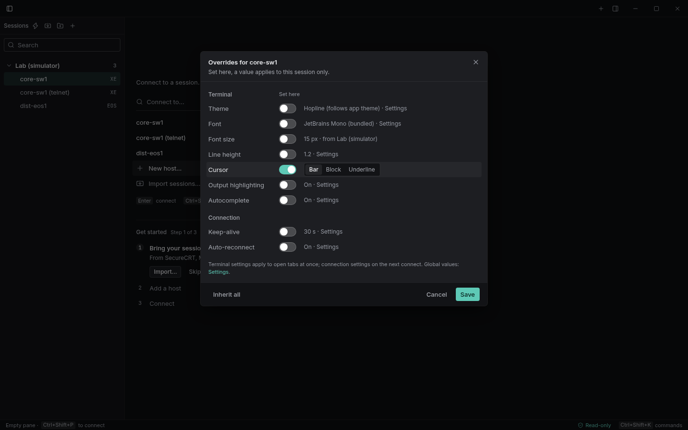

# Sessions

A session is a saved device: its address, protocol, platform, credentials and options. Sessions live in a tree of folders in the session sidebar.

The sidebar stays visible when you connect. **Open connections** lists your terminal tabs above the saved devices. Select a row to switch terminals or use its × to close it. Hide or show the sidebar with `Mod+B` or the title-bar button.

## The tree

- **Folders** nest to any depth. Drag sessions and folders to move them; a folder can never end up inside itself.
- **Tags** are free-form lowercase labels (`core`, `prod`, `dc1`). The chips above the tree filter by tag.
- **Colors** mark a session with a short dash in its connection row and a marker in the tree.
- **Favorites** and **Recent** sit at the top.
- **Search** filters by name, host and tag and highlights the matches.
- **Multi-select** (Ctrl/⌘-click, Shift-click) opens **bulk edit**, and the context menu works on the whole selection: run on, send to, back up, investigate across devices.
- **Rename** inline with F2; **duplicate** from the context menu.
- The tree is a single Tab stop: arrow keys move, Enter connects, Delete deletes (with a confirmation).

Right-click a session for its menu: connect (or connect in a split), run on and send to many devices, investigate across devices, back up, config history, edit, overrides, favorites, tags, color, rename and delete. A folder's menu adds a new session or subfolder here, run on or send to the folder, back up the folder, schedule backups, import sessions here and overrides for the folder.

## Quick connect

**Quick connect** (`Mod+O`, or the palette) connects without saving first. It takes:

| Form | Example |
| --- | --- |
| `user@host:port` | `admin@10.0.0.1:2222` |
| `ssh://` | `ssh://admin@core-sw1` |
| `telnet://` | `telnet://10.0.0.1` |
| `raw://` | `raw://console-server:7001` |
| `serial://` | `serial:///dev/ttyUSB0?baud=115200` |

The platform starts as Auto-detect. **Save as session** in the tab menu keeps it.

**Go to session or host…** (`Mod+P`) is the switcher: type part of a name or host to jump to an open tab or connect to a saved session.

## Import from other tools

**Import sessions…** (palette, the first-run steps, or Settings › Sync & export) reads:

- **SecureCRT**: a sessions folder or an XML export;
- **MobaXterm**: an `.mxtsessions` or `.mobaconf` export, or the bookmarks in `MobaXterm.ini`;
- **PuTTY**: a `.reg` export of its sessions;
- **ssh_config**: your OpenSSH config. `Host` entries become sessions and `ProxyJump` becomes a jump host chain; port forwards are kept in the notes only;
- **CSV**: one row per device. Headers are matched loosely: `ip`, `host`, `hostname` or `address` for the address; `name`, `device` or `label` for the name; `port`, `protocol`, `username`, `folder` (or `site`, `group`), `platform` (or `os`), `tags`, `notes`, `baud`;
- **NetBox or Nautobot**: from the API, with a token kept in the vault.

The wizard shows what is **new**, what has **changed** (field by field) and what **conflicts** with an existing session, lets you set platforms in bulk, and applies everything in one transaction. Platforms the importer recognises are mapped; anything else is left on Auto-detect rather than guessed. **Passwords are never imported.**

**Re-sync from NetBox** (or Nautobot) matches devices by their NetBox id. A device that has gone from NetBox is removed only if you tick it.

A session whose address or port forwards change during an import or sync loses its stored credential, so a crafted file can't send your saved password to another host. New sessions' forwards arrive switched off.

## Credential profiles and the vault

A **credential profile** is a username plus one of: a password, a private key, the SSH agent, or ask every time. Sessions point at a profile, so each linked session uses the saved password at its next sign-in. Profiles are managed in Settings › Credentials, or created inline from the session dialog's Credentials field.

After a password changes on your devices or identity provider, select **Settings › Credentials › Update saved passwords…**. Select up to 200 password profiles, review the number of linked sessions, enter the new password twice and choose **Update**. Hopline applies the whole selection together. Existing connections stay open.

Saved secrets are never sent back to the window. The dialog shows that a secret exists, never its value.

### The vault

One random data key encrypts every secret Hopline keeps: device passwords, private keys and passphrases, the API key, the NetBox token, the sync passphrase, saved scrollback, config backups and the egress log. The data key is protected in one of three ways (Settings › Security › Protection):

| Mode | How it unlocks |
| --- | --- |
| **OS keychain** | With your OS login: DPAPI on Windows, the macOS Keychain, libsecret or KWallet on Linux. The default where a keyring exists. |
| **Master password** | Asked at startup and after the auto-lock delay (scrypt). Works without a keyring. |
| **Session only** | The key lives in memory and every secret is forgotten when Hopline quits. |

On Linux without a keyring (common on WSL), the vault starts in session-only mode until you set a master password, and the status bar says so. Hopline never stores secrets with Electron's `basic_text` fallback.

**Auto-lock** locks the vault after 15 idle minutes by default, and when the machine sleeps or the screen locks. Locking drops the key from memory: open sessions keep running, and the next connect that needs a secret asks you to unlock. Changing the protection mode or the auto-lock needs the current master password.

## Encrypted export and folder sync

Settings › Sync & export:

- **Export** writes folders, sessions, credential profiles, portable settings and known hosts to one `.hopline` file, encrypted with a passphrase (scrypt and AES-256-GCM). Secrets are included only if you opt in. There is no recovery without the passphrase.
- **Import from a file** shows what will change before anything is written. A hand-imported file can't retarget a session that keeps its credential, attach a stored credential to a session, pre-trust host keys or change security settings.
- **Folder sync** keeps machines in step through a folder you pick: Dropbox, OneDrive, a Git checkout. Deletions travel as tombstones, so every machine converges. Symlinks are not followed and reads are size-capped.

Config backups are not part of the export; see [Productivity › Config backups](productivity.md#config-backups).

## Per-host overrides

Right-click a session or folder › **Overrides…** (also **Overrides for this session…** in the palette).

You can set: terminal theme, font, font size, line height, cursor, output highlighting, autocomplete, keep-alive, auto-reconnect, and (folders only) log to file.

- A folder's values apply to everything below it, unless a nearer folder or the session sets its own. The dialog shows where each inherited value comes from.
- Terminal settings apply to open tabs at once; connection settings on the next connect.
- Read-only mode, the egress log, budgets and anything a [team policy](team-policy.md) can lock cannot be overridden per host.
