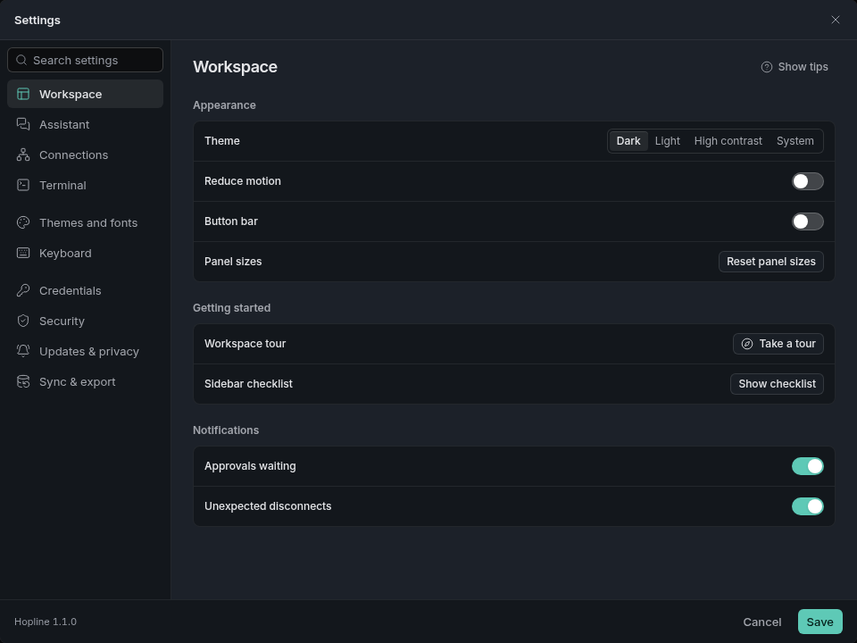
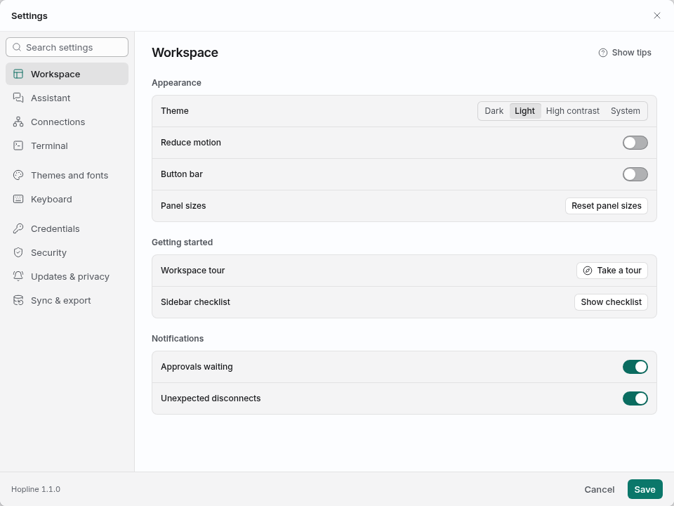

# Settings reference

Open Settings with `Mod+,`. **Workspace** has appearance, onboarding and notification preferences. Use **Assistant** to connect a model, **Connections** for keep-alive and logging, or **Terminal** for text, cursor and input. **Show tips** reveals explanations for the current page.

Search for a setting or keyboard shortcut by name or synonym. For example, search for “anti-idle” and press Enter to reach Keep-alive. Links of the form `hopline://settings/<section>/<key>` open the same controls in installed builds.

Choose **Save** to apply your edits. Some actions apply immediately, including privacy choices. Settings fixed by your organization show **Managed by policy**. Individual connections can also inherit folder preferences. [Team policy](team-policy.md) · [Per-host overrides](sessions.md#per-host-overrides)

The tables below are generated from the settings registry (`apps/desktop/src/shared/settings-registry.ts`) by `npm run docs:reference`; a test fails when a setting is missing here.

<!-- generated:settings -->
<!-- Generated by apps/desktop/scripts/docs-reference.ts. Do not edit by hand. -->

### Workspace › Appearance

| Setting | What it does | Default | Key and deep link |
| --- | --- | --- | --- |
| **Reduce motion** | Keep transitions and the terminal cursor still. Your system’s reduced-motion setting also applies. | — | `reduceMotion` `hopline://settings/appearance/reduceMotion` |
| **Theme** | Dark or light app theme. The terminal follows it unless you pick a terminal theme. | Dark | `theme` `hopline://settings/appearance/theme` |
| **Button bar** | Show saved snippets above the terminal. This takes effect immediately. | Hidden | `buttonBar` `hopline://settings/appearance/buttonBar` |
| **Workspace tour** | Take a four-stop tour of saved sessions, the terminal, workspace chat and packet captures. | — | `workspaceTour` `hopline://settings/appearance/workspaceTour` |
| **Getting started** | Review the getting started checklist in the session sidebar. | Shown until closed | `gettingStarted` `hopline://settings/appearance/gettingStarted` |
| **Panel sizes** | Restore the default sidebar, assistant and file panel sizes. | — | `panelSizes` `hopline://settings/appearance/panelSizes` |

### Workspace › Notifications

| Setting | What it does | Default | Key and deep link |
| --- | --- | --- | --- |
| **Approvals waiting** | A desktop notification when the assistant waits for your approval and Hopline is not the focused window. | On | `notifyApprovals` `hopline://settings/notifications/notifyApprovals` |
| **Unexpected disconnects** | A desktop notification when a session drops without you closing it and Hopline is not the focused window. | On | `notifyDisconnects` `hopline://settings/notifications/notifyDisconnects` |

### Assistant

| Setting | What it does | Default | Key and deep link |
| --- | --- | --- | --- |
| **Provider** | Choose a cloud API, a ChatGPT or GitHub Copilot account, or an Ollama server you control. | Anthropic | `aiProvider` `hopline://settings/assistant/aiProvider` |
| **API key** | Encrypted in your vault. Never sent to the window or put in a prompt. | — | `apiKey` `hopline://settings/assistant/apiKey` |
| **Model** | Choose a Claude model, enter an OpenAI or Gemini model ID, or select a model from your Ollama server. | `claude-opus-5-5` (Claude Opus 5.5) | `aiModel` `hopline://settings/assistant/aiModel` |
| **Ollama server** | Default http://127.0.0.1:11434. Device output is redacted before it is sent. | `http://127.0.0.1:11434` | `ollamaEndpoint` `hopline://settings/assistant/ollamaEndpoint` |
| **Connection** | Makes one minimal request with the values above. Nothing is saved until you press Save. | — | `aiConnection` `hopline://settings/assistant/aiConnection` |
| **Read-only mode** | Restricts automated commands and blocks file uploads. You can still type in the terminal. | On | `aiReadOnly` `hopline://settings/assistant/aiReadOnly` |
| **Run budget** | Tokens one question may use, all model turns together (output counts 5×). The run is told to finish at the limit. A team policy can set a lower maximum. | 200,000 tokens | `aiRunTokenBudget` `hopline://settings/assistant/aiRunTokenBudget` |
| **Log what leaves** | Keep every request sent to a model, exactly as sent (redacted), encrypted on this machine. The oldest are removed past 64 MB. | On | `egressLog` `hopline://settings/assistant/egressLog` |
| **Command timeout** | Per agent command. Ctrl-C is sent when exceeded. | 30 s | `commandTimeoutMs` `hopline://settings/assistant/commandTimeoutMs` |
| **Output cap** | Max output per agent command. | 512 KB | `outputCapBytes` `hopline://settings/assistant/outputCapBytes` |

### Connections

| Setting | What it does | Default | Key and deep link |
| --- | --- | --- | --- |
| **Keep-alive** | SSH keep-alive interval. 0 disables. A session or folder can override it. | 30 s | `keepAliveSec` `hopline://settings/connections/keepAliveSec` |
| **Open Files on SSH connect** | Show the remote file browser when the active SSH session connects. The terminal keeps keyboard focus. | Off | `filesOnConnect` `hopline://settings/connections/filesOnConnect` |
| **Auto-reconnect** | Retry with backoff when a session drops (not on auth or host-key errors). | On | `autoReconnect` `hopline://settings/connections/autoReconnect` |
| **Known hosts** | SSH host keys you trust, and import from OpenSSH. | — | `knownHosts` `hopline://settings/connections/knownHosts` |

### Connections › Logging

| Setting | What it does | Default | Key and deep link |
| --- | --- | --- | --- |
| **Log folder** | Where session logs are written when logging is on. | `Documents/Hopline/logs` | `logDir` `hopline://settings/logging/logDir` |
| **Log file name** | Tokens: %S session, %H host, %P port, %U user, %Y %M %D date, %h %m %s time. Use / for subfolders, e.g. %Y-%M/%S_%D.log | `%S_%Y-%M-%D_%h-%m-%s.log` | `logTemplate` `hopline://settings/logging/logTemplate` |
| **Timestamp each line** | Prefix logged lines with [hh:mm:ss.ms]. | Off | `logTimestamps` `hopline://settings/logging/logTimestamps` |
| **New log file daily** | Long-running sessions roll over to a new file at midnight. | On | `logRotateDaily` `hopline://settings/logging/logRotateDaily` |

### Terminal

| Setting | What it does | Default | Key and deep link |
| --- | --- | --- | --- |
| **Theme** | Colors for terminal output. | Hopline (follows the app theme) | `termTheme` `hopline://settings/terminal/termTheme` |
| **Smooth caret movement** | Ease the blinking bar cursor between cells. | — | `termSmoothCaret` `hopline://settings/terminal/termSmoothCaret` |
| **Font ligatures** | Join operator pairs such as arrows in the terminal font. | — | `termLigatures` `hopline://settings/terminal/termLigatures` |
| **Font** | Any installed monospace font. Empty uses the bundled JetBrains Mono. | Bundled JetBrains Mono | `termFontFamily` `hopline://settings/terminal/termFontFamily` |
| **Size and spacing** | Font size and line height of the terminal. | 13 px, line height 1.2 | `termFontSize` `hopline://settings/terminal/termFontSize` |
| **Cursor** | Block, bar or underline, and whether it blinks. Reduced motion stops the blink. | Bar, blinking | `termCursorStyle` `hopline://settings/terminal/termCursorStyle` |
| **Restore history** | Keep each session's last 5,000 lines, encrypted on disk, and show them when you reconnect. Needs the OS keychain or a master password, set under Security. | On | `termRestoreScrollback` `hopline://settings/terminal/termRestoreScrollback` |
| **Scrollback** | Lines kept per tab. More lines use more memory (about 1 MB per 10,000 lines). | 20,000 lines | `termScrollback` `hopline://settings/terminal/termScrollback` |
| **Output highlighting** | Colors interfaces, IPs, MACs, up/down states, errors and syslog severity. Display only: logs and copy stay plain. | On | `termHighlight` `hopline://settings/terminal/termHighlight` |
| **Screen reader mode** | Reads new output of the active tab through your screen reader, at most once a second, and summarises long output. Mod+Alt+B opens the scrollback as plain text. | Off | `termScreenReader` `hopline://settings/terminal/termScreenReader` |
| **Autocomplete** | Ghost text and command help at the device prompt, from the platform's command model. Tab, → or End accepts; with no suggestion showing, Tab goes to the device. Never sends a command of its own. | On | `termAutocomplete` `hopline://settings/terminal/termAutocomplete` |

### Themes and fonts

| Setting | What it does | Default | Key and deep link |
| --- | --- | --- | --- |
| **Terminal palettes** | Browse built-in and saved terminal palettes, filter by dark or light, and preview device output before saving. | — | `themeLibrary` `hopline://settings/themes/themeLibrary` |
| **Theme generator** | Build a terminal theme from a base and an accent colour (OKLCH). Lightness is tuned until every colour passes WCAG AA. | — | `themeGenerator` `hopline://settings/themes/themeGenerator` |
| **Import and export** | Preview a Hopline, iTerm2, MobaXterm (.ini) or Royal TS (.rtcp or .termcolors) palette. | — | `themeImport` `hopline://settings/themes/themeImport` |
| **Font preview** | Choose the font in Terminal. This preview checks its glyphs. | — | `fontPreview` `hopline://settings/themes/fontPreview` |

### Keyboard

| Setting | What it does | Default | Key and deep link |
| --- | --- | --- | --- |
| **Shortcuts** | Rebind any app shortcut. Keys the device needs (Ctrl+letter, Tab, Alt+letter and others) are refused. See [Keyboard shortcuts](keyboard-shortcuts.md). | — | `keymap` `hopline://settings/keyboard/keymap` |

### Credentials

| Setting | What it does | Default | Key and deep link |
| --- | --- | --- | --- |
| **Credential profiles** | Saved usernames with a password, a private key, the SSH agent, or ask every time. Secrets stay in main and are never shown again. | — | `credentials` `hopline://settings/credentials/credentials` |

### Security

| Setting | What it does | Default | Key and deep link |
| --- | --- | --- | --- |
| **Protection** | How the data key that encrypts every secret is protected: OS keychain, master password, or session only (forgotten at quit). | OS keychain; without a keyring, session only until you set a master password | `vaultMode` `hopline://settings/security/vaultMode` |
| **Master password** | Re-wraps the data key; nothing else is re-encrypted. | — | `masterPassword` `hopline://settings/security/masterPassword` |
| **Auto-lock** | Lock the vault after this many idle minutes (0 turns it off). Locking also happens when the screen locks. | 15 min | `autoLock` `hopline://settings/security/autoLock` |

### Updates & privacy › Updates

| Setting | What it does | Default | Key and deep link |
| --- | --- | --- | --- |
| **Automatic update checks** | Check GitHub Releases every six hours. GitHub sees your IP address and which version you download. | On | `updateAutoCheck` `hopline://settings/updates/updateAutoCheck` |
| **Update channel** | Beta gets new versions first, and every stable one too. | Stable | `updateChannel` `hopline://settings/updates/updateChannel` |

### Updates & privacy › Crash reports

| Setting | What it does | Default | Key and deep link |
| --- | --- | --- | --- |
| **Send crash reports** | Sends scrubbed error reports. Device output, commands and identifying fields are removed. | Off | `crashReports` `hopline://settings/crash/crashReports` |
| **Crash report server** | Where crash reports go when you turn them on: the release's built-in DSN, your own Sentry or GlitchTip DSN, or the team policy's. | The release's built-in DSN, if any | `crashReportDsn` `hopline://settings/crash/crashReportDsn` |

### Sync & export

| Setting | What it does | Default | Key and deep link |
| --- | --- | --- | --- |
| **Config backups** | Running-config history per device, diffs and schedules. Opens Config backups. Not part of the export file. | — | `configBackups` `hopline://settings/data/configBackups` |
| **Export** | Export folders, sessions, credential profiles, portable settings and known hosts to one encrypted `.hopline` file (scrypt + AES-256-GCM). Secrets only on explicit opt-in. There is no recovery without the passphrase. | — | `exportFile` `hopline://settings/data/exportFile` |
| **Import from a file** | Shows what will change before anything is written. | — | `importFile` `hopline://settings/data/importFile` |
| **Folder sync** | Keep sessions in step across machines through a folder you choose (Dropbox, a Git checkout). Secrets only if you opt in. | — | `folderSync` `hopline://settings/data/folderSync` |
| **Sessions from other tools** | SecureCRT, MobaXterm, PuTTY, ssh_config or a CSV. You review every session first; passwords are never imported. | — | `importSessions` `hopline://settings/data/importSessions` |
| **NetBox / Nautobot** | Pull devices from NetBox or Nautobot, then re-sync whenever it changes. The token is kept in the vault. | — | `netbox` `hopline://settings/data/netbox` |

56 settings in 13 sections.

<!-- /generated:settings -->
