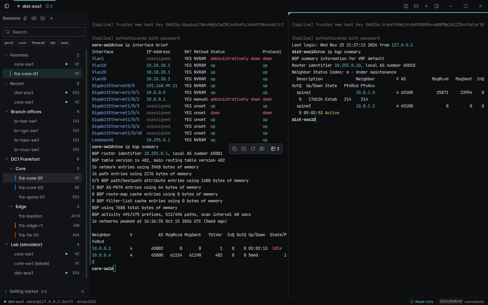
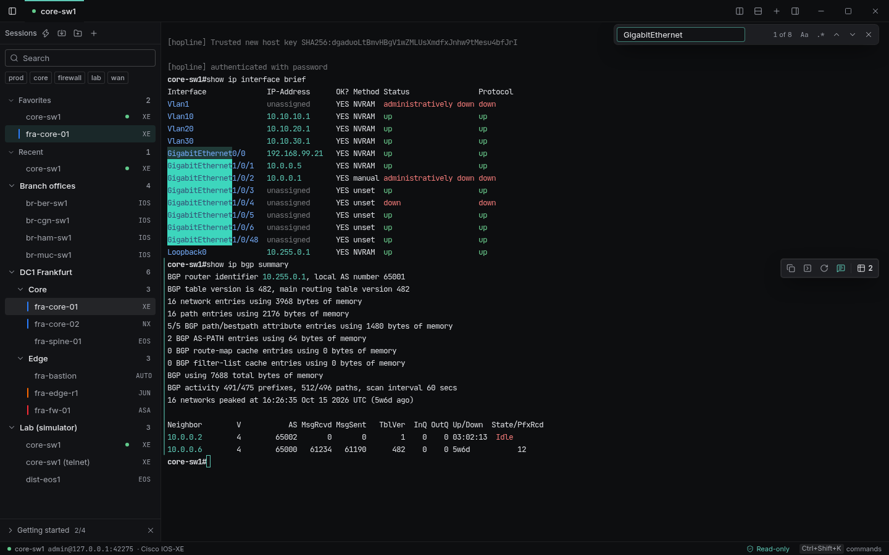
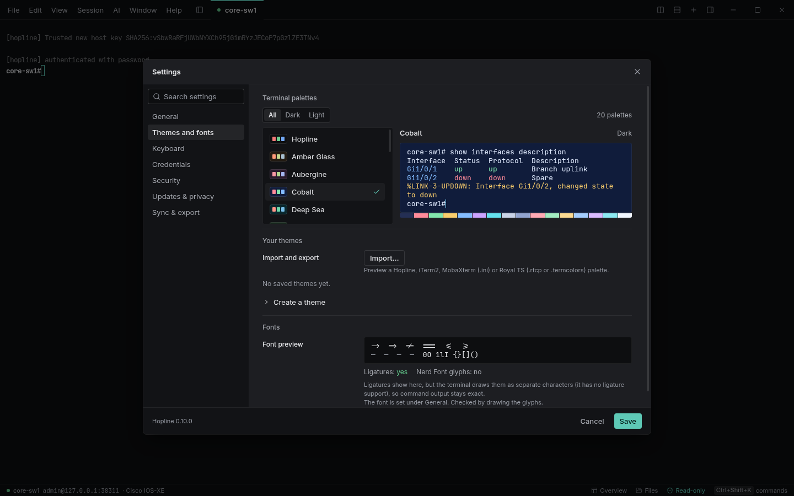
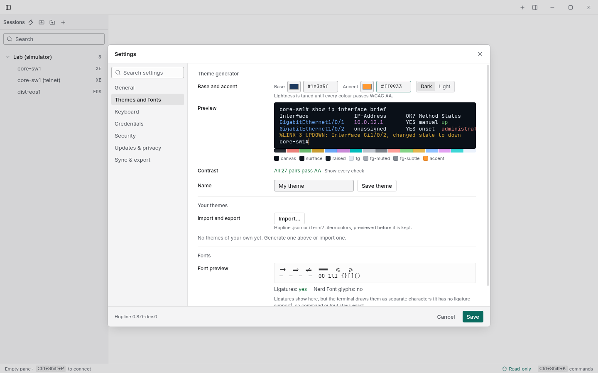
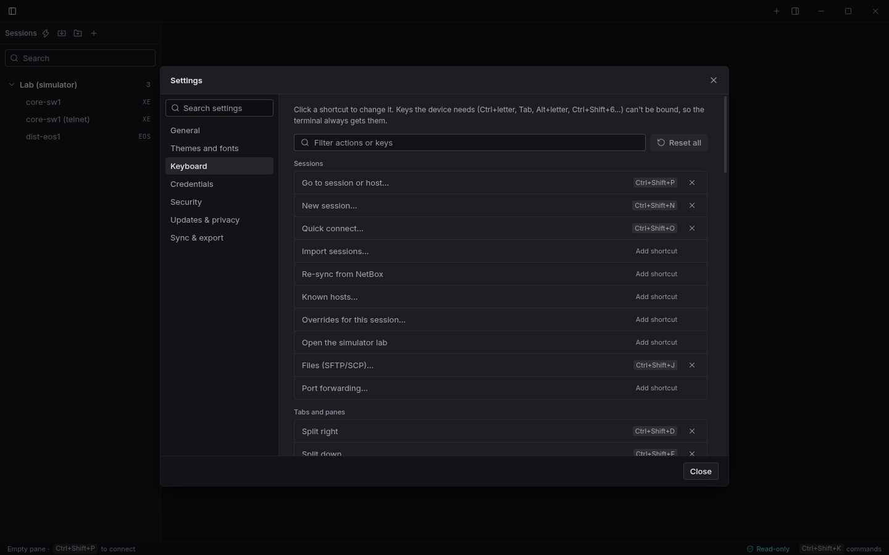
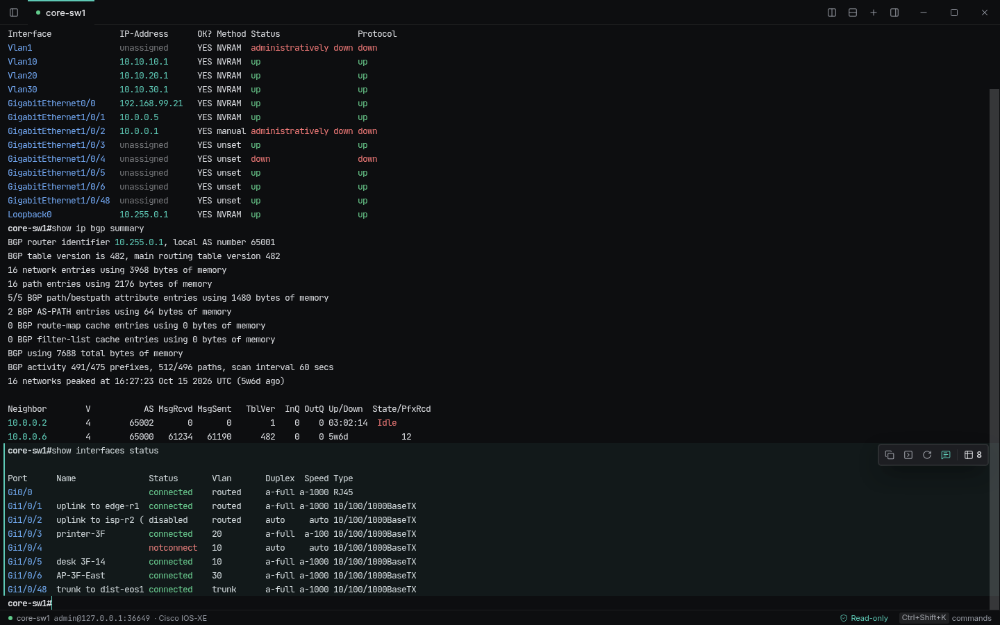

# Terminal

The terminal is xterm.js with the WebGL renderer, edge to edge under the title bar. Every key without an app modifier goes to the device: Ctrl-C, Ctrl-Z, Ctrl-U, Ctrl-R, Tab, `?`, Ctrl+Shift+6 (Cisco break), `Ctrl+]` (Telnet escape), Alt+letter word motion. App shortcuts use **Mod** (Ctrl+Shift on Windows and Linux, ⌘ on macOS). The full list is in [Keyboard shortcuts](keyboard-shortcuts.md).

## Tabs

Tabs appear under **Open connections** in the session sidebar. Click a row to switch terminals. The selected row has a bar on its left edge. Each row shows the connection state and any pending approval, configuration mode, unknown platform or sign-in failure. A split tab shows its focused session and pane count.

- `Ctrl+Tab` cycles tabs by most recent use (hold Ctrl). `Ctrl+PgDn` / `Ctrl+PgUp` go to the next and previous tab, `Mod+PgUp` / `Mod+PgDn` move the tab.
- `Alt+1` … `Alt+8` go to a tab, `Alt+9` to the last one (⌘1 … ⌘9 on macOS).
- `Mod+T` reopens the last closed tab.
- In **Open connections**, Up and Down move between rows, Enter activates the focused tab and Delete closes it. Drag a row to reorder it or drop it onto a terminal to create a split.
- Closing a tab or the window with live sessions asks first ("Close N sessions?").

The tab menu (right-click a tab) has Save as session, Files, Port forwarding, Run on…, Send to…, Back up config and Config history….

## Splits

Splits are unlimited. `Mod+D` splits right and `Mod+E` splits down; each new pane opens a launcher where you pick a session. `Ctrl+Alt+←/→/↑/↓` (or `Mod+Alt+arrow`, for desktops that take Ctrl+Alt+arrow) moves focus between panes. `Mod+Enter` zooms the focused pane, and `Mod+W` closes it. Drag a divider, or focus it and use the arrow keys (see [Accessibility](accessibility.md#keyboard-only)).

## Copy and paste

- Selecting text copies it.
- **Edit › Copy all terminal output** copies the active terminal’s retained scrollback and screen to the clipboard. Hopline Terminal joins soft-wrapped lines and masks recognised secrets. For a shorter incident note, select the relevant lines and choose **Add selection to scratchpad** from the terminal menu.
- `Mod+C` copies and `Mod+V` pastes (Ctrl+Shift+C / Ctrl+Shift+V on Windows and Linux). Plain Ctrl+C is the device's interrupt.
- Pasting more than one line asks first, with a preview: each line is sent as a command.
- The terminal's right-click menu has copy, paste, **Explain this output** for a selection, and the block actions for the command under the pointer.

Links (OSC 8 hyperlinks and plain URLs) open with Ctrl+click (⌘-click), after a confirmation that shows the address.

## Find

- `Mod+F` finds in the active terminal, with a match count, case sensitivity and regular expressions.
- `Mod+Alt+F` (**Find in all tabs…**) searches every open tab's scrollback and jumps to a match.

## Scrollback

Each tab keeps 20,000 lines by default (Settings › Terminal › Scrollback; about 1 MB per 10,000 lines). **Restore history** keeps each session's last 5,000 lines, encrypted on disk with the vault's key, and shows them again when you reconnect. It needs a persistent vault (OS keychain or master password). Hopline Terminal saves scrollback in the background and again before it quits.

## Logging

Turn on **Log session output to a file** on a session (or for a whole folder with [overrides](sessions.md#per-host-overrides)). Logs are written by the session host on the raw stream, with escape sequences removed and backspaces applied, so a log reads like a transcript. Settings › Connections › Logging:

- **Log folder**: by default `Documents/Hopline/logs`.
- **Log file name**: a template with SecureCRT-compatible tokens: `%S` session, `%H` host, `%P` port, `%U` user, `%Y %M %D` date, `%h %m %s` time, `%t` epoch milliseconds, `%%` a literal `%`. A `/` makes subfolders (`%Y-%M/%S_%D.log`); a template can never write outside the log folder, write a hidden file, or append to a file Hopline Terminal did not create. The default is `%S_%Y-%M-%D_%h-%m-%s.log`.
- **Timestamp each line** with `[hh:mm:ss.ms]`.
- **New log file daily**: a long-running session rolls over at midnight.

## Output highlighting

**Output highlighting** colours interfaces, IP and MAC addresses, up and down states, errors and syslog severities. It is display-only: logs and copied text stay plain. Under a heavy flood it backs off so output keeps up. Turn it off from Settings, the palette or per host.

## Themes and fonts

Open **Settings › Themes and fonts** to compare 20 built-in terminal palettes. Choose **Dark** or **Light** to filter the list. Click a palette or use the arrow keys to preview the same interface table, link status and ANSI colours. **Save** applies it to open terminals that use the global theme. **Cancel** discards the selection. You can also choose a palette under **Terminal › Theme**, or override it for a folder or session.

| Appearance | Built-in choices |
| --- | --- |
| Follows the app | Hopline Terminal |
| Dark | Amber Glass, Aubergine, Cobalt, Deep Sea, Forest, Graphite, Green Phosphor, Gruvbox Dark, Midnight, MobaXterm style, Nord, Royal TS style (PuTTY), Solarized Dark |
| Light | Glacier, Lavender, Paper, Porcelain, Sage, Sandstone |

- **Create a theme.** Under **Your themes**, expand **Create a theme**. Pick a base and an accent, dark or light, and Hopline Terminal builds a full terminal theme in OKLCH: 16 ANSI colours, cursor and selection. A live preview and contrast rows (text, dim text, every ANSI colour, selection) update as you drag. Save it, use it, export it as JSON, or delete it. Custom themes colour the terminal only; the app's own colours, including the safety colours on approval cards and risk labels, never change with a theme.
- **Import:** Hopline Terminal JSON, iTerm2 `.itermcolors`, Royal TS `.rtcp` or `.termcolors` and the `[Colors]` section of a MobaXterm `.ini`. Keys missing from a file are filled from the Hopline Terminal palette and listed, and the import opens as a draft you keep or discard.
- **Font preview:** a sample in your font with checks for ligatures and Nerd Font glyphs. The terminal draws ligatures as separate characters.

The terminal font is set under Terminal: any installed monospace font, or the bundled JetBrains Mono. Size (13 px), line height (1.2) and cursor (bar, block or underline; blinking or not) sit next to it. With reduced motion on, the cursor stops blinking.

The app theme (dark or light) is under Workspace › Appearance, or **Toggle dark / light theme** in the palette.

## The keymap

Every app shortcut can be rebound in **Settings › Keyboard** (or **Edit keyboard shortcuts…** in the palette). Click a shortcut and press the new keys. The editor refuses:

- keys the device needs: keys without a modifier, Shift+key, Tab, Ctrl+letter, `Ctrl+[ ] \ Space`, Ctrl+Shift+6, Ctrl+Shift+2, Ctrl+Shift+-, and Alt+letter;
- copy and paste in the terminal, and ⌘Q on macOS;
- a key another action already uses (it says which).

Bindings match the physical key, so they work on any keyboard layout, survive restarts, and can be reset per action or all at once. Keys that two actions answer to (after an update, say) are listed at the top with a one-click fix. A character typed with AltGr (`@ { [ |` on many layouts) is always text, never a shortcut. `Mod+/` shows the cheat sheet.

## Command blocks

Hopline Terminal splits the terminal into blocks: a prompt, its command, and the output until the next prompt, found with the session platform's prompt grammar. Nothing is written into the terminal buffer.

- Hover a block, or jump between prompts with `Mod+↑` / `Mod+↓`, to see its toolbar: **copy output** (`Mod+Alt+C`), **copy command**, **re-run**, **ask the AI about this block**, and **show as table** (`Mod+Alt+T`).
- **Re-run is safe.** The guard classifies the command first. A read-only command runs through the same checked path as the assistant's commands. Anything else (configuration, disruptive or unknown) is only typed at the prompt, without Enter, for you to review. Every re-run is in the audit log.
- **Show as table** parses the output with the bundled TextFSM templates when one matches. Drag the grip at the top of the viewer, or focus it and press ↑ or ↓. Shift makes a larger adjustment, Home restores the default, and End expands the table. Hopline Terminal remembers the height. See [Productivity › Parsed tables](productivity.md#parsed-tables).
